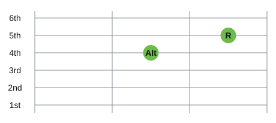

# Pixel Studio Guitar Lab｜Folk guitar handbook and lesson plans in twelve chapters

Teacher: Leo Lee, Pixel Studio｜Source material: Pixel Studio's 2013 beginner folk guitar handbook (books 1 and 2) and club class slides, reorganised and revised in 2026.

## Overview

The folk guitar course is split into Book 1 (beginner) and Book 2 (advanced), with six chapters each. Every chapter is a 120-minute class, 24 hours in all. Book 1 starts by getting to know the guitar and builds up to the mid-course performance; Book 2 moves through fingerpicking, barre chords, bass and scale degrees all the way to choosing a key and songwriting.

### Twelve-chapter schedule

| Chapter | Book | Topic | Core content | Materials |
| --- | --- | --- | --- | --- |
| 1 | Book 1 | Meet the guitar and tune it | Origins and history, types, parts, materials, body shapes, choosing a guitar, tuning, holding | Slides done |
| 2 | Book 1 | Beats, reading music and warming up | Pitch and the staff, note values, time signatures, tab, finger crawls, C major scale | Slides done |
| 3 | Book 1 | Your first chords | Chord diagrams, C, G, Am, F, chord changes, scale degrees I–V–vi–IV | Slides done |
| 4 | Book 1 | Strumming and syncopation | Downstrokes, upstrokes, ghost strums, strum marks in Chinese-language books, 8 beats, syncopated folk rock | Slides done |
| 5 | Book 1 | Triple time and varying the accompaniment | Duple-time accompaniment, 3/4, 6/8, 12/8, boom-chick-chick | Slides done |
| 6 | Book 1 | Song form and mid-course performance | Verse, chorus, bridge, capo, designing accompaniment by section, mid-course showcase | Slides done |
| 7 | Book 2 | Intro to theory and fingerpicking | Intervals and consonance, triads, fingerpicking posture, arpeggios | Slides done |
| 8 | Book 2 | G major and barre chords | G major scale, diatonic chords, barre F, Bm | Slides done |
| 9 | Book 2 | Bass movement | Roots and alternate roots, slash chords, descending bass lines | Slides done |
| 10 | Book 2 | Scale degrees and chord arranging | Scale-degree functions, common progressions, substitute chords, intro to arranging | Slides done |
| 11 | Book 2 | Melody and tone techniques | Hammer-ons, pull-offs, slides, palm muting, chucks, slaps, harmonics, bends, releases, vibrato, trills | Slides done |
| 12 | Book 2 | Changing key, choosing a key and songwriting | Transposing and the capo, choosing a key, other keys, songwriting | Slides done |

### The shared rhythm of each 120-minute chapter

| Section | Time | Content |
| --- | --- | --- |
| Open | 20 minutes | Warm-up, tuning, reviewing last week's questions, introducing the topic |
| Build | 35 minutes | Explaining and demonstrating new ideas |
| Break | 10 minutes | Relax fingers, drink some water |
| Turn | 35 minutes | Group practice, games, hands-on work |
| Close | 20 minutes | Whole-class play-along, check-in, exit ticket, practice after class |

### Equipment

- Guitar (one each, mainly folk guitar; classical guitar is fine too), pick (medium 0.6–0.73 mm), capo
- Tuner or phone tuning app; classroom projector and sound system
- Students' phones: scan the slide QR codes to use the tuner, practice tools and exit tickets alongside the class

### Assessment

- Pre-class surveys and exit tickets: keep track of each student's progress and questions
- Practice checklists and seven-day logs: build the habit of practising on your own
- Mid-course performance (Chapter 6) and final project (Chapter 12): complete a full play-and-sing or original song

### Principles for class activities

- Keep new ideas within 35 minutes and leave the rest of the time for playing
- At least one activity every three slides: votes, multiple choice, ordering, flip cards, team scoring or practice tools
- Demonstrate first, then follow along, then practise individually; slow to fast, and steadiness matters more than speed
- The fixed BPMs in the original materials are only examples; set the starting tempo to fit the students

<!-- learning-notes-start -->
### Skill route and practice logs

[Open the course skill route](index.html#lessons): each lesson card shows suggested prerequisites and this device's homework ticks, and you can expand the full course route. The website's practice chart uses the original seven-day table, leaves missing values blank, and shows seconds, counts and minutes separately. The PDF keeps this table as a paper record with no sample scores filled in.

<!-- learning-notes-end -->

## Chapter 1｜Meet the guitar and tune it

Goals: explain where the guitar came from and its types, name its 16 parts, understand how wood, body shape and size affect tone, and learn to choose a guitar; before the end of class, tune all six strings and strum your first sound with good posture.

### Pre-class survey (joining the class)

- Instruments learned, current guitar level
- Type of guitar (folk, classical, electric, or not bought yet)
- Three songs you most want to play
- Self-ratings: sense of rhythm, reading music, left-hand fretting, right-hand strumming, playing and singing
- Biggest worry about learning guitar, time available to practise each week

### Lesson outline (120 minutes)

| Section | Time | Content | Slide |
| --- | --- | --- | --- |
| Open | 00:00–00:20 | Reflection before starting, vote on "what you most want to do with the guitar", the twelve-chapter map, guessing the guitar's ancestor | 1–5 |
| Build | 00:20–00:55 | Origins and history, ordering game, the guitar family, comparing three guitars, interactive parts diagram, how sound travels | 6–13 |
| Break | 00:55–01:05 | 10-minute break | 14 |
| Turn | 01:05–01:40 | Laminated and solid wood, common woods, six body shapes, sizes, bracing and truss rod, guitar-buying myth flip cards, group guitar clinic | 15–21 |
| Close | 01:40–02:00 | Standard tuning, hands-on tuner, sitting and holding the pick, first open-string strum, three key lines, exit ticket, practice after class | 22–30 |

### Extended notes: where the guitar came from

The guitar is a plucked string instrument whose ancestry goes back to the oud of the Middle East. In Europe the oud became the lute, and in Spain the vihuela developed. Early guitars had strings in pairs called "courses"; Renaissance guitars had four courses, the five-course guitar appeared in the 16th century and gradually replaced it, and in the late 18th century the paired strings became six single strings, forming today's six-string guitar.

### Extended notes: how the guitar changed

| Period | Years | Focus |
| --- | --- | --- |
| Renaissance | 1450–1600 | The four-course guitar used gut strings; the five-course guitar appeared |
| Baroque | 1600–1750 | The five-course guitar was popular at court and among ordinary people; the lute slowly left the stage |
| The first golden age | About 1780–1850 | The six-string guitar takes shape; F. Sor, D. Aguado, M. Carcassi and others left a large body of pieces and method books |
| The Romantic low point | About 1850–1900 | The piano took centre stage and fewer composers wrote for guitar; F. Tárrega brought the guitar back into favour through his playing and arrangements |
| The modern classical guitar | Late 19th century | Spanish luthier A. de Torres enlarged the body, set the string length at about 65 cm and used fan bracing, creating the model for the modern classical guitar |
| Into the concert hall | 20th century | A. Segovia championed it all his life; J. Rodrigo's Concierto de Aranjuez put the guitar on the concerto stage |
| Folk guitar | 1920s–1930s | Blues, country and folk rose in America; Martin and other makers switched to steel strings and strengthened the body for a brighter, louder sound |
| Electric guitar | 1930s–1950s | Pickups turn string vibration into an electrical signal; in 1950 Leo Fender released a mass-produced solid-body electric guitar |

For three hundred years, nearly every change to the guitar has been about volume, so it can be heard clearly in a band.

### Extended notes: kinds of guitar

| Type | Strings | Features |
| --- | --- | --- |
| Classical | Strings 1–3 nylon, strings 4–6 metal wound on a nylon core | A wide neck, played solo with the fingers, with a focus on technique and staff notation; usually played seated with the guitar on the left leg |
| Flamenco | Same as classical guitar | From Andalusia in Spain, with a lighter body and bright tone; often played with dance, castanets and singing |
| Folk | All steel; strings 1–2 plain, strings 3–6 wound | A bright tone and plenty of volume; accompanies pop songs with chords and a capo, and can be played fingerstyle too |
| Electric | Steel strings | Makes its sound through pickups and an amplifier; split into lead and rhythm, with the electric bass handling the low end |
| Lap steel | Steel strings | Laid flat on the lap, the left hand slides a steel bar and the right hand wears finger picks, for a long, singing sound |
| Relatives | Varies | The four-string ukulele, the round-headed banjo, and the mandolin, whose back looks like half a pear |

### Extended notes: parts of the guitar

| No. | Body part | Function |
| --- | --- | --- |
| 1 | Headstock | Holds the tuning pegs; the brand logo usually sits here |
| 2 | Tuning machines | Hold the strings and tune them; sealed (oil-filled) and open types are common |
| 3 | Nut | Sets the string spacing; the harder the material, the less vibration is lost; bone, plastic and Tusq are common |
| 4 | Fretboard | Where the left hand presses the strings, usually rosewood, ebony or maple |
| 5 | Frets | Keep the pitch steady once a string is pressed; usually brass or stainless steel |
| 6 | Position markers | Markers at frets 3, 5, 7, 9 and 12; fret 12 is an octave above the open string |
| 7 | Neck | Joins the headstock to the body, with a truss rod inside |
| 8 | Top | The main source of the tone |
| 9 | Sound hole | Once the air inside the body resonates, the sound comes out here |
| 10 | Rosette | Decorates and reinforces the edge of the sound hole |
| 11 | Pickguard | Stops the top getting scratched when you strum |
| 12 | Bridge | Takes the strings' pull and passes their vibration to the top |
| 13 | Saddle | Where the vibrating string ends; its height sets the action |
| 14 | Bridge pins | Hold the string ends in the bridge |
| 15 | Binding | Protects the body's joins and shows the workmanship |
| 16 | Sides & back | Form the sound box with the top, shaping the depth and sustain of the bass |

The sound's path: the right hand plucks → the string vibrates → saddle and bridge → the top vibrates → the air inside the body resonates → out through the sound hole.

### Extended notes: what the body is made of

- **Laminated**: pressed from thin wood sheets with glue layers. Affordable and not easily affected by temperature and humidity; the glue absorbs vibration, so resonance is weaker.
- **Solid**: made from a single piece of wood. A more open sound that "opens up" further after years of playing; more expensive, and you need to watch the humidity. Only a solid top is called a "solid top"; a solid top, sides and back is called "all solid".
- How to tell: look at the edge of the top through the sound hole. If the top and bottom layers are different colours with a layer in between, it's most likely laminated; if the grain runs through in one piece, it's solid.

| Wood | Where it usually falls | Sound |
| --- | --- | --- |
| Spruce | Top | Pale yellow and hard; bright and clear, the most common on folk guitars |
| Cedar | Top | Dark orange-brown and soft; warm, round and quick to vibrate, common on classical guitars |
| Mahogany | Back and sides | Thick mids, warm and focused |
| Rosewood | Back and sides | Deep lows, bright highs, rich overtones |
| Maple | Back and sides | Clean and direct; doesn't get buried by other instruments in a band |
| Koa | Top / back and sides | Sweet upper mids that sound better the more it's played |
| Walnut | Back and sides | Between mahogany and rosewood |
| Basswood | Electric guitar bodies | Light, soft and affordable, with gentle mids |

The same wood also varies with origin, thickness and workmanship; the table is only for comparison.

### Extended notes: size and body shape

Choose a size to fit your body: about 1/4 for ages 2–5, 1/2 for 5–8, 3/4 for 8–12, and full size from 12 up to adults. If your right arm rests naturally on the top edge of the body and your straight left arm reaches fret 1, the size is right.

| Body | Character |
| --- | --- |
| Jumbo | Widest at the bottom and narrowest at the waist; full bass and the most volume |
| Dreadnought (D) | The most common; square shoulders, loud, with an even frequency balance |
| Grand Auditorium (GA) | Clear mids, good for both strumming and fingerstyle |
| Auditorium (OM/000) | A slim waist with distinct highs and lows; good for fingerstyle and recording |
| Grand Concert (GC) | A compact body with responsive highs; good for fingerstyle and lead |
| Concert | The smallest and lightest, easy to carry |

Each brand has its own body specs; holding and playing one yourself is the real test.

### Extended notes: inside the guitar

- **Bracing**: wooden strips glued under the top that support the strings' pull and shape how the top vibrates. Folk guitars use X bracing to handle steel-string tension; classical guitars use the fan bracing Torres established.
- **Truss rod**: hidden inside the neck, it resists the roughly 70 kg combined pull of the six strings and keeps a slight bow in the neck; it should be adjusted by a professional.

### Extended notes: choosing and caring for a guitar

- Never put steel strings on a classical guitar: the pull is too strong and will warp the neck and bridge
- Choose size and body shape to fit your body; a good fit matters more than size
- Sore fingertips for the first two weeks are normal; if the action at string 6, fret 12 is over about 3 mm, have a technician adjust it
- Keep it out of sun, heat and humidity; store it in its bag, and watch the humidity in Taiwan's summers

### Extended notes: tuning the guitar

Standard tuning from string 6 to string 1 is E, A, D, G, B, E. Neighbouring strings are a perfect fourth apart, except strings 3 to 2, which are a major third; strings 1 and 6 are two octaves apart. Say it: Eddie Ate Dynamite, Good Bye Eddie.

| Strings | 6 | 5 | 4 | 3 | 2 | 1 |
| --- | --- | --- | --- | --- | --- | --- |
| Note names | E2 | A2 | D3 | G3 | B3 | E4 |
| Frequency (Hz) | 82.4 | 110.0 | 146.8 | 196.0 | 246.9 | 329.6 |

How to tune: listen to the reference note → pluck the open string → tightening raises the pitch, loosening lowers it → if it's sharp, loosen below the target first and then tighten slowly back up; it holds its tuning better.

### Extended notes: getting ready to play

- **Sitting**: sit on the front third of the chair with your back straight; rest the body on your right thigh close to you, with the neck tilted slightly up.
- **Holding the pick**: rest it on the side of the first joint of your index finger with the thumb on top, about 2–3 mm of tip showing; let the middle, ring and little fingers relax open, and keep your wrist steady, not twisting, as you strum.
- **Finger numbers**: left hand index 1, middle 2, ring 3, little 4; for right-hand fingerpicking, thumb T covers strings 4–6, index 1 string 3, middle 2 string 2, ring 3 string 1.
- **Left-hand fretting**: press with the area between tip and pad, fingers as upright to the fretboard as possible and close to the fret; keep the thumb on the middle line at the back of the neck, not resting on the fretboard.

<!-- scores:1 -->

### Examples: staff + tab

The strums and fingerpicking used in this chapter. The staff above shows pitch and note length; the tab below shows strings and frets; arrows under the strums show the right hand's direction.

<b>Quarter-note downstrokes</b> (open strings)

<b>Eighth notes, 8 beats</b> (open strings)

<!-- /scores:1 -->

### Class activities (website slides)

| Slide | Activity | Purpose |
| --- | --- | --- |
| 2 | Phone sync QR code | Students follow along on their phones |
| 3 | Show-of-hands vote on "what you most want to do with the guitar" | Understand motivation, as something to look back on later |
| 5 | Predict, then reveal: the guitar's ancestor | Spark curiosity |
| 7 | Reveal "why the piano won" | Links to the "volume" thread |
| 9 | Ordering game: how the guitar changed | Retrieval practice |
| 12 | Tap to explore: interactive parts diagram | Learn the 16 parts |
| 13 | Multiple choice: the path of vibration | Check understanding |
| 17 | Tap to compare: six body shapes | Compare the differences |
| 20 | Myth-busting flip cards | Build good ideas about choosing and caring for a guitar |
| 21 | Group task: guitar clinic (timed, scored) | Apply what you've learned |
| 23 | Tuner (microphone) | Everyone tunes their own guitar |
| 25 | Strum-along metronome: open-string downstrokes, 8 beats | Your first sound |
| 27 | Exit ticket 3-2-1 | Collect questions |
| 28–29 | Seven-day log, practice checklist | Keep the practice going |

### Practice after class

- [ ] Without the handbook, name at least 10 of the guitar's 16 parts
- [ ] Photograph your guitar and label its body shape, top wood, and whether it's laminated or solid
- [ ] Tune all six strings yourself before practising each day
- [ ] Open-string downstrokes at 60 BPM for one minute without stopping, then try 8 beats
- [ ] Complete the seven-day practice log and fill in the Chapter 2 pre-class survey

<!-- teaching-visuals-start -->

<h3>Wood close-ups｜Illustrated</h3>

<figure><figcaption>Spruce: fine, straight grain</figcaption></figure>
<figure><figcaption>Cedar: warm brown grain</figcaption></figure>
<figure><figcaption>Mahogany: open pores</figcaption></figure>
<figure><figcaption>Rosewood: dark stripes</figcaption></figure>
<figure><figcaption>Maple: pale grain</figcaption></figure>
<figure><figcaption>Koa: golden-brown figure</figcaption></figure>
<figure><figcaption>Walnut: brown figure</figcaption></figure>
<figure><figcaption>Basswood: fine, pale grain</figcaption></figure>

Colour and grain vary with each piece of wood; the images help you recognise the look, but you still need to listen for the tone.

<h3>Six body shapes｜Illustrated</h3>

<figure><figcaption>Jumbo｜Wide lower bout and a pronounced waist</figcaption></figure>
<figure><figcaption>Dreadnought｜Square shoulders, a gentler waist</figcaption></figure>
<figure><figcaption>Grand Auditorium｜Mid-to-large, with a clear waist</figcaption></figure>
<figure><figcaption>Auditorium/OM｜Smaller, balanced proportions</figcaption></figure>
<figure><figcaption>Grand Concert｜Compact body</figcaption></figure>
<figure><figcaption>Concert｜Small body</figcaption></figure>

The shapes show the type; names and sizes may differ between brands.

<h3>Sizes and how they fit｜Illustrated</h3>

<figure><figcaption>Relative proportions of 1/4, 1/2, 3/4 and full size</figcaption></figure>
<figure><figcaption>When trying one, check your arm rests naturally on the body</figcaption></figure>

The size chart shows relative proportions; choose by actually holding the guitar and checking your arm's room to move.

<h3>Bracing under the top｜Illustrated</h3>

<figure><figcaption>X bracing on a steel-string guitar</figcaption></figure>
<figure><figcaption>Fan bracing on a classical guitar</figcaption></figure>

<h3>The truss rod inside the neck｜Illustrated</h3>

<figure><figcaption>Fretboard, neck and truss rod in cross-section</figcaption></figure>
<figure><figcaption>Close-up of the adjusting nut at the sound hole</figcaption></figure>

The cross-section is a sketch; where you adjust it depends on the model.

<!-- teaching-visuals-end -->

## Chapter 2｜Beats, reading music and warming up

Goals: clearly identify Do to Do on the staff and understand how note names, solfège and numbered notation match up; understand note values from whole notes to sixteenths and tell 2/4, 3/4, 4/4 and 6/8 apart; read tab and complete finger-crawl warm-ups with a metronome; before the end of class, play Ode to Joy on the C major scale.

### Pre-class survey

- How many of last chapter's five practice tasks you finished
- How many guitar parts you can name without the handbook
- Roughly how long it takes you to tune all six strings yourself
- Kinds of music you can read
- Your steadiest tempo for open-string downstrokes with a metronome
- Where your fingers or wrists ache when you practise

### Lesson outline (120 minutes)

| Section | Time | Content | Slide |
| --- | --- | --- | --- |
| Open | 00:00–00:20 | Tune first, then share this week's practice; beats: clap along with the metronome; what does the "4/4" on guitar music mean? | 3–5 |
| Build | 00:20–00:55 | The staff: the higher the position, the higher the note; one note, three names, eight notes, two semitones; cut a bar in half, then in half again; count rests just as carefully; listen once, say it once: sing the rhythm on "Ta"; time signatures set strong and weak beats; sing Happy Birthday and clap along; six lines are six strings, numbers are frets | 6–13 |
| Break | 00:55–01:05 | 10-minute break | 14 |
| Turn | 01:05–01:40 | Four keys to clean fretting; finger crawl 1-2-3-4: one finger per fret; finger crawl 1-3-2-4: independent fingers; finger-crawl relay; fifth-fret tuning: use the next string as reference; myth or fact? | 15–20 |
| Close | 01:40–02:00 | C major in first position: find Do Re Mi; the C major scale up and down; Ode to Joy on strings 1 and 2 alone; record your Ode to Joy; write your 3-2-1 before you leave | 21–26 |
| Wrap up | After class | Three-line summary, daily practice log, practice after class and next chapter preview | 25、27、28、29 |

### Extended notes: pitch and the staff

- The higher the position on the staff, the higher the note; the treble (G) clef centres on the second line, and that line is G. Notes beyond the five lines use ledger lines, and middle C sits on the first ledger line below.
- Guitar music is written an octave up: middle C on the page actually sounds an octave lower.

| Degree | Ⅰ Tonic | Ⅱ Supertonic | Ⅲ Mediant | Ⅳ Subdominant | Ⅴ Dominant | Ⅵ Submediant | Ⅶ Leading note | Ⅷ Tonic |
| --- | --- | --- | --- | --- | --- | --- | --- | --- |
| Note names | C | D | E | F | G | A | B | C |
| Solfège | Do | Re | Mi | Fa | Sol | La | Si | Do |
| Numbered notation | 1 | 2 | 3 | 4 | 5 | 6 | 7 | 1̇ |

A major scale's steps are "whole, whole, half, whole, whole, whole, half"; one fret on the guitar is a semitone.

### Extended notes: note values, rests and time signatures

| Note | Beats in 4/4 | Rest |
| --- | --- | --- |
| Whole note | 4 beats | Whole rest |
| Half note | 2 beats | Half rest |
| Quarter notes | 1 beat | Quarter rest |
| Eighth notes | ½ beat | Eighth rest |
| Sixteenth note | ¼ beat | Sixteenth rest |

- Dot: adds half the note's length again; a dotted quarter note is 1.5 beats, for example.
- The top of a time signature is beats per bar, and the bottom is which note counts as one beat. 2/4 is strong, weak; 3/4 is strong, weak, weak; 4/4 is strong, weak, medium, weak; 6/8 is two big beats, each split in three.

### Extended notes: tab and warm-ups

- The top line of tab is the thinnest string, string 1; numbers are frets, 0 is an open string, and stacked numbers are played together.
- Left-hand fretting: close to the fret, fingertips upright, thumb on the middle line at the back of the neck, and just enough pressure for a clear sound.
- Finger crawls 1-2-3-4 and 1-3-2-4: one finger per fret, the right-hand pick alternating down and up; add 4 BPM only after two steady rounds in a row. The original handbook's 100 BPM is the final goal; start slow.
- Fifth-fret tuning: fret 5 on strings 6, 5, 4 and 2 matches the next string open; only string 3 uses fret 4 (a major third).

### Examples: staff + tab

The strums and fingerpicking used in this chapter. The staff above shows pitch and note length; the tab below shows strings and frets; arrows under the strums show the right hand's direction.

### Class activities (website slides)

| Slide | Activity | Content |
| --- | --- | --- |
| 2 | Phone sync | Today's route: read music, wake up your fingers |
| 3 | Show-of-hands vote | Tune first, then share this week's practice |
| 5 | Predict, then reveal | What does the "4/4" you often see on guitar music mean? |
| 10 | Rhythm challenge | Listen once, say it once: sing the rhythm on "Ta" |
| 12 | Multiple choice | Sing Happy Birthday together and clap as you sing |
| 16 | Tab trainer | Finger crawl 1-2-3-4: one finger per fret |
| 17 | Tab trainer | Finger crawl 1-3-2-4: make each finger independent |
| 18 | Team contest · timed | Finger-crawl relay |
| 19 | Listen and compare | Fifth-fret tuning: use the next string as your reference |
| 20 | Myth-busting · flip cards | Myth or fact? |
| 21 | Tap to hear | C major in first position: find where Do Re Mi are |
| 22 | Tab trainer | The C major scale: up first, then down |
| 23 | Tab trainer | Ode to Joy: playable on strings 1 and 2 alone |
| 24 | Record and compare | Record your Ode to Joy |
| 26 | Exit ticket 3-2-1 | Before you leave, write down 3-2-1 |
| 27 | Self-directed log | A 15-minute daily warm-up routine |
| 28 | Self-directed tracking | Practice after class: tap once to tick each item you finish |
| 29 | Pre-class survey | Chapter 3 Your first chords |

### Practice after class

- [ ] Without the handbook, write how many beats each note from whole to sixteenth lasts
- [ ] Finger crawls 1-2-3-4 and 1-3-2-4, two unbroken rounds each at 70 BPM
- [ ] Tune once with fifth-fret tuning, then check with a tuner
- [ ] Play the C major scale up and down, singing the solfège as you go
- [ ] Record Ode to Joy once and fill in the Chapter 3 pre-class survey

<!-- teaching-visuals-start -->

<h3>Four-finger crawl｜Illustrated</h3>

<figure><figcaption>1: four fingers naturally curved, one per fret</figcaption></figure>
<figure><figcaption>2: place fingers in turn, wrist relaxed</figcaption></figure>

Index, middle, ring and little fingers are 1, 2, 3 and 4; see the example for the actual order.

<!-- teaching-visuals-end -->

## Chapter 3｜Your first chords

Goals: read chord diagrams and understand which notes make up a chord; make every string that should sound ring on C, Am, G and F; play C → G → Am → F at 60 BPM, 4 beats per chord, without losing the beat; before the end of class, accompany a chorus together with the four chords.

### Pre-class survey

- Your fastest finger-crawl tempo
- The hardest of your four fingers to control
- What's easiest to mix up when reading tab
- Chords you can already play
- How your fingertips are now

### Lesson outline (120 minutes)

| Section | Time | Content | Slide |
| --- | --- | --- | --- |
| Open | 00:00–00:20 | Tune and crawl to wake up your fingers; three or more notes sounding together make a chord; how many songs can you play with just C, G, Am and F? | 3–5 |
| Build | 00:20–00:55 | Chord diagrams: the fretboard stood upright; C: ring finger first, low to high; Am: one finger different from C; G: fingers spread, all six strings ring; small F: index flat across two strings; four chords, four colours; name the chord from the diagram; close your eyes and tell which chord you hear | 6–13 |
| Break | 00:55–01:05 | 10-minute break | 14 |
| Turn | 01:05–01:40 | Get ready early for faster changes; how many times can you switch between two chords in a minute?; 4 beats per chord, then 2 once steady; the family in C: calling chords by number; reading a chord chart: one box per bar, four downstrokes; songs from the original handbook playable with four chords; chord chain | 15–21 |
| Close | 01:40–02:00 | Chord sounding dead? Flip the cards to find out why; whole-class play-along: the teacher sings, everyone accompanies; record 30 seconds of C → G → Am → F; write your 3-2-1 before you leave | 22–26 |
| Wrap up | After class | Three-line summary, daily practice log, practice after class and next chapter preview | 25、27、28、29 |

### Extended notes: chords and chord diagrams

- Three or more notes sounding together make a chord. The five strings of a C chord hold only three notes: C, E and G (Do, Mi, Sol).
- Chord diagrams: vertical lines are strings (string 6 on the left, string 1 on the right), horizontal lines are frets, and the number in each dot is the finger; ○ means play the open string, × means skip it.

| Chord | Fingering (strings 6→1) | Focus |
| --- | --- | --- |
| C | x 3 2 0 1 0 | Start with the ring finger and place fingers from low to high |
| Am | x 0 2 2 1 0 | Only the ring finger differs from C |
| G | 3 2 0 0 0 3 | Drop the wrist so all six strings ring |
| F (small F) | x x 3 2 1 1 | Index flat across strings 1 and 2; play strings 4 to 1 only |

### Extended notes: changing chords and scale degrees

- How to change chords: start moving on the last beat and drop your fingers as a unit; if you're not in time, strum open strings and keep the beat going.
- C ↔︎ Am moves only the ring finger; Am → F shifts the whole hand one string; F → G places the farthest finger, the middle, first; G → C moves the ring finger from string 1 to string 5.
- Diatonic chords in C: C (I), Dm (ii), Em (iii), F (IV), G (V), Am (vi), Bdim (vii°). C → G → Am → F is I–V–vi–IV.

### Examples: staff + tab

The strums and fingerpicking used in this chapter. The staff above shows pitch and note length; the tab below shows strings and frets; arrows under the strums show the right hand's direction.

<b>Quarter-note downstrokes</b> (C chord)

<b>Eighth notes, 8 beats</b> (C chord)

### Class activities (website slides)

| Slide | Activity | Content |
| --- | --- | --- |
| 2 | Phone sync | Today's route: four chords, your first accompaniment |
| 3 | Show-of-hands vote | Tune and crawl to wake up your fingers |
| 4 | Tab trainer | Three or more notes sounding together make a chord |
| 5 | Predict, then reveal | If you only know C, G, Am and F, how many songs can you play? |
| 7 | String-by-string check | C: start with the ring finger and place fingers from low to high |
| 11 | Listen closely | Four chords, four colours |
| 12 | Multiple choice | Name the chord from the diagram |
| 13 | Listening game | Close your eyes and tell which chord you're hearing |
| 16 | Timed stages | How many times can you switch between two chords in a minute? |
| 17 | Chord change trainer | 4 beats per chord, then switch to 2 once you're steady |
| 19 | Strum-along metronome | Reading a chord chart: one box per bar, four downstrokes |
| 20 | Song listening · YouTube | Songs from the original handbook: playable with four chords |
| 21 | Team contest · scoring | Chord chain |
| 22 | Myth-busting · flip cards | Chord sounding dead? Flip the cards to find out why |
| 23 | Whole-class play-along | Whole-class play-along: the teacher sings, everyone accompanies |
| 24 | Record and compare | Record 30 seconds of C → G → Am → F |
| 26 | Exit ticket 3-2-1 | Before you leave, write down 3-2-1 |
| 27 | Self-directed log | A 15-minute daily chord routine |
| 28 | Self-directed tracking | Practice after class: tap once to tick each item you finish |
| 29 | Pre-class survey | Chapter 4 Strumming and syncopation |

### Practice after class

- [ ] Every string rings when you pluck C, Am, G and F string by string
- [ ] C ↔︎ Am more than 30 times in a minute
- [ ] C → G → Am → F at 60 BPM, 4 beats per chord, without losing the beat
- [ ] The same progression at 2 beats per chord, two rounds
- [ ] Record 30 seconds of the four chords and fill in the Chapter 4 pre-class survey

<!-- teaching-visuals-start -->

<h3>Open chord hand shapes｜Illustrated</h3>

<figure><figcaption>C: index string 2 fret 1, middle string 4 fret 2, ring string 5 fret 3</figcaption></figure>
<figure><figcaption>Am: index string 2 fret 1, middle string 4 fret 2, ring string 3 fret 2</figcaption></figure>
<figure><figcaption>G: middle string 6 fret 3, index string 5 fret 2, little or ring finger string 1 fret 3</figcaption></figure>
<figure><figcaption>Small F: index pressing strings 1 and 2 at fret 1</figcaption></figure>
<figure><figcaption>D: index string 3 fret 2, middle string 1 fret 2, ring string 2 fret 3</figcaption></figure>
<figure><figcaption>Front: see how the fingertips press and the fingers' natural curve</figcaption></figure>
<figure><figcaption>Angled side: see where the fingertips meet the strings</figcaption></figure>
<figure><figcaption>Back: the thumb supports the neck naturally</figcaption></figure>

Check strings and frets against the chord diagrams in the slides; the photos show finger curve and wrist position.

<!-- teaching-visuals-end -->

<!-- learning-notes-start -->

<h3>Interactive practice and diagrams</h3><h4>Chord change paths</h4>
C→Am: index and middle stay put while the ring finger moves from string 5 fret 3 to string 3 fret 2. Lift off the string before you move.
<figure class="learning-print"><figcaption>Chord change paths｜Key states</figcaption></figure>
<a href="ch03/#15">Open the interactive practice</a>

<!-- learning-notes-end -->

## Chapter 4｜Strumming and syncopation

Goals: keep the right hand swinging steadily, down on the beat and up on the half beat; recognise downstrokes, upstrokes and ghost strums, plus the X, ↓ and ↑ used in Chinese-language books; play 8 beats and syncopated folk rock over C → G → Am → F without losing the beat; before the end of class, play a section together with 8 beats in the verse and syncopation in the chorus.

### Pre-class survey

- Your steadiest tempo for C → G → Am → F, 4 beats per chord
- The hardest of the four chords to make ring
- Your least smooth chord change
- What happens most often when you strum
- How often you nod or tap your foot to the beat when listening to songs

### Lesson outline (120 minutes)

| Section | Time | Content | Slide |
| --- | --- | --- | --- |
| Open | 00:00–00:20 | C → G → Am → F: how smooth are your chord changes?; same chords, different strum: what changes? | 3–4 |
| Build | 00:20–00:55 | Strum from the wrist, keep the arm steady; three symbols for writing strums; three marks to know before reading Chinese guitar music; quarter notes: one strum per beat, hand back up on the half beat; 8 beats: the upward stroke sounds too; hide a beat: a tie moves the accent forward; say it: down, down-up, up-down-up; sing "eighth notes" and "syncopation" on Ta; listen to one bar and tell which strum it is | 5–13 |
| Break | 00:55–01:05 | 10-minute break | 14 |
| Turn | 01:05–01:40 | 8 beats and syncopation over the four main chords; three tricks for great-sounding strumming; 16 beats: each beat in four, the hand swings twice as fast; start 16 beats at 50 BPM; songs from the original handbook: tell which strum they use; design the strumming for a song | 15–20 |
| Close | 01:40–02:00 | Myth or fact?; 8 beats in the verse, syncopation in the chorus: whole-class play-along; record both strums and listen for the accents; write your 3-2-1 before you leave | 21–25 |
| Wrap up | After class | Three-line summary, daily practice log, practice after class and next chapter preview | 24、26、27、28 |

### Extended notes: strum symbols

| Symbol | Name | Motion |
| --- | --- | --- |
| ↓ | Downstroke | From thick strings to thin, on the beat |
| ↑ | Upstroke | From thin strings to thick, only the top 3 or 4 treble strings, on the half beat |
| Hollow arrow | Ghost strum | The hand still swings but stays off the strings |

- Marks common in Chinese-language books: X "boom" plucks the bass string downward, ↓ "chick" strums the treble strings down, ↑ "a" strums the treble strings up; in some books the arrows point the opposite way to Western books, so find the key before reading.
- Strum from the wrist with the elbow as the pivot; tilt the pick slightly so it brushes the strings. The hand never stops swinging; whether it touches the strings is what changes the rhythm.

### Extended notes: basic patterns

| Pattern | 1 & 2 & 3 & 4 & | Notes |
| --- | --- | --- |
| Quarter notes | ↓ · ↓ · ↓ · ↓ · | One strum per beat |
| 8 Beats | ↓ ↑ ↓ ↑ ↓ ↑ ↓ ↑ | Eight even strokes, downstrokes a bit heavier, upstrokes a bit lighter |
| Syncopated folk rock | ↓ · ↓ ↑ · ↑ ↓ ↑ | The second half of beat 2 is tied into beat 3; say it "down, down-up, up-down-up" |
| 16 Beats | 1 e & a on each beat | Keep downstrokes on the beat and add upstrokes on the offbeats; at 60 BPM the hand moves as fast as 8 beats at 120 BPM |

### Examples: staff + tab

The strums and fingerpicking used in this chapter. The staff above shows pitch and note length; the tab below shows strings and frets; arrows under the strums show the right hand's direction.

<b>Quarter-note downstrokes</b> (C chord)

<b>Eighth notes, 8 beats</b> (C chord)

<b>Syncopated folk rock</b> (C chord)

<b>Sixteenth notes, 16 beats</b> (C chord)

### Class activities (website slides)

| Slide | Activity | Content |
| --- | --- | --- |
| 2 | Phone sync | Today's route: play a drummer's groove with your right hand |
| 3 | Show-of-hands vote | C → G → Am → F: how smooth are your chord changes right now? |
| 4 | Listen, then guess | Same chords, different strum: what changes? |
| 9 | Strum-along metronome | 8 beats: the upward stroke makes a sound too |
| 11 | Timed stages | Say it: down, down-up, up-down-up |
| 12 | Rhythm challenge | "Eighth notes" and "syncopation": sing them on Ta |
| 13 | Listening game | Listen to one bar and tell which strum it is |
| 15 | Strum-along metronome | 8 beats and syncopation over the four main chords |
| 18 | Strum-along metronome | Start 16 beats at 50 BPM |
| 19 | Song listening · YouTube | Songs from the original handbook: tell which strum each song uses |
| 20 | Group task · scoring | Design the strumming for a song |
| 21 | Myth-busting · flip cards | Myth or fact? |
| 22 | Whole-class play-along | 8 beats in the verse, syncopation in the chorus: the whole class plays together |
| 23 | Record and compare | Record both strums and listen for where the accents fall |
| 25 | Exit ticket 3-2-1 | Before you leave, write down 3-2-1 |
| 26 | Self-directed log | A 15-minute daily strumming routine |
| 27 | Self-directed tracking | Practice after class: tap once to tick each item you finish |
| 28 | Pre-class survey | Chapter 5 Triple time and varying the accompaniment |

### Practice after class

- [ ] Muted 8 beats at 60 BPM for one minute without stopping, hand swinging throughout
- [ ] 8 beats over C → G → Am → F, one bar per chord, two rounds without stopping
- [ ] Clap and say the syncopation: down, down-up, up-down-up
- [ ] Syncopated folk rock through one round of the four chords at 70 BPM
- [ ] Record a section of each strum and fill in the Chapter 5 pre-class survey

<!-- teaching-visuals-start -->

<h3>The strumming wrist｜Illustrated</h3>

<figure><figcaption>1: the wrist drives the downstroke, the arm supports naturally</figcaption></figure>
<figure><figcaption>2: upstroke along the same path, the pick lightly brushing the strings</figcaption></figure>

<!-- teaching-visuals-end -->

## Chapter 5｜Triple time and varying the accompaniment

Goals: tell duple time (2/4, 4/4) from triple time (3/4, 6/8); find each chord's bass note and play boom-chick-a and alternating bass; use 3/4 waltz and 6/8 accompaniments, choosing one to suit a song's speed; before the end of class, play Happy Birthday together in 3/4.

### Pre-class survey

- Your steadiest tempo for 8 beats with the four main chords
- How well you know syncopated folk rock
- How tense your right wrist gets when strumming
- Songs in triple time you know
- Accompaniment styles you want to learn

### Lesson outline (120 minutes)

| Section | Time | Content | Slide |
| --- | --- | --- | --- |
| Open | 00:00–00:20 | Is your syncopated folk rock steady yet?; telling the time: listen for how often the strong beat comes round | 3–4 |
| Build | 00:20–00:55 | The two big families of time; "boom": play the note the chord is named after, usually on the lowest string; boom, chick-a, boom, chick-a; boom-chick-a on C written as tab; 3/4 waltz: boom, chick, chick; count it, think it through; 6/8: two big beats, each in three; how 3/4 and 6/8 differ | 5–12 |
| Break | 00:55–01:05 | 10-minute break | 13 |
| Turn | 01:05–01:40 | 12/8: three little beats in every beat; songs from the original handbook: one each in 3/4, 6/8 and 12/8; listen for the time signature and tempo, then choose the right hand's accompaniment; same chords, three accompaniments; myth or fact? | 14–18 |
| Close | 01:40–02:00 | Happy Birthday in 3/4, C major; record two kinds of time; write your 3-2-1 before you leave | 19–22 |
| Wrap up | After class | Three-line summary, daily practice log, practice after class and next chapter preview | 21、23、24、25 |

### Extended notes: kinds of time

- Duple time: 2/4 (strong, weak), 4/4 (strong, weak, medium, weak). Triple time: 3/4 (strong, weak, weak).
- In simple time each beat splits in two (1 & 2 &); in compound 6/8 and 12/8 each big beat splits in three (1 & a 2 & a), with a swing to it. 3/4 has three beats, 6/8 only two big beats.

### Extended notes: bass notes and accompaniment patterns

| Chord | Bass note (root) | Alternating bass |
| --- | --- | --- |
| C | String 5 fret 3 | String 4 fret 2 E, or string 6 fret 3 G |
| Am | Open string 5 | String 4 fret 2 E |
| G | String 6 fret 3 | String 5 fret 2 B, or open string 4 D |
| Em | Open string 6 | String 5 fret 2 B |
| F (small F) | String 4 fret 3 | String 3 fret 2 A |
| D | Open string 4 | String 3 fret 2 A |

| Pattern | Time signature | Written |
| --- | --- | --- |
| Boom-chick-a | 4/4 | X · ↓ ↑ x · ↓ ↑ |
| Waltz | 3/4 | X · ↓ · ↓ · |
| Boom-chick-a-chick-a | 3/4 | X · ↓ ↑ ↓ ↑ |
| 6/8 swing | 6/8 | X ↓ ↑ x ↓ ↑ |
| 12/8 slow | 12/8 | X ↓ ↑ on every beat |

Choose an accompaniment to suit the song: slow ballads (60–80 BPM) use 12/8 or boom-chick-a; mid-tempo songs use 8 beats; upbeat pop uses syncopation or 16 beats; waltzes use 3/4.

### Examples: staff + tab

The strums and fingerpicking used in this chapter. The staff above shows pitch and note length; the tab below shows strings and frets; arrows under the strums show the right hand's direction.

<b>Bass & strum, boom-chick-a</b> (C chord)

<b>Eighth notes, 8 beats</b> (C chord)

<b>Waltz 3/4 boom-chick-chick</b> (C chord)

<b>3/4 boom-chick-a-chick-a</b> (C chord)

<b>6/8 swing</b> (Am chord)

<b>12/8 slow</b> (C chord)

### Class activities (website slides)

| Slide | Activity | Content |
| --- | --- | --- |
| 2 | Phone sync | Today's route: let the bass and strum move forward together |
| 3 | Show-of-hands vote | Is your syncopated folk rock steady yet? |
| 4 | Listening game | Telling the time: listen for how often the strong beat comes round |
| 7 | Strum-along metronome | Boom, chick-a, boom, chick-a |
| 8 | Tab trainer | Boom-chick-a on C, written out as tab |
| 9 | Strum-along metronome | 3/4 waltz: boom, chick, chick |
| 10 | Multiple choice | Count it, think it through |
| 11 | Strum-along metronome | 6/8: two big beats, each split in three |
| 14 | Strum-along metronome | 12/8: three little beats inside every beat |
| 15 | Song listening · YouTube | Songs from the original handbook: listen to one each in 3/4, 6/8 and 12/8 |
| 17 | Group task · scoring | Same chords, three accompaniments |
| 18 | Myth-busting · flip cards | Myth or fact? |
| 19 | Whole-class play-along | Happy Birthday: 3/4, C major |
| 20 | Record and compare | Record two kinds of time |
| 22 | Exit ticket 3-2-1 | Before you leave, write down 3-2-1 |
| 23 | Self-directed log | A 15-minute daily accompaniment routine |
| 24 | Self-directed tracking | Practice after class: tap once to tick each item you finish |
| 25 | Pre-class survey | Chapter 6 Song form and mid-course performance |

### Practice after class

- [ ] Without the table, say which string the bass note of C, Am, G, Em, F and D is on
- [ ] 4/4 boom-chick-a over C → G → Am → F, two rounds without stopping
- [ ] Play Happy Birthday all the way through as a 3/4 waltz, and sing along
- [ ] 6/8 swing over Am → F → C → G, two rounds at 56 BPM without stopping
- [ ] Choose your mid-course song and fill in the Chapter 6 pre-class survey

<!-- learning-notes-start -->

<h3>Interactive practice and diagrams</h3><h4>Roots and alternating bass</h4>
Find each chord's root and another chord tone. Alternations such as C/E aren't always a fifth; follow the fingering in the materials.
<figure class="learning-print"><figcaption>Roots and alternating bass｜Key states</figcaption></figure>
<a href="ch05/#6">Open the interactive practice</a>

<h4>Choosing an accompaniment by time signature</h4>
Choose the time signature first, then compare tempos and patterns on the same chords; the suggestion isn't the only right answer.
<figure class="learning-print"><figcaption>Choosing an accompaniment by time signature｜Key states</figcaption></figure>
<a href="ch05/#16">Open the interactive practice</a>

<!-- learning-notes-end -->

## Chapter 6｜Song form and mid-course performance

Goals: tell intro, verse, pre-chorus, chorus, bridge, interlude and outro apart; use a capo to move a song into a key that fits the singer's range; choose an accompaniment for each section, gentle in the verse and full in the chorus; give your mid-course performance and give a classmate one compliment and one suggestion.

### Pre-class survey

- The song you want to play and sing at mid-course
- How the song's original key feels when you sing it
- Experience with a capo
- How sure you are at telling verse, chorus and bridge apart
- Format for the mid-course performance

### Lesson outline (120 minutes)

| Section | Time | Content | Slide |
| --- | --- | --- | --- |
| Open | 00:00–00:20 | Share your mid-course song; which part of a song do people remember most? | 3–4 |
| Build | 00:20–00:55 | A map of a pop song; the verse makes room for the singer, the chorus lets the energy out; put the sections in order for a typical pop song; a capo: a nut you can move; shape plus capo equals the real key; changing key for a singer | 5–10 |
| Break | 00:55–01:05 | 10-minute break | 11 |
| Turn | 01:05–01:40 | Same chords, shape built through the sections; mid-course song ideas: 16-beat songs from the original handbook; rehearsal: play from start to finish without stopping; five tips for a more polished play-and-sing | 12–15 |
| Close | 01:40–02:00 | Mid-course assessment: getting through it matters most; for each performer: one compliment, one suggestion; record your mid-course performance; Book 1 is done: write your 3-2-1 | 16–20 |
| Wrap up | After class | Three-line summary, daily practice log, practice after class and next chapter preview | 19、21、22、23 |

### Extended notes: pop song form

| Section | Job | Suggested accompaniment |
| --- | --- | --- |
| Intro | Tell listeners the tempo and key | Quarter-note downstrokes, or one pass through the chorus chords |
| Verse (A) | Tells the story so the lyrics come across clearly | Boom-chick-a, quarter notes, fingerpicking |
| Pre-chorus | Slowly heat up | 8 beats, strumming more and more densely |
| Chorus (B) | The song's high point, the hook | Syncopation or 16 beats |
| Bridge (C) | Create contrast | Change the strum, add stops, let chords ring |
| Outro | Wrap up | Slow down and strum once more, letting the chord ring out fully |

A common order: intro → A → pre-chorus → B → interlude → A → B → C → B → outro.

### Extended notes: the capo

- A capo is a nut you can move: each fret higher raises every string a semitone, and the left hand uses its usual shapes.
- "Key: F Play: C Capo: 5": use C shapes with the capo at fret 5 to play in F.
- How to work it out: target key minus shape key equals the capo fret. The singer wants D and you use C shapes, so fret 2; Capo 3 Play G is actually Bb.

### Extended notes: mid-course assessment

Five areas are assessed: steadiness (unbroken beat), chords (clear and on time), sections (contrast between verse and chorus), playing and singing (at the same time), and stage presence (start, ending and engagement). Getting through it matters most, difficulty second.

### Examples: staff + tab

The strums and fingerpicking used in this chapter. The staff above shows pitch and note length; the tab below shows strings and frets; arrows under the strums show the right hand's direction.

<b>Quarter-note downstrokes</b> (C chord)

<b>Bass & strum, boom-chick-a</b> (C chord)

<b>Syncopated folk rock</b> (C chord)

### Class activities (website slides)

| Slide | Activity | Content |
| --- | --- | --- |
| 2 | Phone sync | Today's route: play a whole song all the way through |
| 3 | Show-of-hands vote | Share your mid-course song |
| 4 | Predict, then reveal | Which part of a song do people usually remember most? |
| 7 | Ordering game | Put the sections in order for a typical pop song |
| 9 | Capo calculator | Shape plus capo equals the real key |
| 10 | Multiple choice | Changing key for a singer |
| 12 | Strum-along metronome | Same chords, with shape built through the sections |
| 13 | Song listening · YouTube | Mid-course song ideas: 16-beat songs from the original handbook |
| 14 | Timed stages | Rehearsal: play from start to finish without stopping |
| 17 | Peer feedback | For each performer: one compliment, one suggestion |
| 18 | A recording to keep | Record your mid-course performance |
| 20 | Exit ticket 3-2-1 | Book 1 is done: write your 3-2-1 |
| 21 | Self-directed log | 15 minutes a day: get one song really comfortable |
| 22 | Self-directed tracking | Practice after class: tap once to tick each item you finish |
| 23 | Pre-class survey | Chapter 7 Intro to theory and fingerpicking |

### Practice after class

- [ ] Draw a section map of your mid-course song: chords and strum for each section
- [ ] Use a capo to play the same song once in another key
- [ ] Listen to a new song and write down its form (for example ABABCB)
- [ ] Play and sing your mid-course song from start to finish without stopping
- [ ] Listen to your mid-course recording, write down one thing that's improved, and fill in the Chapter 7 pre-class survey

<!-- teaching-visuals-start -->

<h3>Placing the capo｜Illustrated</h3>

<figure><figcaption>The bar crosses the fretboard and all six strings, inside the fret space and close to the fret.</figcaption></figure>
<figure><figcaption>The rubber pad on top presses the strings; the clamp below sits against the back of the neck.</figcaption></figure>

<!-- teaching-visuals-end -->

## Chapter 7｜Intro to theory and fingerpicking

Goals: work out the distance between two notes (in degrees) and tell consonant from dissonant; understand how major, minor, augmented, diminished and sus4 chords are built and tell major from minor by ear; use the four right-hand fingers T, 1, 2 and 3 to play three arpeggio patterns; before the end of class, fingerpick through C → Am → F → G.

### Pre-class survey

- What you were happiest with in your mid-course performance
- What you most want to improve from your mid-course performance
- Experience listening to or practising fingerstyle
- How familiar terms like "interval" and "triad" are to you
- Your right-hand nails

### Lesson outline (120 minutes)

| Section | Time | Content | Slide |
| --- | --- | --- | --- |
| Open | 00:00–00:20 | After mid-course: giving your guitar more expression; C and Cm sound very different, so how many notes apart are they? | 3–4 |
| Build | 00:20–00:55 | The distance between two notes in degrees and semitones; some notes sound settled together, some tense; listen to two notes and tell how far apart they are; triads: notes stacked in thirds; A and Am, E and Em, D and Dm; a suspended sound has to come home | 5–10 |
| Break | 00:55–01:05 | 10-minute break | 11 |
| Turn | 01:05–01:40 | Put down the pick: each of four fingers looks after its own strings; T-1-2-3: the most basic arpeggio; T-1-2-1-3-1-2-1: up, then back down; pinch: thumb and ring finger together; songs from the original handbook accompanied with arpeggios; add fingerpicking to a song | 12–17 |
| Close | 01:40–02:00 | Myth or fact?; half fingerpicking, half strumming; record your first fingerpicking; write your 3-2-1 before you leave | 18–22 |
| Wrap up | After class | Three-line summary, daily practice log, practice after class and next chapter preview | 21、23、24、25 |

### Extended notes: intervals

| Semitones | Interval | Consonance |
| --- | --- | --- |
| 0 | Unison | Perfect consonance |
| 1 | Minor 2nd | Dissonance |
| 2 | Major 2nd | Dissonance |
| 3 | Minor 3rd | Imperfect consonance |
| 4 | Major 3rd | Imperfect consonance |
| 5 | Perfect 4th | Perfect consonance |
| 6 | Augmented 4th / diminished 5th | Dissonance |
| 7 | Perfect 5th | Perfect consonance |
| 8 | Minor 6th | Imperfect consonance |
| 9 | Major 6th | Imperfect consonance |
| 10 | Minor 7th | Dissonance |
| 11 | Major 7th | Dissonance |
| 12 | Octave | Perfect consonance |

### Extended notes: triads

| Chord | Built from | On C | Written |
| --- | --- | --- | --- |
| Major triad | Major third + minor third | C E G | C、Cmaj |
| Minor triad | Minor third + major third | C Eb G | Cm、Cmin、C- |
| Augmented triad | Major third + major third | C E G# | Caug、C+ |
| Diminished triad | Minor third + minor third | C Eb Gb | Cdim、C° |
| Suspended 4th | A fourth replaces the third | C F G | Csus4 |

A dominant 7th (for example G7 = G B D F) contains a dissonant augmented fourth that strongly wants to resolve to the tonic.

### Extended notes: fingerpicking

- Thumb T covers the bass on strings 4–6, and index 1, middle 2 and ring 3 cover strings 3, 2 and 1; keep the wrist slightly arched and curl the fingers in toward the palm.
- Pattern 1 T-1-2-3; pattern 2 T-1-2-1-3-1-2-1; pattern 3 pinch, thumb and ring finger together, with alternating bass added.

### Examples: staff + tab

The strums and fingerpicking used in this chapter. The staff above shows pitch and note length; the tab below shows strings and frets; arrows under the strums show the right hand's direction.

<b>Eighth notes, 8 beats</b> (C chord)

<b>Quarter-note downstrokes</b> (C chord)

### Class activities (website slides)

| Slide | Activity | Content |
| --- | --- | --- |
| 2 | Phone sync | Today's route: understand how chords are built, and play them with your fingers |
| 3 | Show-of-hands vote | After mid-course: giving your guitar more expression |
| 4 | Predict, then reveal | C and Cm sound very different. How many notes apart are they? |
| 7 | Listening game | Listen to two notes and tell how far apart they are |
| 9 | Listening game | A and Am, E and Em, D and Dm |
| 10 | Tab trainer | A suspended sound has to come home |
| 13 | Tab trainer | T-1-2-3: the most basic arpeggio |
| 14 | Tab trainer | T-1-2-1-3-1-2-1: up, then back down |
| 15 | Tab trainer | Pinch: thumb and ring finger play together |
| 16 | Song listening · YouTube | Songs from the original handbook: songs accompanied with arpeggios |
| 17 | Group task · scoring | Add fingerpicking to a song |
| 18 | Myth-busting · flip cards | Myth or fact? |
| 19 | Whole-class play-along | Half fingerpicking, half strumming |
| 20 | Record and compare | Record your first fingerpicking |
| 22 | Exit ticket 3-2-1 | Before you leave, write down 3-2-1 |
| 23 | Self-directed log | A 15-minute daily fingerpicking routine |
| 24 | Self-directed tracking | Practice after class: tap once to tick each item you finish |
| 25 | Pre-class survey | Chapter 8 G major and barre chords |

### Practice after class

- [ ] Write out the notes of the major and minor triads on C, F, G and A
- [ ] Get 5 interval questions right in a row
- [ ] Pattern 1 over C → Am → F → G, two rounds at 66 BPM without stopping
- [ ] Pattern 2 or 3, your choice, through one full round
- [ ] Switch the verse of your mid-course song to fingerpicking and fill in the Chapter 8 pre-class survey

<!-- teaching-visuals-start -->

<h3>Right-hand fingerstyle posture｜Illustrated</h3>

<figure><figcaption>Thumb T on the bass strings, 1, 2 and 3 on strings 3, 2 and 1</figcaption></figure>
<figure><figcaption>Fingers pluck in toward the palm, wrist relaxed</figcaption></figure>

<!-- teaching-visuals-end -->

## Chapter 8｜G major and barre chords

Goals: play the G major scale and understand that G major adds an F#; lay out the seven diatonic chords of G major by scale degree; change between G, D, Em and C without losing the beat; press a full barre F with all six strings ringing, plus Bm.

### Pre-class survey

- How well you know the T-1-2-3 arpeggio
- How your full barre F is going
- The hardest part of laying your left index finger flat
- Songs in G major you can play

### Lesson outline (120 minutes)

| Section | Time | Content | Slide |
| --- | --- | --- | --- |
| Open | 00:00–00:20 | How your fingerpicking practice went; why learn G when you already know C? | 3–4 |
| Build | 00:20–00:55 | Whole-whole-half-whole-whole-whole-half from G; the G major scale over two octaves; stack a triad on every note of the scale; D: three fingers in a small triangle; G → D → Em → C; tell the four chords in G apart | 5–10 |
| Break | 00:55–01:05 | 10-minute break | 11 |
| Turn | 01:05–01:40 | Barre chords: your index finger is a capo; to make it ring, position matters more than strength; pluck string by string, every one should ring; 4 beats per chord, starting with the most common progression; songs from the original handbook: G major and Em shapes; myth or fact?; barre chord checkpoint | 12–18 |
| Close | 01:40–02:00 | Play-along in G major: G → D → Em → C; record today's two challenges; write your 3-2-1 before you leave | 19–22 |
| Wrap up | After class | Three-line summary, daily practice log, practice after class and next chapter preview | 21、23、24、25 |

### Extended notes: G major

- The G major scale: G A B C D E F# G, with one sharp (F#). First position: G on string 6 fret 3, string 5 frets 0/2/3, string 4 frets 0/2/4, string 3 frets 0/2, string 2 frets 0/1/3, string 1 frets 0/2/3.
- The qualities of a major key's diatonic chords are always "major, minor, minor, major, major, minor, diminished".

| Degree | I | ii | iii | IV | V | vi | vii° |
| --- | --- | --- | --- | --- | --- | --- | --- |
| C major | C | Dm | Em | F | G | Am | Bdim |
| G major | G | Am | Bm | C | D | Em | F#dim |

### Extended notes: barre chords

- How barre chords work: the index finger acts as a capo. Move the E shape up one fret and barre fret 1 for F (1 3 3 2 1 1); move the Am shape up two frets and barre fret 2 for Bm (x 2 4 4 3 2).
- Keys to pressing: use the side of the index finger nearer the thumb, keep it right against the fret, pull back with the weight of your arm, keep the thumb low behind the middle finger, and check string by string. String 3 gets muted most; nudge the index finger so the joint crease misses it.
- Every day, "press firmly for 5 seconds, relax for 5 seconds" ten times; if it won't ring yet, use small F and Bm (strings 4–1) to keep the song going.

### Examples: staff + tab

The strums and fingerpicking used in this chapter. The staff above shows pitch and note length; the tab below shows strings and frets; arrows under the strums show the right hand's direction.

<b>Bass & strum, boom-chick-a</b> (G chord)

<b>Syncopated folk rock</b> (G chord)

<b>Eighth notes, 8 beats</b> (G chord)

### Class activities (website slides)

| Slide | Activity | Content |
| --- | --- | --- |
| 2 | Phone sync | Today's route: a new key, and another hurdle to clear |
| 3 | Show-of-hands vote | How your fingerpicking practice went |
| 4 | Predict, then reveal | Why learn G when you already know C? |
| 5 | Tap to hear | Whole-whole-half-whole-whole-whole-half, starting on G |
| 6 | Tab trainer | The G major scale over two octaves |
| 8 | String-by-string check | D: three fingers in a small triangle |
| 9 | Chord change trainer | G → D → Em → C |
| 10 | Listening game | Tell the four chords in G apart |
| 14 | Tab trainer | Pluck string by string; every one should ring |
| 15 | Chord change trainer | 4 beats per chord, starting with the most common progression |
| 16 | Song listening · YouTube | Songs from the original handbook: G major and Em shapes |
| 17 | Myth-busting · flip cards | Myth or fact? |
| 18 | Team contest · scoring | Barre chord checkpoint |
| 19 | Whole-class play-along | Play-along in G major: G → D → Em → C |
| 20 | Record and compare | Record today's two challenges |
| 22 | Exit ticket 3-2-1 | Before you leave, write down 3-2-1 |
| 23 | Self-directed log | 15 minutes a day: scales and barre chords |
| 24 | Self-directed tracking | Practice after class: tap once to tick each item you finish |
| 25 | Pre-class survey | Chapter 9 Bass movement |

### Practice after class

- [ ] The G major scale over two octaves, once up and once down without stopping
- [ ] Write out the seven diatonic chords of G major with their scale degrees
- [ ] G → D → Em → C at 60 BPM, 4 beats per chord, two rounds without stopping
- [ ] At least five strings ringing on full barre F, and at least four on Bm
- [ ] Play one round of C → F → G → C with full barre F, and fill in the Chapter 9 pre-class survey

<!-- teaching-visuals-start -->

<h3>Open chord hand shapes｜Illustrated</h3>

<figure><figcaption>C: index string 2 fret 1, middle string 4 fret 2, ring string 5 fret 3</figcaption></figure>
<figure><figcaption>Am: index string 2 fret 1, middle string 4 fret 2, ring string 3 fret 2</figcaption></figure>
<figure><figcaption>G: middle string 6 fret 3, index string 5 fret 2, little or ring finger string 1 fret 3</figcaption></figure>
<figure><figcaption>Small F: index pressing strings 1 and 2 at fret 1</figcaption></figure>
<figure><figcaption>D: index string 3 fret 2, middle string 1 fret 2, ring string 2 fret 3</figcaption></figure>
<figure><figcaption>Front: see how the fingertips press and the fingers' natural curve</figcaption></figure>
<figure><figcaption>Angled side: see where the fingertips meet the strings</figcaption></figure>
<figure><figcaption>Back: the thumb supports the neck naturally</figcaption></figure>

Check strings and frets against the chord diagrams in the slides; the photos show finger curve and wrist position.

<h3>Barre chord hand shape｜Illustrated</h3>

<figure><figcaption>Index finger across the strings, other fingers kept curved</figcaption></figure>
<figure><figcaption>Front: see how the fingertips press and the fingers' natural curve</figcaption></figure>
<figure><figcaption>Angled side: see where the fingertips meet the strings</figcaption></figure>
<figure><figcaption>Back: the thumb supports the neck naturally</figcaption></figure>

Check that each string rings, then adjust the index finger's angle and pressure.

<!-- teaching-visuals-end -->

## Chapter 9｜Bass movement

Goals: read slash chords like C/G and G/B, understanding that the note after the slash is the bass; use alternate roots so the "boom" alternates between two strings; play the descending bass line C → G/B → Am → Am/G → F; add passing notes between chords so the accompaniment walks like a bass player.

### Pre-class survey

- How your F and Bm barre chords are going
- How well you can hear the bass line when listening to songs
- How familiar chord names like C/G and G/B are to you

### Lesson outline (120 minutes)

| Section | Time | Content | Slide |
| --- | --- | --- | --- |
| Open | 00:00–00:20 | How many strings ring on your full barre F?; what does the G after the slash in "C/G" mean? | 3–4 |
| Build | 00:20–00:55 | The bass decides where a chord sits; the five most-used slash chords; the bass moving between root and fifth; C → G/B → Am → Am/G → F: the bass steps down; play the bass first, then add the chords; ascending bass: C → C/E → F → G | 5–10 |
| Break | 00:55–01:05 | 10-minute break | 11 |
| Turn | 01:05–01:40 | Walk the bass from one chord to the next; boom-chick-a + descending bass; the thumb walks the bass, the other fingers stay put; songs from the original handbook: listen along the bass line; design a bass line for a progression | 12–16 |
| Close | 01:40–02:00 | Myth or fact?; descending bass play-along; record your bass line; write your 3-2-1 before you leave | 17–21 |
| Wrap up | After class | Three-line summary, daily practice log, practice after class and next chapter preview | 20、22、23、24 |

### Extended notes: slash chords

The chord comes before the slash and the bass after it (read "C over G"). The notes stay the same; the lowest note changes, and so does the feel of the chord.

| Chord | Fingering (strings 6→1) | Bass |
| --- | --- | --- |
| C/G | 3 3 2 0 1 0 | G |
| C/E | 0 3 2 0 1 0 | E |
| G/B | x 2 0 0 0 3 | B |
| Am/G | 3 0 2 2 1 0 | G |
| D/F# | 2 x 0 2 3 2 | F# |

### Extended notes: bass lines

- Double and alternate roots: the bass alternates between root and fifth, for example string 5 fret 3 and string 6 fret 3 for C, or string 6 fret 3 and open string 4 for G.
- Descending bass: C → G/B → Am → Am/G → F → C/E → Dm → G, the bass stepping down C B A G F E D G, bringing out nostalgia and wistfulness.
- Ascending bass: C → C/E → F → G, common in pre-choruses to push into the chorus.
- Passing notes: on the last beat before a chord change, walking through scale notes; once or twice every four bars is plenty.

### Examples: staff + tab

The strums and fingerpicking used in this chapter. The staff above shows pitch and note length; the tab below shows strings and frets; arrows under the strums show the right hand's direction.

<b>Bass & strum, boom-chick-a</b> (C chord)

<b>Waltz 3/4 boom-chick-chick</b> (C chord)

<b>Eighth notes, 8 beats</b> (C chord)

### Class activities (website slides)

| Slide | Activity | Content |
| --- | --- | --- |
| 2 | Phone sync | Today's route: join the bass notes into a melody |
| 3 | Show-of-hands vote | How many strings ring on your full barre F right now? |
| 4 | Predict, then reveal | In "C/G" on a chord chart, what does the G after the slash mean? |
| 7 | Tab trainer | The bass moves back and forth between the root and the fifth |
| 8 | Chord change trainer | C → G/B → Am → Am/G → F: the bass steps down |
| 9 | Tab trainer | Play the bass first, then add the chords |
| 12 | Tab trainer | Walk the bass from one chord to the next |
| 13 | Strum-along metronome | Boom-chick-a + descending bass |
| 14 | Tab trainer | The thumb walks the bass, the other fingers stay put |
| 15 | Song listening · YouTube | Songs from the original handbook: listen along the bass line |
| 16 | Group task · scoring | Design a bass line for a progression |
| 17 | Myth-busting · flip cards | Myth or fact? |
| 18 | Whole-class play-along | Descending bass play-along |
| 19 | Record and compare | Record your bass line |
| 21 | Exit ticket 3-2-1 | Before you leave, write down 3-2-1 |
| 22 | Self-directed log | A 15-minute daily bass routine |
| 23 | Self-directed tracking | Practice after class: tap once to tick each item you finish |
| 24 | Pre-class survey | Chapter 10 Scale degrees and chord arranging |

### Practice after class

- [ ] Without the diagrams, press the four slash chords C/G, C/E, G/B and Am/G
- [ ] One round of C → Am → F → G with alternate roots
- [ ] C → G/B → Am → Am/G → F → C/E → Dm → G without losing the beat
- [ ] Add a bass line or passing notes to your mid-course song
- [ ] Record the descending bass and fill in the Chapter 10 pre-class survey

## Chapter 10｜Scale degrees and chord arranging

Goals: name chords by scale degree and understand the three functions: tonic, subdominant and dominant; tell apart the four most common progressions; use substitute and seventh chords to change the accompaniment's colour; put chords to a simple melody and plan a song's arrangement.

### Pre-class survey

- How smooth your descending bass lines are (for example C → G/B → Am)
- Have you noticed that lots of songs use very similar chords?
- How much you want to learn to put chords to songs yourself
- The song you've practised most lately

### Lesson outline (120 minutes)

| Section | Time | Content | Slide |
| --- | --- | --- | --- |
| Open | 00:00–00:20 | Is your descending bass smooth?; how can the same chords make completely different songs? | 3–4 |
| Build | 00:20–00:55 | Seven degrees, seven roles; at home, setting out, wanting to go home; V7 → I: the strongest signal to go home; four progressions you've heard a thousand times; listen to four chords and tell the progression; play all four progressions once | 5–10 |
| Break | 00:55–01:05 | 10-minute break | 11 |
| Turn | 01:05–01:40 | Swap in a chord from the same family and the colour changes; add a seventh: Cmaj7, Am7, Dm7, Fmaj7; Twinkle Twinkle: which chord does each strong-beat note belong to?; arranging for one guitar: give every section its own look; songs from the original handbook: each section has its own accompaniment; arrangement makeover | 12–17 |
| Close | 01:40–02:00 | Myth or fact?; Canon progression: four-part class play-along; record your arrangement; write your 3-2-1 before you leave | 18–22 |
| Wrap up | After class | Three-line summary, daily practice log, practice after class and next chapter preview | 21、23、24、25 |

### Extended notes: scale degrees and chord functions

| Degree | Name | Function |
| --- | --- | --- |
| Ⅰ | Tonic | Tonic: stable, home |
| ii | Supertonic | Subdominant: setting out |
| iii | Mediant | Tonic (weaker) |
| Ⅳ | Subdominant | Subdominant: setting out |
| Ⅴ | Dominant | Dominant: tense, wants to go home |
| vi | Submediant | Tonic (relative minor) |
| vii° | Leading-tone | Dominant |

### Extended notes: common chord progressions

| Name | Degree | C major |
| --- | --- | --- |
| Pop four-chord | I–V–vi–IV | C G Am F |
| Sad four-chord | vi–IV–I–V | Am F C G |
| '50s progression | I–vi–IV–V | C Am F G |
| Canon progression | I–V–vi–iii–IV–I–IV–V | C G Am Em F C F G |
| Ⅱ–Ⅴ–Ⅰ | ii–V–I | Dm G C |

- Substitute chords: C can become Am or Em; F can become Dm; G can become G7. Relative major and minor share the same chords (C major and A minor).
- Seventh-chord colours: Cmaj7, Fmaj7, Am7, Dm7 and Em7 soften the sound.
- Harmonising: see which chord each bar's strong-beat melody notes belong to; the last line comes back to I. Twinkle Twinkle: ｜C｜F C｜F C｜G C｜.

### Extended notes: an intro to arranging

This chapter of the original handbook is only an outline; the following comes from classroom practice: the intro uses the chorus chords; the verse uses fingerpicking or boom-chick-a with a bass line; the pre-chorus uses an ascending bass, strumming more and more densely; the chorus uses syncopation or 16 beats and ends on V7; the outro slows down and lets I or Imaj7 ring out fully.

### Examples: staff + tab

The strums and fingerpicking used in this chapter. The staff above shows pitch and note length; the tab below shows strings and frets; arrows under the strums show the right hand's direction.

<b>Bass & strum, boom-chick-a</b> (C chord)

<b>Eighth notes, 8 beats</b> (C chord)

<b>Syncopated folk rock</b> (C chord)

### Class activities (website slides)

| Slide | Activity | Content |
| --- | --- | --- |
| 2 | Phone sync | Today's route: understand the logic of how chords are ordered |
| 3 | Show-of-hands vote | Is your descending bass smooth yet? |
| 4 | Predict, then reveal | How can the same chords make completely different songs? |
| 7 | Tab trainer | V7 → I: the strongest signal to go home |
| 9 | Listening game | Listen to four chords and tell which progression it is |
| 10 | Chord change trainer | Play all four progressions once |
| 13 | Chord change trainer | Add a seventh: Cmaj7, Am7, Dm7, Fmaj7 |
| 14 | Tab trainer | Twinkle Twinkle Little Star: which chord does each strong-beat note belong to? |
| 16 | Song listening · YouTube | Songs from the original handbook: each section has its own accompaniment |
| 17 | Group task · scoring | Arrangement makeover |
| 18 | Myth-busting · flip cards | Myth or fact? |
| 19 | Whole-class play-along | Canon progression: a four-part class play-along |
| 20 | Record and compare | Record your arrangement |
| 22 | Exit ticket 3-2-1 | Before you leave, write down 3-2-1 |
| 23 | Self-directed log | 15 minutes a day: a progressions routine |
| 24 | Self-directed tracking | Practice after class: tap once to tick each item you finish |
| 25 | Pre-class survey | Chapter 11 Melody and tone techniques |

### Practice after class

- [ ] Write out I–V–vi–IV and the Canon progression in C major and G major
- [ ] Get 5 progression questions right in a row
- [ ] Cmaj7 → Am7 → Dm7 → G7, one round without stopping
- [ ] Put chords to Twinkle Twinkle Little Star or a nursery song, and play and sing it
- [ ] Decide the format and song for your final project, and fill in the Chapter 11 pre-class survey

## Chapter 11｜Melody and tone techniques

Goals: use hammer-ons, pull-offs and slides to play more connected melodies; add a short fill between chord changes; use palm muting and chucks to give your strumming a drum feel; play natural harmonics and get to know bends, vibrato and trills.

### Pre-class survey

- How sure you are naming a song's progression in scale degrees
- Techniques you most want to learn
- Guitarists or performance videos you admire

### Lesson outline (120 minutes)

| Section | Time | Content | Slide |
| --- | --- | --- | --- |
| Open | 00:00–00:20 | How your final project is going; the same two notes, plucked versus hammered | 3–4 |
| Build | 00:20–00:55 | Three basic moves: the right hand plucks only once; pluck once, hammer once; pluck once, pull off once; hold the string down and glide across; before a chord change, walk a short phrase with technique | 5–9 |
| Break | 00:55–01:05 | 10-minute break | 10 |
| Turn | 01:05–01:40 | Imitating a drum kit on guitar; down-up, chk-up, down-up, chk-up; frets 12, 7 and 5: a light touch brings out a bell; give long notes more expression; technique test: design a four-bar intro | 11–15 |
| Close | 01:40–02:00 | Myth or fact?; chucks in the verse, 8 beats in the chorus, fills in between; record your techniques; write your 3-2-1 before you leave | 16–20 |
| Wrap up | After class | Three-line summary, daily practice log, practice after class and next chapter preview | 19、21、22、23 |

### Extended notes: melody techniques

| Technique | Mark | Motion |
| --- | --- | --- |
| Hammer-on | H | After plucking the lower note, a left-hand finger strikes a higher fret |
| Pull-off | P | After plucking the higher note, a left-hand finger flicks down off the string |
| Slide | S | Keep pressure on the string and slide to another fret |

Fills go in the last beat or two of a bar, using notes from the next chord or neighbouring scale notes, joined with hammer-ons, pull-offs and slides.

### Extended notes: tone techniques (the original handbook's Chapters 8 and 9 are only outlines; this chapter adds the motions)

| Technique | Motion | Where it's used |
| --- | --- | --- |
| Palm mute | Rest the side of your right palm lightly on the strings by the saddle, then pick | Verses, rock bass parts |
| Chuck | As you strum down, cut the sound with your palm for a "chk" | Beats 2 and 4 |
| Slap | Hit the strings or body with the thumb or palm | Fingerstyle, funk |
| Harmonic | Touch lightly right above fret 12, 7 or 5, and let go straight after plucking | Intros, outros |
| Bend | Hold the string and push it up so the pitch rises; a semitone bend is most common on acoustic | Long notes, lead |
| Release | After bending up, let it slowly back down | Follows a bend |
| Vibrato | Press the string and rock the finger slightly so the pitch wavers a little | Long notes |
| Trill | Rapid hammer-ons and pull-offs between two notes | Ornament |

### Examples: staff + tab

The strums and fingerpicking used in this chapter. The staff above shows pitch and note length; the tab below shows strings and frets; arrows under the strums show the right hand's direction.

<b>Chuck</b> (C chord)

<b>Eighth notes, 8 beats</b> (C chord)

<b>Syncopated folk rock</b> (C chord)

### Class activities (website slides)

| Slide | Activity | Content |
| --- | --- | --- |
| 2 | Phone sync | Today's route: add expression to melodies with technique |
| 3 | Show-of-hands vote | How your final project is going |
| 4 | Predict, then reveal | The same two notes, plucked versus hammered |
| 6 | Tab trainer | Pluck once, hammer once |
| 7 | Tab trainer | Pluck once, pull off once |
| 8 | Tab trainer | Hold the string down and glide across |
| 9 | Tab trainer | Before a chord change, walk a short phrase with technique |
| 12 | Strum-along metronome | Down-up, chk-up, down-up, chk-up |
| 13 | Tab trainer | Frets 12, 7 and 5: a light touch brings out a bell |
| 14 | Tab trainer | Give long notes more expression |
| 15 | Group task · scoring | Technique test: design a four-bar intro |
| 16 | Myth-busting · flip cards | Myth or fact? |
| 17 | Whole-class play-along | Chucks in the verse, 8 beats in the chorus, fills in between |
| 18 | Record and compare | Record your techniques |
| 20 | Exit ticket 3-2-1 | Before you leave, write down 3-2-1 |
| 21 | Self-directed log | A 15-minute daily technique routine |
| 22 | Self-directed tracking | Practice after class: tap once to tick each item you finish |
| 23 | Pre-class survey | Chapter 12 Changing key, choosing a key and songwriting |

### Practice after class

- [ ] 8 hammer-ons and 8 pull-offs in a row on each of three strings, keeping the sound connected
- [ ] Add a fill in the last two beats of each bar of C → Am → F → G
- [ ] Chuck strumming over the four main chords, two rounds at 76 BPM without stopping
- [ ] Play natural harmonics at frets 12, 7 and 5
- [ ] Add at least one technique to your final project and fill in the Chapter 12 pre-class survey

<!-- teaching-visuals-start -->

<h3>Hammer-ons, pull-offs, slides｜Illustrated</h3>

<figure><figcaption>Hammer-on: the lower fret stays down while another finger lands higher</figcaption></figure>
<figure><figcaption>Pull-off: the higher finger flicks off while the lower fret stays down</figcaption></figure>
<figure><figcaption>Slide: move along the same string, keeping contact</figcaption></figure>
<figure><figcaption>Index finger lifted straight, showing the gap above the string</figcaption></figure>
<figure><figcaption>Close-up of the fingertip's curve as it lands on the string</figcaption></figure>

<h3>Palm muting, chucks and slaps｜Illustrated</h3>

<figure><figcaption>Palm mute: side of the palm near the bridge and saddle</figcaption></figure>
<figure><figcaption>Keep it touching lightly, then pick</figcaption></figure>
<figure><figcaption>Chuck: strum first</figcaption></figure>
<figure><figcaption>The palm meets the strings and cuts the sound</figcaption></figure>
<figure><figcaption>Slap: lift the palm a little</figcaption></figure>
<figure><figcaption>Drop the side of the palm or thumb lightly onto the strings / body</figcaption></figure>

<h3>Natural harmonics｜Illustrated</h3>

<figure><figcaption>1: fingertip lightly touching right above fret 12</figcaption></figure>
<figure><figcaption>2: lift off after plucking and let the string ring</figcaption></figure>

Touch the string lightly without pressing it to the fretboard.

<h3>Bends, releases, vibrato and trills｜Illustrated</h3>

<figure><figcaption>The sideways back-and-forth of a bend and release</figcaption></figure>
<figure><figcaption>Vibrato changes the tension in smaller movements</figcaption></figure>
<figure><figcaption>Trill: keep alternating hammer-ons and pull-offs</figcaption></figure>
<figure><figcaption>Index finger presses and pushes slightly sideways; the neck stays straight</figcaption></figure>
<figure><figcaption>Keep the fingertip curved and the wrist natural</figcaption></figure>

<!-- teaching-visuals-end -->

## Chapter 12｜Changing key, choosing a key and songwriting

Goals: move a song into another key and choose the shapes and capo; measure your range and work out the key that suits you best; plan a song with the song planning sheet and write four bars with your group; give your final performance and look back at yourself across twelve chapters.

### Pre-class survey

- Format of your final project
- The song or theme of your final project
- Experience writing lyrics or melodies
- Your most comfortable range or key

### Lesson outline (120 minutes)

| Section | Time | Content | Slide |
| --- | --- | --- | --- |
| Open | 00:00–00:20 | How ready your final project is; the chorus's high note is out of range, so what's the best fix? | 3–4 |
| Build | 00:20–00:55 | Transposing: every chord moves the same distance; transposing practice; four steps to work out your key; follow the reference notes up and down to find your comfort zone; choose a song and work out your key, shapes and capo; the five most-used major keys on guitar; I–IV–V in D, A and E major | 5–11 |
| Break | 00:55–01:05 | 10-minute break | 12 |
| Turn | 01:05–01:40 | Songs from the original handbook: other keys and key changes; writing a song starts with a story; fill in a planning sheet before you start; loop the chords and hum your melody along; find the set whose line endings share one rhyme; each group writes a four-bar chorus | 13–18 |
| Close | 01:40–02:00 | Final assessment: progress since mid-course; record your final project and listen alongside your mid-course recording; help your guitar stay with you for years; all twelve chapters done: write your 3-2-1 | 19–23 |
| Wrap up | After class | Three-line summary, daily practice log, practice after class and next chapter preview | 22、24、25 |

### Extended notes: transposing and choosing a key

- Transposing: move every chord by the same number of semitones, or use a capo and keep the shapes. Thinking in scale degrees is fastest: I–V–vi–IV is the same in any key.
- Four steps to choose a key: ① find the song's highest note ② measure the highest note you can sing easily ③ work out how many semitones apart they are and move the whole song by that much ④ choose your most comfortable shapes and add a capo.

### Extended notes: other keys

| Key | Key signature | I | ii | iii | IV | V | vi |
| --- | --- | --- | --- | --- | --- | --- | --- |
| C | None | C | Dm | Em | F | G | Am |
| G | 1 # | G | Am | Bm | C | D | Em |
| D | 2 # | D | Em | F#m | G | A | Bm |
| A | 3 # | A | Bm | C#m | D | E | F#m |
| E | 4 # | E | F#m | G#m | A | B | C#m |
| F | 1 b | F | Gm | Am | Bb | C | Dm |

### Extended notes: an intro to songwriting

- Theme and story: characters, events, time, place, objects; the more specific, the more moving. Point of view decides where the listener stands.
- Rhyme: end lines on words that rhyme; you can keep one rhyme throughout or change between sections (for example the -ou rhyme: 行走, 雙手, 長久, 以後).
- Song form: the verse tells the story and the chorus makes the point; loop the chords first, then hum a melody, landing strong-beat notes on chord tones.
- Capture, revise, get feedback: record ideas the moment they come; leave a finished draft for a day, sing it to someone, then revise.
- Song planning sheet: theme and story, point of view, key, tempo (BPM), main groove, range, rhyme scheme.

### Reference: caring for an acoustic guitar and changing strings

- Fretboard: clean it when changing strings, and oil rosewood and ebony fretboards once or twice a year. Body: wipe off sweat after playing, keep it out of sun, heat and damp, and hold humidity around 45–55%.
- Strings: change them when they sound dull or show rust; phosphor bronze is warm and durable, 80/20 bronze bright, coated strings last longer.
- Changing strings: one string at a time, fix the ball end with the bridge pin, leave two or three frets' length to wind round the peg, wind in one direction, then tune, gently stretch the string and tune again.

### Examples: staff + tab

The strums and fingerpicking used in this chapter. The staff above shows pitch and note length; the tab below shows strings and frets; arrows under the strums show the right hand's direction.

<b>Eighth notes, 8 beats</b> (C chord)

<b>Bass & strum, boom-chick-a</b> (C chord)

<b>Waltz 3/4 boom-chick-chick</b> (C chord)

### Class activities (website slides)

| Slide | Activity | Content |
| --- | --- | --- |
| 2 | Phone sync | The last chapter: find your key, write your song |
| 3 | Show-of-hands vote | How ready your final project is |
| 4 | Predict, then reveal | The chorus's high note is out of your range. What's the best fix? |
| 6 | Multiple choice | Transposing practice |
| 8 | Range test | Follow the reference notes up and down to find your comfort zone |
| 9 | Key calculator | Choose a song and work out your key, shapes and capo |
| 11 | Chord change trainer | I–IV–V in D, A and E major |
| 13 | Song listening · YouTube | Songs from the original handbook: other keys and key changes |
| 15 | Song planning sheet | Fill in a planning sheet before you start writing |
| 16 | Strum-along metronome · recording | Loop the chords and hum your melody along |
| 17 | Multiple choice | Find the set whose line endings share one rhyme |
| 18 | Group task · timed | Each group writes a four-bar chorus |
| 20 | Record and compare | Record your final project and listen to it alongside your mid-course recording |
| 23 | Exit ticket 3-2-1 | All twelve chapters done: write your 3-2-1 |
| 24 | Course feedback survey | The last survey: course feedback |

### Practice after class

- [ ] Fill in the course feedback survey
- [ ] Download and keep your mid-course and final recordings
- [ ] Play at least three times a week to keep your hands in

<!-- teaching-visuals-start -->

<h3>Placing the capo｜Illustrated</h3>

<figure><figcaption>The bar crosses the fretboard and all six strings, inside the fret space and close to the fret.</figcaption></figure>
<figure><figcaption>The rubber pad on top presses the strings; the clamp below sits against the back of the neck.</figcaption></figure>

<h3>Care and restringing｜Illustrated</h3>

<figure><figcaption>1: wipe sweat off the strings and body after playing</figcaption></figure>
<figure><figcaption>2: loosen the string, then pull the bridge pin</figcaption></figure>
<figure><figcaption>3: fix the ball end with the bridge pin</figcaption></figure>
<figure><figcaption>4: wind the string neatly on the peg, then tune up gradually</figcaption></figure>

<!-- teaching-visuals-end -->
