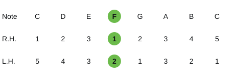

# Pixel Studio Piano Lab｜Beginner pop piano handbook and lesson plans in twelve lessons

Teacher: Leo Lee, Pixel Studio｜Source material: Pixel Studio's jazz piano class schedule (beginner), intro to pop piano materials, piano basics and chord notes, and broken-chord accompaniment notes, reorganised and revised in 2026.

## Overview

Lots of people learned piano as children, mostly classical at their parents' request, and later let it go. This course starts from basic theory and an overview of chords, combines them with playing technique to reach the goal of playing and singing, then goes on to strengthen relative pitch and build the skills to accompany freely and arrange simply. Whatever music you usually listen to, you'll be able to play a piece that's your own.

The course has twelve lessons of 120 minutes each, 24 hours in all. The first eight lay the groundwork in reading, fingering, chords and accompaniment, with a play-and-sing mid-course performance in Lesson 8; the last four go deeper into scale degrees, progressions and rhythm styles, with the final performance in Lesson 12.

### Teaching goals

1. Read the grand staff and numbered notation, and play scales with good posture and fingering.
2. Understand how chords are built, inverted and numbered by degree, and accompany songs from a chord chart.
3. Use accompaniments such as slow soul, waltz, 4 beats, 8 beats, slow rock and tenths.
4. Play and sing a song in one key, and transpose it by scale degree.

### Twelve-lesson schedule

| Lesson | Topic | Syllabus topic (beginner) | Core content |
| --- | --- | --- | --- |
| 1 | Meet the piano and pop piano | Intro to jazz piano | Origins, construction, kinds, classical, pop and jazz, sitting, finger numbers, pedals |
| 2 | Basic theory and reading music | Basic theory and reading | Note names, solfège, numbered notation, grand staff, note values, time signatures, whole and half steps, intervals |
| 3 | Scale fingering | Scale fingering | The major formula, thumb-unders and crossings, C, G and F major |
| 4 | How chords are built | How chords are built | Major, minor, augmented and diminished triads, diatonic chords, inversions |
| 5 | Playing songs (1): chords and melody | Playing songs (1) | Numbered notation and chord charts, three left-hand patterns, choosing chords |
| 6 | Playing songs (2): rhythm and accompaniment styles | Playing songs (2); rhythm styles (1) | Finger-position notation, slow soul, waltz |
| 7 | Stronger accompaniment (4 + 8) | Stronger accompaniment (4 + 8) | 4 beats, 8 beats, one-hand octave, two-hand two octaves (15th) |
| 8 | Songs in one key, playing and singing | Playing songs in one key; playing and singing | Keys, chord charts, intros and outros, mid-course performance |
| 9 | Scale-degree chords and keys | Scale-degree chords and keys | Scale degrees, chord functions, cadences, transposing |
| 10 | Connecting roots, slash chords and common progressions | Connecting roots and slash chords; common progressions | Slash chords, bass lines, 1645, 1564, Canon, 2-5-1 |
| 11 | Playing songs (3): 10th and 15th accompaniment | Rhythm styles (2); 10th and 15th accompaniment | Slow rock, march, tenths, two hands, two octaves (15th) |
| 12 | Major and minor, and songs in G major | Major and minor; songs in G major | Relative keys, three minor scales, G major, final performance |

### The shared rhythm of each 120-minute lesson

| Section | Time | Content |
| --- | --- | --- |
| Open | 20 minutes | Warm-up, reviewing last week's practice and exit tickets, introducing the topic |
| Build | 35 minutes | Explaining new ideas, demos and quick quizzes |
| Break | 10 minutes | Relax fingers and shoulders |
| Turn | 35 minutes | Practice with the player, group challenges, playing songs |
| Close | 20 minutes | Play-along or performance, recording, exit ticket, practice after class |

### Equipment

- Piano or digital piano (ideally at least 61 touch-sensitive keys), sustain pedal
- Classroom projector and sound system; metronome
- Students' phones: scan the slide QR codes to use the keyboard, note-finding game, scale fingering, chord lab, accompaniment player and recorder

### Assessment

- Pre-class surveys and exit tickets: keep track of each student's progress and questions
- Practice checklists and seven-day logs: build a daily practice habit
- Mid-course performance (Lesson 8): playing and singing, or playing, a song in C
- Final performance (Lesson 12): a song using two or more accompaniment patterns, in C major or G major

### Principles for class activities

- Keep new ideas within 35 minutes and leave the rest of the time for playing
- Listen first, break it down, then hands together; slow to fast, and steadiness matters more than speed
- Accompaniments are always written in L5 L3 L2 L1, R1 R2 R5 finger-position notation; finger positions stay the same when the chord changes
- Songs are written in numbered notation; when changing key, the notation stays the same and the chords change by scale degree

<!-- learning-notes-start -->
### Skill route and practice logs

[Open the course skill route](index.html#lessons): each lesson card shows suggested prerequisites and this device's homework ticks, and you can expand the full course route. The website's practice chart uses the original seven-day table, leaves missing values blank, and shows seconds, counts and minutes separately. The PDF keeps this table as a paper record with no sample scores filled in.

<!-- learning-notes-end -->

## Lesson 1｜Meet the piano and pop piano

Goals: explain where the piano came from, how it makes sound and the common kinds; tell classical, pop and jazz piano apart; with good posture and hand shape, learn the finger numbers for both hands and the pedals; before the end of class, everyone finds middle C on the keyboard and plays Do Re Mi Fa Sol in five-finger position.

### Pre-class survey (joining the class)

- Piano experience
- Other instruments you play
- Instrument you practise on at home
- Music you can read
- Rate yourself (1 to 5)
- Three songs you most want to play on piano
- The one thing you most want to achieve by the end of the twelve lessons
- Time you can practise each week

### Lesson outline (120 minutes)

| Section | Time | Content | Slide |
| --- | --- | --- | --- |
| Open | 00:00–00:20 | Lots of people learned piano as kids and then let it go; when I was six, my piano teacher sent me home | 3–4 |
| Build | 00:20–00:55 | Pianoforte: an instrument that can play "soft" and "loud"; press a key and a hammer strikes the strings; predict, then reveal; from concert hall to bedroom: the keyboard family; pop piano is the foundation for jazz piano; listen to four piano pieces and guess the style of each | 5–10 |
| Break | 00:55–01:05 | 10-minute break | 11 |
| Turn | 01:05–01:40 | Sit steady and relaxed, fingers as if holding a ball; The thumb is 1 and the little finger 5, on both hands; Three pedals, each with a job; The white key left of a pair of black keys is C; Myth or fact? | 12–16 |
| Close | 01:40–02:00 | C five-finger position: one finger per key; Play Do Re Mi Fa Sol once with the right hand and once with the left; Before you leave, write down 3-2-1 | 17–20 |
| Wrap up | After class | Three-line summary, exit ticket, practice after class and next lesson preview | 19、21、22、23 |

### Extended notes: where the piano came from and how it's built

- The piano's full name is pianoforte, "soft-loud"; for convenience the forte was dropped, leaving just piano.
- In 1709 the Italian Bartolomeo Cristofori took the harpsichord as a model and switched to hammers striking the strings, making a piano that could play soft and loud.
- In principle the piano is a struck string instrument; because you play it through a keyboard, it's classed as a keyboard instrument. 88 keys, a range from A0 to C8, tuned in twelve-tone equal temperament.
- The sound's path: key → hammer → string → soundboard. Let go of the key and the damper stops the string vibrating.

| Type | Features |
| --- | --- |
| Grand piano | Strings lie horizontally and the hammers strike from below; a responsive touch |
| Upright piano | Strings stand vertically and the hammers strike from the front; most common at home |
| Silent piano | An acoustic piano with a silent system, so you can practise with headphones |
| Digital piano | Samples a real piano's sound and connects to a computer over MIDI |
| Keyboards and synthesizers | 49 to 88 keys, with lots of built-in sounds and rhythms |

### Extended notes: classical, pop and jazz

- Classical piano is played from the score; pop piano values a free feel, choosing the accompaniment freely, adding ornaments and fills, and pushing and laying back with syncopation for a pop flavour.
- Pop piano's harmony is mostly consonant triads, the melody follows the original with added ornaments and syncopation, and the rhythms mostly come from the grooves of traditional dances around the world.
- Jazz piano uses dissonant seventh chords, improvises freely on the melody and accompanies with walking bass. Triads are the foundation of seventh chords, so pop piano can be seen as the foundation of jazz piano.

### Extended notes: sitting, fingers and pedals

- Sit on the front half of the bench, centred on middle C; elbows roughly level with the keys, shoulders relaxed and fingers curved.
- Finger numbers: on both hands the thumb is 1 and the little finger 5. This course writes accompaniment as L5 L3 L2 L1 and R1 R2 R5.
- The right pedal is the sustain pedal, changed with each chord; the left pedal is the soft pedal; the middle pedal varies by model, either a sostenuto or a practice mute.
- Tune a piano at least once a year; the right environment is about 20°C with 50–60% humidity, out of direct sunlight.

### Class activities (website slides)

| Slide | Activity | Content |
| --- | --- | --- |
| 2 | Phone sync | Today's route: get to know the eighty-eight keys in front of you |
| 3 | Show-of-hands vote | Lots of people learned piano as kids and then let it go |
| 7 | Multiple choice | Predict, then reveal |
| 10 | Song listening · YouTube | Listen to four piano pieces and guess the style of each |
| 15 | Playable keyboard | The white key left of a pair of black keys is C |
| 16 | Myth-busting · flip cards | Myth or fact? |
| 17 | Scale fingering | C five-finger position: one finger per key |
| 18 | Recording | Play Do Re Mi Fa Sol once with the right hand and once with the left |
| 20 | Exit ticket 3-2-1 | Before you leave, write down 3-2-1 |
| 21 | Self-directed log | 10-minute daily warm-up |
| 22 | Self-directed tracking | Practice after class: tap once to tick each item you finish |
| 23 | Pre-class survey | Lesson 2: Basic theory and reading music |

### Practice after class

- [ ] Without the handbook, say the piano's sound path: key, hammer, string, soundboard
- [ ] With your eyes closed, find a pair of black keys by touch, then play C
- [ ] C five-finger position ten times with each hand, all five notes equally loud
- [ ] Listen to a pop song with piano accompaniment and decide whether it's closer to pop or jazz
- [ ] Fill in the Lesson 2 pre-class survey

<!-- teaching-visuals-start -->

<h3>Sitting and hand shape｜Illustrated</h3>

<figure><figcaption>Side view: shoulders relaxed, elbows roughly level with the keys</figcaption></figure>
<figure><figcaption>Close-up: fingers curved, wrist natural</figcaption></figure>

<h3>Pedals and footwork｜Illustrated</h3>

<figure><figcaption>Where the three pedals actually are</figcaption></figure>
<figure><figcaption>Heel stays on the floor while the ball of the foot presses the sustain pedal</figcaption></figure>
<figure><figcaption>Ball of the foot lifts, heel still supporting</figcaption></figure>

The middle pedal may work differently on grand and upright pianos; check your model.

<h3>Five-finger position and finger-position notation｜Illustrated</h3>

<figure><figcaption>Each of the five fingers matches one key</figcaption></figure>
<figure><figcaption>Both hands' positions seen from above</figcaption></figure>

Fingers are numbered from thumb 1 to little finger 5; check pitches and hand positions against the keyboard diagram.

<!-- teaching-visuals-end -->

## Lesson 2｜Basic theory and reading music

Goals: match note names, solfège and numbered notation, and find every note on the keyboard; read the notes around middle C on the grand staff and understand note values and time signatures; understand whole steps, half steps, sharps and flats, and work out the interval between two notes; before the end of class, get ten in a row in the note-finding game.

### Pre-class survey

- Practice items completed since last lesson
- In five-finger position, are all five notes equally loud?
- How sure you are of finding middle C with your eyes closed
- Theory you most want to strengthen
- Where you feel tense when practising

### Lesson outline (120 minutes)

| Section | Time | Content | Slide |
| --- | --- | --- | --- |
| Open | 00:00–00:20 | Is your five-finger position steady now?; three elements of sound: pitch, volume, tone colour | 3–4 |
| Build | 00:20–00:55 | One note, three names; switch between note names, solfège and numbers and see each white key's name; the grand staff shows every note's exact position; halving: each step down is half as long; the top is beats per bar, the bottom is which note counts as one beat; staves and time | 5–10 |
| Break | 00:55–01:05 | 10-minute break | 11 |
| Turn | 01:05–01:40 | Two neighbouring keys are a half step apart; sharp, flat, natural: move a note up or down a half step; the distance between two notes, counted in degrees; tap two keys to work out the interval and hear how consonant it is; working out intervals | 12–16 |
| Close | 01:40–02:00 | See a note name, tap the right key; see a note on the staff, tap the right key; write your 3-2-1 before you leave | 17–20 |
| Wrap up | After class | Three-line summary, exit ticket, practice after class and next lesson preview | 19、21、22 |

### Extended notes: note names, solfège and numbered notation

| Degree | Ⅰ Tonic | Ⅱ Supertonic | Ⅲ Mediant | Ⅳ Subdominant | Ⅴ Dominant | Ⅵ Submediant | Ⅶ Leading note |
| --- | --- | --- | --- | --- | --- | --- | --- |
| Note names | C | D | E | F | G | A | B |
| Solfège | Do | Re | Mi | Fa | Sol | La | Si |
| Numbered notation | 1 | 2 | 3 | 4 | 5 | 6 | 7 |

- Three elements of sound: pitch (frequency), volume (amplitude), tone colour (overtones). A4 is 440 Hz.
- The grand staff combines the treble and bass staves. Middle C sits on the first ledger line below the treble staff; the treble staff's first line is E4 and the bass staff's first line is G2.

### Extended notes: note values and time signatures

| Note | Beats in 4/4 |
| --- | --- |
| Whole note | 4 beats |
| Half note | 2 beats |
| Quarter notes | 1 beat |
| Eighth notes | ½ beat |
| Sixteenth note | ¼ beat |

- A dot adds half the note's value; a triplet splits one beat evenly in three.
- Duple time (2/4, 4/4), triple time (3/4, 6/8), and mixed meters that combine them (5/4, 7/8).

### Extended notes: half steps, accidentals and intervals

- Two neighbouring keys are a half step apart, and two half steps make a whole step; there's no black key between E–F or B–C, so they're a half step apart themselves.
- A sharp ♯ raises a half step, a flat ♭ lowers a half step, and a natural ♮ cancels them. Those written inside a bar are accidentals; those next to the clef are the key signature.

| Semitones | Interval | Consonance |
| --- | --- | --- |
| 0 | Unison | Perfect consonance |
| 1 | Minor 2nd | Dissonance |
| 2 | Major 2nd | Dissonance |
| 3 | Minor 3rd | Imperfect consonance |
| 4 | Major 3rd | Imperfect consonance |
| 5 | Perfect 4th | Perfect consonance |
| 6 | Augmented fourth, diminished fifth | Dissonance |
| 7 | Perfect 5th | Perfect consonance |
| 8 | Minor 6th | Imperfect consonance |
| 9 | Major 6th | Imperfect consonance |
| 10 | Minor 7th | Dissonance |
| 11 | Major 7th | Dissonance |
| 12 | Octave | Perfect consonance |

### Class activities (website slides)

| Slide | Activity | Content |
| --- | --- | --- |
| 2 | Phone sync | Today's route: read music and find every note on the keyboard |
| 3 | Show-of-hands vote | Is your five-finger position steady now? |
| 6 | Playable keyboard | Switch between note names, solfège and numbers, and see each white key's name |
| 10 | Multiple choice | Staves and time |
| 15 | Interval calculator | Tap two keys to work out the interval and hear how consonant it is |
| 16 | Multiple choice | Working out intervals |
| 17 | Note-finding game | See a note name, tap the right key |
| 18 | Note-finding game · staff | See a note on the staff, tap the right key |
| 20 | Exit ticket 3-2-1 | Before you leave, write down 3-2-1 |
| 21 | Self-directed tracking | Practice after class: tap once to tick each item you finish |
| 22 | Pre-class survey | Lesson 3: Scale fingering |

### Practice after class

- [ ] Twenty in a row in the note-finding game (note names)
- [ ] Ten in a row in the note-finding game (staff)
- [ ] Play C to G, C to E and E to F on the keyboard and name their intervals
- [ ] Write the numbered notation of Twinkle Twinkle, 1 1 5 5 6 6 5, as note names and solfège
- [ ] Fill in the Lesson 3 pre-class survey

## Lesson 3｜Scale fingering

Goals: explain the "whole, whole, half, whole, whole, whole, half" rule of the major scale; use thumb-unders and middle-finger crossings to play a one-octave scale; play C major with the right fingering and get to know the fingering for G and F major; before the end of class, play the C major scale up and down at 60 BPM with each hand.

### Pre-class survey

- Questions in a row you got right in the note-finding game (staff)
- What you mix up most
- Daily practice time
- The hardest of your five fingers to control
- How skilled your left hand is

### Lesson outline (120 minutes)

| Section | Time | Content | Slide |
| --- | --- | --- | --- |
| Open | 00:00–00:20 | What was your score in the note-finding game?; starting from the tonic, laid out at fixed distances | 3–4 |
| Build | 00:20–00:55 | Whole, whole, half, whole, whole, whole, half; When you run out of fingers, the thumb goes under and the middle finger goes over; Follow the lit keys and fingering to play C major up and down; Fingering and the formula | 5–8 |
| Break | 00:55–01:05 | 10-minute break | 9 |
| Turn | 01:05–01:40 | Change the tonic and watch the sharps, flats and fingering change; Three keys, two fingerings; Hands together: the thumbs pass under at different times; Canon's melody is full of descending scale runs; Scale relay: one note each, passed on steadily | 10–14 |
| Close | 01:40–02:00 | Record the C major scale with each hand; write your 3-2-1 before you leave | 15–17 |
| Wrap up | After class | Three-line summary, exit ticket, practice after class and next lesson preview | 16、18、19、20 |

### Extended notes: major scales and fingering

- The major scale formula: whole, whole, half, whole, whole, whole, half. It splits into two "whole-whole-half" groups joined by a whole step.
- Start on G and follow the formula, and the seventh has to be raised to F♯; start on F, and the fourth has to be lowered to B♭.
- Equal temperament divides the octave into twelve equal half steps, so every key sounds equally even.

| Key | Scale | Right hand up | Left hand up |
| --- | --- | --- | --- |
| C major | C D E F G A B C | 1 2 3 1 2 3 4 5 | 5 4 3 2 1 3 2 1 |
| G major | G A B C D E F♯ G | 1 2 3 1 2 3 4 5 | 5 4 3 2 1 3 2 1 |
| F major | F G A B♭ C D E F | 1 2 3 4 1 2 3 4 | 5 4 3 2 1 3 2 1 |
| A minor | A B C D E F G A | 1 2 3 1 2 3 4 5 | 5 4 3 2 1 3 2 1 |

- Going up, the right thumb passes under after finger 3; coming down, finger 3 crosses over the thumb. The left hand is the reverse.
- Practice order: right hand, left hand, then hands together; start at 50 BPM and add 4 BPM each time it's steady.

### Class activities (website slides)

| Slide | Activity | Content |
| --- | --- | --- |
| 2 | Phone sync | Today's route: ten fingers moving smoothly through eight notes |
| 3 | Show-of-hands vote | What was your score in the note-finding game? |
| 7 | Scale fingering | Follow the lit keys and fingering to play C major up and down |
| 8 | Multiple choice | Fingering and the formula |
| 10 | Scale fingering | Change the tonic and watch the sharps, flats and fingering change |
| 13 | Song listening · YouTube | Canon's melody is full of descending scale runs |
| 14 | Group task · scoring | Scale relay: one note each, passed on steadily |
| 15 | Record and compare | Record the C major scale with each hand |
| 17 | Exit ticket 3-2-1 | Before you leave, write down 3-2-1 |
| 18 | Self-directed log | 15-minute daily scale routine |
| 19 | Self-directed tracking | Practice after class: tap once to tick each item you finish |
| 20 | Pre-class survey | Lesson 4: How chords are built |

### Practice after class

- [ ] Without the handbook, write out the major scale formula and the fingering for C major
- [ ] Right-hand C major scale up and down, five times in a row at 60 BPM without stopping
- [ ] Left-hand C major scale up and down, five times in a row at 60 BPM without stopping
- [ ] Try hands together, or play the G major scale
- [ ] Fill in the Lesson 4 pre-class survey

<!-- teaching-visuals-start -->

<h3>Thumb-unders and crossings｜Illustrated</h3>

<figure><figcaption>The exact notes, finger numbers and paths of thumb-unders and crossings</figcaption></figure>
<figure><figcaption>Close-up of the fingers meeting the keys</figcaption></figure>
<figure><figcaption>Keep the wrist natural as the hand moves</figcaption></figure>
<figure><figcaption>The other fingers lift naturally, ready for the next note</figcaption></figure>
<figure><figcaption>The palm shifts along with the fingers</figcaption></figure>

<!-- teaching-visuals-end -->

<!-- learning-notes-start -->

<h3>Interactive practice and diagrams</h3><h4>Hands-together fingering</h4>
Going up in C major, the right thumb passes under at F and the left hand crosses over at A; the two moves don't happen at the same time.
<figure class="learning-print"><figcaption>Hands-together fingering｜Key states</figcaption></figure>
<a href="p03/#12">Open the interactive practice</a>

<!-- learning-notes-end -->

## Lesson 4｜How chords are built

Goals: define harmony and chords, and stack triads in thirds; tell major, minor, augmented and diminished triads apart by how they're built and how they sound; name the seven diatonic chords of C major and play three inversions; before the end of class, play C → F → G → C in the right hand using inversions, without the hand jumping.

### Pre-class survey

- Your steadiest speed on the C major scale
- How smooth your thumb-unders and finger-overs are
- Chords you can already play
- Playing scales hands together

### Lesson outline (120 minutes)

| Section | Time | Content | Slide |
| --- | --- | --- | --- |
| Open | 00:00–00:20 | What's your steadiest speed on the C major scale?; two or more notes make harmony, three notes stacked in thirds make a chord | 3–4 |
| Build | 00:20–00:55 | Major and minor thirds combine into four colours; change the root and quality and hear the chord's colour; work out the chord; use each note of the scale as a root and stack seven chords | 5–8 |
| Break | 00:55–01:05 | 10-minute break | 9 |
| Turn | 01:05–01:40 | Same three notes, a different note at the bottom; tap an inversion and watch the bottom note change; inversions keep the right hand from moving much and join chords more smoothly; myth or fact?; quick-fire chords: the teacher calls a name, each group plays it | 10–14 |
| Close | 01:40–02:00 | Play C → F → G → C along with the player, trying inversions in the right hand; write your 3-2-1 before you leave | 15–17 |
| Wrap up | After class | Three-line summary, exit ticket, practice after class and next lesson preview | 16、18、19 |

### Extended notes: triads

| Chord | Built from | On C | Symbol | Sound |
| --- | --- | --- | --- | --- |
| Major triad | Major third + minor third | C E G | C | Bright, open |
| Minor triad | Minor third + major third | C E♭ G | Cm | Soft, sad |
| Augmented triad | Major third + major third | C E G♯ | C+、Caug | Suspenseful, uneasy |
| Diminished triad | Minor third + minor third | C E♭ G♭ | Cdim、C° | Tense, eerie |

- Harmony is two or more notes sounding together; a chord is three or more notes stacked in thirds.
- A suspended fourth (sus4) replaces the third with the fourth, for example Csus4 = C F G; it sounds unresolved and wants to go back to the major triad.

### Extended notes: diatonic chords in C major

| Degree | Ⅰ | Ⅱm | Ⅲm | Ⅳ | Ⅴ | Ⅵm | Ⅶdim |
| --- | --- | --- | --- | --- | --- | --- | --- |
| Chord | C | Dm | Em | F | G | Am | Bdim |
| Chord tones | 1 3 5 | 2 4 6 | 3 5 7 | 4 6 1 | 5 7 2 | 6 1 3 | 7 2 4 |

### Extended notes: inversions

| Where | C chord | Lowest note | Right-hand fingering |
| --- | --- | --- | --- |
| Root position | C E G | Root | 1 3 5 |
| First inversion | E G C | Third | 1 2 5 |
| Second inversion | G C E | Fifth | 1 3 5 |

- Inversions keep the common notes between neighbouring chords and move the others to the nearest note. C → F → G → C can be played C E G → C F A → B D G → C E G.
- Close position: three notes within an octave; open position: the notes spread apart for a wider sound.

### Class activities (website slides)

| Slide | Activity | Content |
| --- | --- | --- |
| 2 | Phone sync | Today's route: stack three notes into a chord |
| 3 | Show-of-hands vote | What's your steadiest speed on the C major scale? |
| 6 | Chord lab | Change the root and quality and hear the chord's colour |
| 7 | Multiple choice | Work out the chord |
| 8 | Diatonic chords | Use each note of the scale as a root and stack seven chords |
| 11 | Chord lab · inversions | Tap an inversion and watch the bottom note change |
| 13 | Myth-busting · flip cards | Myth or fact? |
| 14 | Group task · scoring | Quick-fire chords: the teacher calls a name, each group plays it |
| 15 | Accompaniment player | Play C → F → G → C along with the player, trying inversions in the right hand |
| 17 | Exit ticket 3-2-1 | Before you leave, write down 3-2-1 |
| 18 | Self-directed tracking | Practice after class: tap once to tick each item you finish |
| 19 | Pre-class survey | Lesson 5: Playing songs (1): chords and melody |

### Practice after class

- [ ] Play the seven diatonic chords of C major and name each one's quality
- [ ] Work out major and minor triads from any root, at least six pairs
- [ ] Play C → F → G → C in the right hand using inversions, ten times in a row without the hand jumping
- [ ] Left hand plays the roots of C, F and G while the right hand holds the chord
- [ ] Fill in the Lesson 5 pre-class survey

<!-- learning-notes-start -->

<h3>Interactive practice and diagrams</h3><h4>Nearest-note voice leading</h4>
Compare root position and nearest-note voicing on C→F→G→C. C→F keeps C4, E4 moves to F4 and G4 to A4.
<figure class="learning-print"><figcaption>Nearest-note voice leading｜Key states</figcaption></figure>
<a href="p04/#12">Open the interactive practice</a>

<!-- learning-notes-end -->

## Lesson 5｜Playing songs (1): chords and melody

Goals: read numbered notation and chord charts and plan right-hand fingering for a melody; accompany with three left-hand patterns: roots, fifths and block chords; understand how to choose a chord to fit the melody notes; before the end of class, play Twinkle Twinkle hands together and Happy Birthday in 3/4.

### Pre-class survey

- Number of chords you can play straight away
- How C → F → G → C in inversions is going
- How sure you are of telling major chords from minor
- The song you most want to learn first

### Lesson outline (120 minutes)

| Section | Time | Content | Slide |
| --- | --- | --- | --- |
| Open | 00:00–00:20 | Can you press C, F and G with your eyes closed?; the piano in a song has two roles | 3–4 |
| Build | 00:20–00:55 | One box per bar, chords on top, melody below; find the melody's lowest and highest notes first, then decide where your hand sits; from simple to full: root, fifth, block chord; play left-hand block chords and broken chords along with the player | 5–8 |
| Break | 00:55–01:05 | 10-minute break | 9 |
| Turn | 01:05–01:40 | Choose the chord that the melody note belongs to; choose chords for a melody; Twinkle Twinkle: melody in the right hand, chord changes in the left; one Twinkle Twinkle, three left hands | 10–13 |
| Close | 01:40–02:00 | Happy Birthday: in 3/4, starting on the pickup "Happy"; write your 3-2-1 before you leave | 14–16 |
| Wrap up | After class | Three-line summary, exit ticket, practice after class and next lesson preview | 15、17、18、19 |

### Extended notes: numbered notation and chord charts

| Written | Meaning |
| --- | --- |
| 5 | Quarter note, one beat |
| 5 - | Held one more beat, two in all |
| One line under the number | Eighth notes |
| 0 | Rest |
| Dot above or below the number | An octave higher or lower |

- Reading order: say the solfège, clap the rhythm, find the chords, and only then put it on the keys.
- Write finger numbers on the numbered notation and use the same fingering every time.

### Extended notes: three left-hand patterns

| Playing style | C chord | Left-hand fingering |
| --- | --- | --- |
| Root | C | 5 |
| Fifths | C G | 5 1 |
| Block chords | C E G | 5 3 1 |

### Extended notes: chord tones and choosing chords

| Chord | Chord tones | Melody notes that fit |
| --- | --- | --- |
| C（Ⅰ） | 1 3 5 | Do、Mi、Sol |
| F（Ⅳ） | 4 6 1 | Fa、La、Do |
| G（Ⅴ） | 5 7 2 | Sol、Si、Re |

- Choose chords by the melody note on beat one of each bar; phrases often end G → C.
- Twinkle Twinkle: C｜F C｜F C｜G C｜C F｜C G｜C F｜C G｜C｜F C｜F C｜G C.
- Happy Birthday (3/4, pickup): C｜G｜G｜C｜C｜F｜C G｜C.

### Class activities (website slides)

| Slide | Activity | Content |
| --- | --- | --- |
| 2 | Phone sync | Today's route: finish your first song on the piano |
| 3 | Show-of-hands vote | Can you press C, F and G with your eyes closed? |
| 4 | Song listening · YouTube | The piano in a song has two roles |
| 8 | Accompaniment player | Play left-hand block chords and broken chords along with the player |
| 11 | Multiple choice | Choose chords for a melody |
| 12 | Playing songs | Twinkle Twinkle: melody in the right hand, chord changes in the left |
| 13 | Group task · scoring | One Twinkle Twinkle, three left hands |
| 14 | Playing songs | Happy Birthday: in 3/4, starting on the pickup "Happy" |
| 16 | Exit ticket 3-2-1 | Before you leave, write down 3-2-1 |
| 17 | Self-directed log | 15-minute daily song routine |
| 18 | Self-directed tracking | Practice after class: tap once to tick each item you finish |
| 19 | Pre-class survey | Lesson 6: Playing songs (2): rhythm and accompaniment styles |

### Practice after class

- [ ] Twinkle Twinkle with all three left-hand versions, hands together once each
- [ ] Happy Birthday hands together, with the right chord on each beat one
- [ ] Choose a simple children's song and mark the chords and fingering on the numbered notation yourself
- [ ] Record Twinkle Twinkle hands together
- [ ] Fill in the Lesson 6 pre-class survey

## Lesson 6｜Playing songs (2): rhythm and accompaniment styles

Goals: read L5 L3 L2 L1 and R1 R2 R5 finger-position notation and play broken chords; play the four slow soul patterns and explain how they differ; accompany in 3/4 waltz with oom-pah-pah and broken chords; before the end of class, play Twinkle Twinkle in slow soul and Happy Birthday as a waltz.

### Pre-class survey

- How Twinkle Twinkle hands together is going
- Your most comfortable left-hand pattern
- How well your hands work together
- Experience with the sustain pedal

### Lesson outline (120 minutes)

| Section | Time | Content | Slide |
| --- | --- | --- | --- |
| Open | 00:00–00:20 | Have you finished Twinkle Twinkle hands together?; both are ballads, but four-beat and three-beat accompaniments differ | 3–4 |
| Build | 00:20–00:55 | Finger-position notation: writing accompaniment by where the fingers sit; Slow soul: the most common rhythm in today's pop; Four slow soul accompaniments: listen first, then play along; Reading finger-position notation | 5–8 |
| Break | 00:55–01:05 | 10-minute break | 9 |
| Turn | 01:05–01:40 | Strong, weak, weak: four accompaniments in triple time; listen for the time signature and tempo, then choose the left hand; myth or fact?; Twinkle Twinkle in slow soul, hands together | 10–13 |
| Close | 01:40–02:00 | Happy Birthday: switch to 3/4 broken chords; record a four-beat and a three-beat version; write your 3-2-1 before you leave | 14–17 |
| Wrap up | After class | Three-line summary, exit ticket, practice after class and next lesson preview | 16、18、19 |

### Extended notes: broken-chord accompaniment and finger-position notation

Taking a C chord as an example: L5 = C3 (root), L3 = E3 (third), L2 = G3 (fifth), L1 = C4 (root an octave up), R1 = E4, R2 = G4, R5 = C5. When the chord changes, the finger positions stay the same and the whole hand moves to the new root.

### Extended notes: slow soul

| Pattern | Numbered notation (C chord) | Finger positions |
| --- | --- | --- |
| (1) | 1̣ 5̣ 1 3 5 － | L5 L2 L1 R1 R2 |
| (2) | 1̣ 5̣ 1 3 5 1̇ 5 3 | L5 L2 L1 R1 R2 R5 R2 R1 |
| (3) | （1 3 5）× 4 | L5＋L3＋L2 |
| (4) | 1̣ 5̣ 1 5̣ 3 5̣ 1 5̣ | L5 L2 L1 L2 R1 L2 L1 L2 |

### Extended notes: the 3/4 waltz

| Beat pattern | Finger positions |
| --- | --- |
| 4 beats one-hand octave | L5 L3 L2 |
| Oom-pah-pah | L5, chord, chord |
| 8 beats one-hand octave | L5 L3 L2 L1 L2 L1 |
| 8 beats two hands, two octaves (15th) | L5 L2 L1 R1 R2 R5 |

### Extended notes: choosing an accompaniment

| Song feel | Tempo | Suggested accompaniment |
| --- | --- | --- |
| Slow ballads | 60–80 BPM | Slow soul (1) (2) |
| Mid-tempo pop | 80–110 BPM | Slow soul (3) (4), 8 beats |
| Waltzes, birthday songs | 3/4 | Waltz |
| Children's songs, upbeat songs | 100 BPM and up | Block chords, 4 beats |

### Class activities (website slides)

| Slide | Activity | Content |
| --- | --- | --- |
| 2 | Phone sync | Today's route: get the left hand flowing |
| 3 | Show-of-hands vote | Have you finished Twinkle Twinkle hands together? |
| 4 | Song listening · YouTube | Both are ballads, but four-beat and three-beat accompaniments differ |
| 7 | Accompaniment player | Four slow soul accompaniments: listen first, then play along |
| 8 | Multiple choice | Reading finger-position notation |
| 10 | Accompaniment player | Strong, weak, weak: four accompaniments in triple time |
| 12 | Myth-busting · flip cards | Myth or fact? |
| 13 | Playing songs | Twinkle Twinkle in slow soul, hands together |
| 14 | Playing songs | Happy Birthday: switch to 3/4 broken chords |
| 15 | Record and compare | Record a four-beat and a three-beat version |
| 17 | Exit ticket 3-2-1 | Before you leave, write down 3-2-1 |
| 18 | Self-directed tracking | Practice after class: tap once to tick each item you finish |
| 19 | Pre-class survey | Lesson 7: Stronger accompaniment (4 + 8) |

### Practice after class

- [ ] All four slow soul patterns over C → Am → F → G, two rounds each
- [ ] 3/4 oom-pah-pah and broken chords over C → G → G → C, two rounds each
- [ ] Choose a slow soul pattern for Twinkle Twinkle, play it hands together all the way through and record it
- [ ] Choose a song in C you'd like to play and sing for mid-course, and find its chord chart
- [ ] Fill in the Lesson 7 pre-class survey

<!-- teaching-visuals-start -->

<h3>Five-finger position and finger-position notation｜Illustrated</h3>

<figure><figcaption>Each of the five fingers matches one key</figcaption></figure>
<figure><figcaption>Both hands' positions seen from above</figcaption></figure>

Fingers are numbered from thumb 1 to little finger 5; check pitches and hand positions against the keyboard diagram.

<!-- teaching-visuals-end -->

<!-- learning-notes-start -->

<h3>Interactive practice and diagrams</h3><h4>Choosing an accompaniment by time signature</h4>
Compare this course's accompaniments on the same C chord by time signature, rather than choosing a style by BPM alone.
<figure class="learning-print"><figcaption>Choosing an accompaniment by time signature｜Key states</figcaption></figure>
<a href="p06/#11">Open the interactive practice</a>

<!-- learning-notes-end -->

## Lesson 7｜Stronger accompaniment (4 + 8)

Goals: explain how 4 beats and 8 beats differ and choose an accompaniment density to fit the tempo; play broken chords as a one-hand octave and as two hands, two octaves (15th); understand the fingering and hand positions for handing over between hands; before the end of class, play an accompaniment over C → Am → F → G with "4 beats in the verse, 8 beats in the chorus".

### Pre-class survey

- The slow soul accompaniment you know best
- How comfortable you are with the waltz
- The song you want to play and sing at mid-course
- Format for the mid-course performance

### Lesson outline (120 minutes)

| Section | Time | Content | Slide |
| --- | --- | --- | --- |
| Open | 00:00–00:20 | Which of the four slow soul accompaniments do you like best?; the piano plays a different number of notes in the verse and chorus | 3–4 |
| Build | 00:20–00:55 | One note per beat, or two; 4 beats: three one-hand octave patterns; Three two-hand, two-octave (fifteenth) patterns; On the handover beat, the sound mustn't break; Accompaniment density and range | 5–8 |
| Break | 00:55–01:05 | 10-minute break | 9 |
| Turn | 01:05–01:40 | 8 beats: three one-hand patterns; Three two-hand patterns; Twelve accompaniments in 4/4; 4 beats in the verse, 8 beats in the chorus; Accompaniment relay: one pattern per person | 10–13 |
| Close | 01:40–02:00 | Record both verse and chorus accompaniments; write your 3-2-1 before you leave | 14–16 |
| Wrap up | After class | Three-line summary, exit ticket, practice after class and next lesson preview | 15、17、18、19 |

### Extended notes: broken-chord accompaniment (4/4)

| Beat pattern | Range  | Finger positions per bar |
| --- | --- | --- |
| 4 Beats | One-hand octave | L5 L3 L2 L1 |
| 4 Beats | One-hand octave | L5 L3 L2 L1｜L2 L1 L2 L1 |
| 4 Beats | One-hand octave | L5 L3 L2 L1｜L3 L2 L1 L3｜L2 L1 L3 L2｜L1 L3 L2 L1 |
| 4 Beats | Two hands, two octaves (15th) | L5 L3 L2 L1｜R1 R2 R5 R2 |
| 4 Beats | Two hands, two octaves (15th) | L5 L3 L2 L1｜R5 R2 R1 R2 |
| 4 Beats | Two hands, two octaves (15th) | L5 L3 L2 L1｜R1 R2 R5 R2｜R1 L1 L2 L3｜L5 L3 L2 L1 |
| 8 Beats | One-hand octave | L5 L3 L2 L1 L5 L3 L2 L1 |
| 8 Beats | One-hand octave | L5 L3 L2 L1 L3 L1 L2 L1 |
| 8 Beats | One hand, two octaves (15th) | L5 L3 L2 L1 L3 L2 L1 L2 |
| 8 Beats | Two hands, two octaves (15th) | L5 L3 L2 L1 R1 R2 R5 R2 |
| 8 Beats | Two hands, two octaves (15th) | L5 L2 L1 R1 R2 R5 R2 R1 |
| 8 Beats | Two hands, two octaves (15th) | L5 L2 L1 R2 R5 R2 R1 R2 |

- 4 beats has one note per beat, steady; 8 beats has two, flowing.
- Handing over between hands: as the left hand plays L1, the right hand is already hovering over R1; with the sustain pedal, the two octaves blend into one.
- Switching sections: verse in 4 beats one-hand octave, pre-chorus in 4 beats two hands, two octaves (15th), chorus in 8 beats two hands, two octaves (15th).

### Class activities (website slides)

| Slide | Activity | Content |
| --- | --- | --- |
| 2 | Phone sync | Today's route: hands taking turns to sound two octaves |
| 3 | Show-of-hands vote | Which of the four slow soul accompaniments do you like best? |
| 4 | Song listening · YouTube | The piano plays a different number of notes in the verse and chorus |
| 6 | Accompaniment player | 4 beats: three one-hand octave patterns, three two hands, two octaves (15th) |
| 8 | Multiple choice | Accompaniment density and range |
| 10 | Accompaniment player | 8 beats: three one-hand, three two-hand |
| 13 | Group task · scoring | Accompaniment relay: one pattern per person |
| 14 | Record and compare | Record both verse and chorus accompaniments |
| 16 | Exit ticket 3-2-1 | Before you leave, write down 3-2-1 |
| 17 | Self-directed log | 20-minute daily accompaniment routine |
| 18 | Self-directed tracking | Practice after class: tap once to tick each item you finish |
| 19 | Pre-class survey | Lesson 8: Songs in one key, playing and singing |

### Practice after class

- [ ] All six 4-beat accompaniments, two rounds each over C → Am → F → G
- [ ] Choose three of the six 8-beat accompaniments and practise up to 72 BPM
- [ ] Design verse and chorus patterns for your mid-course song and write them on the chord chart
- [ ] Record your mid-course song's accompaniment without singing
- [ ] Fill in the Lesson 8 pre-class survey

<!-- teaching-visuals-start -->

<h3>Handing over between hands｜Illustrated</h3>

<figure><figcaption>The left hand finishes the low register as the right hand gets ready</figcaption></figure>
<figure><figcaption>The right hand carries on in the upper register, keeping the groove going</figcaption></figure>

<!-- teaching-visuals-end -->

## Lesson 8｜Songs in one key, playing and singing

Goals: find a song's key from its chord chart and read the sections of a pop song; design an intro and outro for a song; practise playing and singing in four steps, simplifying the accompaniment when needed; give your mid-course performance: playing and singing, or playing, a song in C.

### Pre-class survey

- Mid-course song
- Accompaniment patterns for the verse and chorus
- How well you know the accompaniment
- The hardest part of playing and singing

### Lesson outline (120 minutes)

| Section | Time | Content | Slide |
| --- | --- | --- | --- |
| Open | 00:00–00:20 | Is your mid-course song ready?; when you play and sing, the piano should be quieter than your voice | 3–4 |
| Build | 00:20–00:55 | The first and last chords usually tell you the key; a chord chart is a map of the whole song; borrow the last four bars of the chorus as the intro; a complete one-key workout: C, 4/4, sixteen bars | 5–8 |
| Break | 00:55–01:05 | 10-minute break | 9 |
| Turn | 01:05–01:40 | Only once the accompaniment is automatic do you have room to sing; when singing is a struggle, simplify your hands first; ideas about playing and singing; in pairs, listen to each other rehearse | 10–13 |
| Close | 01:40–02:00 | Two minutes each: one verse, one chorus; record your mid-course performance and listen again in Lesson 12; write your 3-2-1 before you leave | 14–17 |
| Wrap up | After class | Three-line summary, exit ticket, practice after class and next lesson preview | 16、18、19 |

### Extended notes: finding the key and reading chord charts

- One key: the whole song stays in the same key. Look at the first and last chords, then at the three chords that appear most.
- Common chord chart marks: Intro, Verse, Chorus, repeat signs, first and second endings, D.S., D.C., Coda, N.C.

### Extended notes: intros and outros

- Intro: borrow the chords of the chorus's last four bars and stop on G, ready for the verse.
- Outro: repeat the last line's chords and slow down, ending on a broken C chord with the sustain pedal held.

### Extended notes: four steps to playing and singing

1. Memorise the accompaniment: without the music, play the whole accompaniment twice in a row without stopping.
2. Accompaniment plus humming: hands and voice learn to work separately.
3. Accompaniment plus solfège: check which beat each note lands on.
4. Accompaniment plus lyrics: start with the verse and add a section at a time.

When singing is a struggle, simplify the accompaniment first: left hand only, fewer notes, and just the root where you breathe.

### Extended notes: mid-course performance

Five areas are assessed: steadiness, chords, sections, balance (accompaniment lighter than the voice or melody) and stage presence. Practice piece Jingle Bells: C｜C｜C｜C｜F｜C｜G｜G｜C｜C｜C｜C｜F｜C｜G｜C.

### Class activities (website slides)

| Slide | Activity | Content |
| --- | --- | --- |
| 2 | Phone sync | Today's route: play and sing at the same time |
| 3 | Show-of-hands vote | Is your mid-course song ready? |
| 4 | Song listening · YouTube | When you play and sing, the piano should be quieter than your voice |
| 8 | Playing songs | A complete one-key workout: C, 4/4, sixteen bars |
| 12 | Multiple choice | Ideas about playing and singing |
| 13 | Section timer · random pick | In pairs, listen to each other rehearse |
| 14 | Section timer · scoring | Two minutes each: one verse, one chorus |
| 15 | Recording | Record your mid-course performance and listen again in Lesson 12 |
| 17 | Exit ticket 3-2-1 | Before you leave, write down 3-2-1 |
| 18 | Self-directed tracking | Practice after class: tap once to tick each item you finish |
| 19 | Pre-class survey | Lesson 9: Scale-degree chords and keys |

### Practice after class

- [ ] Listen to your mid-course recording again and write down the one thing you most want to improve
- [ ] Play Jingle Bells hands together all the way through, and try playing and singing it
- [ ] Add an intro and outro to your mid-course song
- [ ] Find a new song in C and mark its sections and breathing points
- [ ] Fill in the Lesson 9 pre-class survey

## Lesson 9｜Scale-degree chords and keys

Goals: write chords as scale degrees in Roman numerals and name the diatonic chords of a major key; understand what the tonic, subdominant and dominant do and the common cadences; move a progression into G major and F major by scale degree; before the end of class, play Jingle Bells once in C major and once in G major.

### Pre-class survey

- What you were happiest with in your mid-course performance
- What you most want to improve from your mid-course performance
- How familiar you are with "scale degrees" and "Ⅰ Ⅳ Ⅴ"
- Why you'd like to be able to transpose

### Lesson outline (120 minutes)

| Section | Time | Content | Slide |
| --- | --- | --- | --- |
| Open | 00:00–00:20 | After your mid-course performance, what do you most want to improve?; the singer says "too high, bring it down": what does the accompanist do? | 3–4 |
| Build | 00:20–00:55 | Roman numerals mark where a chord sits in the key; switch keys, tap the chord cards, and see that the degrees stay the same; the tonic is home, the subdominant goes out, the dominant wants to go home; four cadences: the punctuation at the end of a phrase; how chords get home at the end of a phrase; degrees and functions | 5–10 |
| Break | 00:55–01:05 | 10-minute break | 11 |
| Turn | 01:05–01:40 | Three steps to move a chord chart into another key; the same Ⅰ Ⅵm Ⅳ Ⅴ heard in four keys in turn; quick-fire transposing | 12–14 |
| Close | 01:40–02:00 | Jingle Bells in G major: the numbered notation stays the same, the chords become G, C and D; write your 3-2-1 before you leave | 15–17 |
| Wrap up | After class | Three-line summary, exit ticket, practice after class and next lesson preview | 16、18、19 |

### Extended notes: scale degrees

| Degree | Ⅰ | Ⅱm | Ⅲm | Ⅳ | Ⅴ | Ⅵm | Ⅶdim |
| --- | --- | --- | --- | --- | --- | --- | --- |
| C major | C | Dm | Em | F | G | Am | Bdim |
| G major | G | Am | Bm | C | D | Em | F♯dim |
| F major | F | Gm | Am | B♭ | C | Dm | Edim |
| D major | D | Em | F♯m | G | A | Bm | C♯dim |

### Extended notes: chord functions and cadences

- Tonic Ⅰ (Ⅵm and Ⅲm can stand in): settled, finished. Subdominant Ⅳ (Ⅱm is similar): leaving, moving. Dominant Ⅴ (Ⅶdim is similar): tension, wanting to go home.
- Ⅰ, Ⅳ and Ⅴ are the primary triads; lots of folk songs and children's songs use only these three.

| Cadence | Degree | Sound |
| --- | --- | --- |
| Authentic cadence | Ⅴ → Ⅰ | Certain, complete |
| Plagal cadence | Ⅳ → Ⅰ | Gentle |
| Half cadence | → Ⅴ | Waiting for the next line |
| Deceptive cadence | Ⅴ → Ⅵm | Takes a turn |

### Extended notes: transposing by scale degree

1. Write out the scale degrees of the chords in the original key.
2. Choose the new key.
3. Swap in the new key's chords by scale degree. The melody's numbered notation doesn't need to change.

### Class activities (website slides)

| Slide | Activity | Content |
| --- | --- | --- |
| 2 | Phone sync | Today's route: find the number patterns behind the chords |
| 3 | Show-of-hands vote | After your mid-course performance, what do you most want to improve? |
| 6 | Diatonic chords | Switch keys, tap the chord cards, and see that the degrees stay the same |
| 9 | Accompaniment player | How chords get home at the end of a phrase |
| 10 | Multiple choice | Degrees and functions |
| 13 | Accompaniment player | The same Ⅰ Ⅵm Ⅳ Ⅴ, heard in four keys in turn |
| 14 | Group task · scoring | Quick-fire transposing |
| 15 | Playing songs | Jingle Bells in G major: the numbered notation stays the same, the chords become G, C and D |
| 17 | Exit ticket 3-2-1 | Before you leave, write down 3-2-1 |
| 18 | Self-directed tracking | Practice after class: tap once to tick each item you finish |
| 19 | Pre-class survey | Lesson 10: Connecting roots, slash chords and common progressions |

### Practice after class

- [ ] Write out the seven diatonic chords and degrees of C, G and F major
- [ ] Mark the scale degrees on your mid-course song's chord chart
- [ ] Move your mid-course song into another key and play it once
- [ ] Play Jingle Bells once in C major and once in G major
- [ ] Fill in the Lesson 10 pre-class survey

## Lesson 10｜Connecting roots, slash chords and common progressions

Goals: read slash chords such as C/E, G/B and Am/G; connect roots so neighbouring chords' bass notes move by step; play 1645, 1564, the Canon progression and 2-5-1 and describe how they sound; before the end of class, play the Canon progression together with a descending bass line.

### Pre-class survey

- Keys you can write the diatonic chords for
- How transposing your mid-course song is going
- Have you heard of the "Canon progression"?
- Chords you've noticed repeating in songs you love

### Lesson outline (120 minutes)

| Section | Time | Content | Slide |
| --- | --- | --- | --- |
| Open | 00:00–00:20 | Have you transposed your mid-course song?; listen only to the lowest sound: it keeps going down | 3–4 |
| Build | 00:20–00:55 | Chord on the left of the slash, bass on the right; two neighbouring bass notes should ideally be just one step apart; switch between two sets of chords and compare a jumping bass with a stepping bass; reading slash chords | 5–8 |
| Break | 00:55–01:05 | 10-minute break | 9 |
| Turn | 01:05–01:40 | The five progressions pop songs use most; switch progressions, play along and feel the difference in mood; myth or fact?; design a bass line | 10–13 |
| Close | 01:40–02:00 | Half the class plays the bass line, half plays right-hand chords; write your 3-2-1 before you leave | 14–16 |
| Wrap up | After class | Three-line summary, exit ticket, practice after class and next lesson preview | 15、17、18 |

### Extended notes: slash chords

- How to write it: chord on the left of the slash, bass on the right. C/E is read "C over E".
- The left hand plays the bass to the right of the slash and the right hand plays the chord as usual. C/E equals C in first inversion; the bass notes of Am/G and C/B aren't in the chord and are there only to make the bass line move by step.

### Extended notes: connecting roots

| Original | C | G | Am | Em | F | C | F | G |
| --- | --- | --- | --- | --- | --- | --- | --- | --- |
| Connected roots | C | G/B | Am | Em/G | F | C/E | F | G |
| Bass | C | B | A | G | F | E | F | G |

Another common descending bass line: C → C/B → Am → Am/G → F → C/E → Dm → G.

### Extended notes: common progressions

| Name | Degree | C major | Sound |
| --- | --- | --- | --- |
| 1645 | Ⅰ Ⅵm Ⅳ Ⅴ | C Am F G | Warm, nostalgic |
| 1564 | Ⅰ Ⅴ Ⅵm Ⅳ | C G Am F | Bright, strong |
| Canon progression | Ⅰ Ⅴ Ⅵm Ⅲm Ⅳ Ⅰ Ⅳ Ⅴ | C G Am Em F C F G | Elegant, classic |
| 4536 | Ⅳ Ⅴ Ⅲm Ⅵm | F G Em Am | Pushes the mood upward |
| 2-5-1 | Ⅱm Ⅴ Ⅰ | Dm G C | The way home |
| 16451 | Ⅰ Ⅵm Ⅳ Ⅴ Ⅰ | C Am F G C | Starts and ends on the tonic |

### Class activities (website slides)

| Slide | Activity | Content |
| --- | --- | --- |
| 2 | Phone sync | Today's route: walk the bass down the stairs, one step at a time |
| 3 | Show-of-hands vote | Have you transposed your mid-course song? |
| 4 | Song listening · YouTube | Listen only to the lowest sound: it keeps going down |
| 7 | Accompaniment player | Switch between the two sets of chords and compare a jumping bass with a stepping bass |
| 8 | Multiple choice | Reading slash chords |
| 11 | Accompaniment player | Switch progressions, play along and feel the difference in mood |
| 12 | Myth-busting · flip cards | Myth or fact? |
| 13 | Group task · scoring | Design a bass line |
| 14 | Accompaniment player · whole-class play-along | Half the class plays the bass line, half plays right-hand chords |
| 16 | Exit ticket 3-2-1 | Before you leave, write down 3-2-1 |
| 17 | Self-directed tracking | Practice after class: tap once to tick each item you finish |
| 18 | Pre-class survey | Lesson 11: Playing songs (3): 10th and 15th accompaniment |

### Practice after class

- [ ] Play two versions of the Canon progression: plain bass and descending bass line
- [ ] Play 1645, 1564, 4536 and 2-5-1 two rounds each and describe how they sound
- [ ] Add a slash chord to your mid-course song
- [ ] Listen to a song you love and find the progression it uses
- [ ] Fill in the Lesson 11 pre-class survey

## Lesson 11｜Playing songs (3): 10th and 15th accompaniment

Goals: play a slow rock accompaniment with a 12/8 triplet groove; play the oom-pah of a 2/4 march and recognise the bossa nova style; play tenth accompaniment and two-hand, two-octave (15th) broken chords; before the end of class, play the same chords in three different rhythm styles and have classmates guess the style.

### Pre-class survey

- How the Canon progression's descending bass line is going
- The progression you know best
- With your left hand spread, how many white keys from thumb to little finger?
- Music styles you'd like to learn

### Lesson outline (120 minutes)

| Section | Time | Content | Slide |
| --- | --- | --- | --- |
| Open | 00:00–00:20 | Have you got the Canon progression's descending bass line down?; tenths, slow rock, bossa nova | 3–4 |
| Build | 00:20–00:55 | 12/8: each beat split in three, with a swing to it; slow rock and the march: listen first, then play along; duple-time "oom-pah", and Brazil's bossa nova; rhythm styles | 5–8 |
| Break | 00:55–01:05 | 10-minute break | 9 |
| Turn | 01:05–01:40 | A tenth: the third, an octave up; Tenths and two-hand fifteenths: the accompaniment's range widens to two octaves; Every accompaniment from the twelve lessons in one table; Guess the style | 10–13 |
| Close | 01:40–02:00 | Record two new accompaniments; write your 3-2-1 before you leave | 14–16 |
| Wrap up | After class | Three-line summary, exit ticket, practice after class and next lesson preview | 15、17、18 |

### Extended notes: playing songs (3): 10th and 15th accompaniment

| Style | Time signature | Pattern | Notes |
| --- | --- | --- | --- |
| Slow Rock | 12/8 | L5 L2 L1　R1 L1 L2 | Three notes per beat, with a swing |
| March | 2/4 | Root, chord, fifth, chord | Oom-pah, light and lively |
| Bossa Nova | 4/4 | Bass on beats one and three, syncopated chords | From Brazil; more in the intermediate course |

The original materials' rhythm styles also include rumba, cha-cha, tango, disco, boogie-woogie and classical styles; pop piano accompaniment mostly comes from traditional dances around the world.

### Extended notes: 10th and 15th accompaniment

- A tenth is the third an octave up. Tenth accompaniment plays 1 5 10 5 10 5 10 5: root, fifth and tenth, then back and forth between fifth and tenth; Richard Clayderman's pieces often use it.
- Two hands, two octaves (15th): the left hand plays L5 L3 L2 L1 and hands over to the right hand's R1 R2 R5, widening the range to two octaves.
- If your hands are smaller, play it broken; there's no need to hold the tenth all at once.

### Class activities (website slides)

| Slide | Activity | Content |
| --- | --- | --- |
| 2 | Phone sync | Today's route: dress the same chords in different styles |
| 3 | Show-of-hands vote | Have you got the Canon progression's descending bass line down? |
| 4 | Song listening · YouTube | Tenths, slow rock, bossa nova |
| 6 | Accompaniment player | Slow rock and the march: listen first, then play along |
| 8 | Multiple choice | Rhythm styles |
| 11 | Accompaniment player | Tenths and two-hand fifteenths: the accompaniment's range widens to two octaves |
| 13 | Group task · scoring | Guess the style |
| 14 | Record and compare | Record two new accompaniments |
| 16 | Exit ticket 3-2-1 | Before you leave, write down 3-2-1 |
| 17 | Self-directed tracking | Practice after class: tap once to tick each item you finish |
| 18 | Pre-class survey | Lesson 12: Major and minor, and songs in G major |

### Practice after class

- [ ] Slow rock over C → Am → F → G, keeping the triplets even
- [ ] Tenth accompaniment over the Canon progression, two rounds
- [ ] Choose two accompaniment patterns for your final song and mark them on the chord chart
- [ ] Record your final song's accompaniment
- [ ] Fill in the Lesson 12 pre-class survey

<!-- teaching-visuals-start -->

<h3>Tenths and two hands, two octaves (15th)｜Illustrated</h3>

<figure><figcaption>The hand's path playing root, fifth and tenth in turn</figcaption></figure>
<figure><figcaption>Seen from above: the hands sharing the low and high registers</figcaption></figure>
<figure><figcaption>Keep a natural curve and a continuous groove as the hands hand over</figcaption></figure>

When playing it broken, let the arm shift to help; there's no need to stretch the hand to hold the tenth all at once.

<!-- teaching-visuals-end -->

## Lesson 12｜Major and minor, and songs in G major

Goals: find a major key's relative minor and understand that they share one key signature; tell natural, harmonic and melodic minor apart; play the G major scale and its diatonic chords, and play a song in G major; give your final performance: a song using two or more accompaniment patterns.

### Pre-class survey

- Final song
- Key of your final song
- Accompaniment patterns used
- How you feel before the performance

### Lesson outline (120 minutes)

| Section | Time | Content | Slide |
| --- | --- | --- | --- |
| Open | 00:00–00:20 | Same white keys, different starting point, a different mood | 3 |
| Build | 00:20–00:55 | The sixth degree of a major key is the tonic of its relative minor; natural, harmonic, melodic: what changes is always the sixth and seventh notes; A natural minor and A harmonic minor: hear the difference in the seventh note; Ⅰ Ⅳ Ⅴ in A minor: Am, Dm, E; G major: one sharp, F♯, and seven diatonic chords; major, minor and G major | 4–9 |
| Break | 00:55–01:05 | 10-minute break | 10 |
| Turn | 01:05–01:40 | Warm up first: the G major scale, whose seventh note is the black key F♯; the numbered notation stays the same, the chords become G, C and D | 11–12 |
| Close | 01:40–02:00 | Three minutes each: intro, two accompaniment patterns, outro; record your final performance and compare it with day one; twelve lessons, twelve keywords; the last exit ticket | 13–17 |
| Wrap up | After class | Three-line summary, exit ticket, practice after class and next lesson preview | 16、18、19 |

### Extended notes: relative major and minor

| major | Relative minor | Key signature |
| --- | --- | --- |
| C major | A minor | No sharps or flats |
| G major | E minor | F♯ |
| F major | D minor | B♭ |

Move a major key's tonic down a minor third and you have the tonic of its relative minor; they share one key signature.

### Extended notes: three minor scales

| Scale | A minor | Notes |
| --- | --- | --- |
| Natural minor | A B C D E F G A | Whole, half, whole, whole, half, whole, whole |
| Harmonic minor | A B C D E F G♯ A | Seventh raised a half step; F–G♯ is an augmented second |
| Melodic minor | Going up A B C D E F♯ G♯ A, coming down the same as natural minor | Avoids the augmented second for singing |

- Diatonic chords of A harmonic minor: Ⅰ and Ⅳ are minor, Ⅴ and Ⅵ major, Ⅱ and Ⅶ diminished, Ⅲ augmented. Minor-key songs often use Am → Dm → E → Am.

### Extended notes: G major

- Key signature: one sharp, F♯. Scale: G A B C D E F♯ G, with the same fingering as C major.
- Diatonic chords: G, Am, Bm, C, D, Em, F♯dim; primary triads G, C, D.
- Happy Birthday in G major: G｜D｜D｜G｜G｜C｜G D｜G.

### Extended notes: final performance

A song using two or more accompaniment patterns, in C major or G major, with an intro and outro. Assessed on steadiness, accompaniment, harmony and completeness.

### Bibliography (Chinese-language books)

1. 紀華麟，《和弦完全 PLAY》，樂匠音樂叢書。
2. 招敏慧，《流行鋼琴自學秘笈》，麥書文化。
3. 楊鴻棋，《爵士鋼琴獨奏大全》，立誼音樂叢書。
4. 楊善蘭，《快樂學爵士》，立誼音樂叢書。
5. 彭萬雄，《流行好爵士》，立誼音樂叢書。

### Class activities (website slides)

| Slide | Activity | Content |
| --- | --- | --- |
| 2 | Phone sync | Today's route: meet another key and give your final performance |
| 3 | Show-of-hands vote | Same white keys, different starting point, a different mood |
| 6 | Scale fingering | A natural minor and A harmonic minor: hear the difference in the seventh note |
| 7 | Accompaniment player | Ⅰ Ⅳ Ⅴ in A minor: Am, Dm, E |
| 8 | Diatonic chords | G major: one sharp, F♯, and seven diatonic chords |
| 9 | Multiple choice | Major and minor, and G major |
| 11 | Scale fingering | Warm up first: the G major scale, whose seventh note is the black key F♯ |
| 12 | Playing songs | The numbered notation stays the same, the chords become G, C and D |
| 13 | Section timer · random pick | Three minutes each: intro, two accompaniment patterns, outro |
| 14 | Record and compare | Record your final performance and compare it with day one |
| 15 | Flip cards | Twelve lessons, twelve keywords |
| 17 | Exit ticket 3-2-1 | The last exit ticket |
| 18 | Course feedback survey | Course feedback survey |
