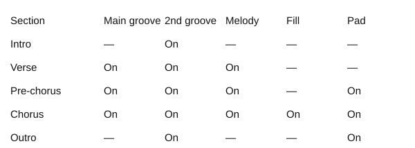

# Pixel Studio Songwriting Lab｜Songwriting in eight lessons: handbook and lesson plans

Taught by Leo Lee, Pixel Studio｜Source materials: Pixel Studio's "Pop Music Program: Songwriting" course outline, Introduction to Songwriting, the 2011 Session 4 and Session 5 lecture materials, and the songwriting class materials of a pop music incubator; reorganised and revised in 2026.

## Overview

Pop music began with the blues, and over a hundred years it turned the whole world's music upside down and blended it together. In the 1950s Taiwan took in a great deal of American pop culture and later became a centre of Mandarin pop, yet Chinese-language songwriting materials have always been scarce. This handbook organises songwriting into a system, hoping to help students clear up their questions about the craft.

The course has eight lessons of 180 minutes, 24 hours in all. Each group starts by settling a theme in Lesson 1, builds up the same "song planning card" lesson by lesson, and in Lesson 8 presents a complete song with words, music, arrangement and a demo.

### Teaching goals

1. Understand the basic methods and structure of pop songwriting, and develop your ideas about writing words and music.
2. Analyse the motifs, form, sequences and meaning of pop songs to sharpen your ability to critique and appreciate music.
3. Through writing practice and discussion, build an objective, fair and professional attitude to songwriting.
4. Discuss and remake a variety of cases to spark a culture of writing and healthy competition.

### Eight-lesson schedule

| Lesson | Topic | Syllabus unit | Core content | Song progress |
| --- | --- | --- | --- | --- |
| 1 | First steps in songwriting | 1. First steps in songwriting | Levels of writing, settling a theme, sources of material, choosing material, arranging and combining, repackaging | Theme, title, point of view |
| 2 | Introduction to songwriting and song form | 2. Introduction to songwriting; 3. A songwriting picture book | Music theory basics, what pop music is, developing motifs, the pop song formula, the chorus | Form chart |
| 3 | Lyric writing (1): from poems to lyrics | 4. Lyric writing | The four great forms of verse, how lyrics differ from poems, writing vs. setting lyrics, tones, rhymes | Verse lyrics |
| 4 | Lyric writing (2): rhetoric and lyricists | 4. Lyric writing | Twenty-three figures of speech, eighteen lyricists, nine taboos, fixing lyrics | Full lyrics |
| 5 | Melody writing (1): motifs and chords | 5. Melody writing | Instrumental pieces vs. songs, composing vs. setting music, scales, melodic contour, chord progressions | Chorus melody |
| 6 | Melody writing (2): melody and vocals | 5. Melody writing; 6. Melody and vocals | Composers, critiquing examples, full and usable range, pitch points, choosing and changing key | Full melody, vocal demo |
| 7 | Arranging: music's magician | 7. Music's magician | Preparing to arrange, the five elements, vocals and arrangement, recording and mixing | Instrumentation, backing |
| 8 | Workshop and final showcase | 8. Songwriting workshop; 9. Final showcase | Revision feedback, weighing criticism, in-class editing, final showcase, term review | Presenting the song |

### The shared flow of each 180-minute lesson

| Section | Time | Content |
| --- | --- | --- |
| Open | 25 minutes | Review last week's work, answer exit-ticket questions, lead into the topic |
| Build | 55 minutes | New ideas, listening to examples and quizzes |
| Break | 10 minutes | Break, have a drink |
| Turn | 60 minutes | Group writing, hands-on with tools, peer review |
| Close | 30 minutes | Save to the song planning card, three-sentence summary, exit ticket, practice after class |

### Equipment

- Classroom projector and sound system; a piano, keyboard or guitar for demonstrating chords and melodies
- Students' phones: scan the slide QR codes to use the material bank, rhyme checker, motif lab, chord progressions and recording alongside
- Headphones and a quiet recording space (for recording demos in Lessons 6, 7 and 8)

### Assessment

The original course named its grade items after song sections, reminding students that the eight lessons build one and the same song.

| Item | Weight | Content |
| --- | --- | --- |
| Verse | 25% | Song planning card and in-class work: staged results for theme, form, lyrics and melody |
| Chorus | 35% | Final project: the Lesson 8 showcase |
| Hook | 30% | Attendance and participation: pre-class surveys, exit tickets, group tasks |
| Tag | 10% | Other contributions: peer review, helping group members, writing after class |

### Song planning card

The song planning card comes from the "Lyric Writing And Compose Sample Form". Its fields cover the title, lyricist, composer, arranger, time signature, key, tempo, range, groove, rhyme scheme and rhymes, point of view, subject and story, hook, section structure, instrumentation, and each section's lyrics and rhetoric. All eight lessons share one card; the data stays on the student's own device, and can be downloaded as a text file or sent to the teacher.

### Principles for class activities

- Keep new ideas within 55 minutes, and leave the rest of the time for writing and discussion
- Every lesson has a "song progress" step saved to the planning card, and the next lesson picks up from there
- Listen to examples first, then analyse the techniques, and finally write; all art begins with imitation, and what you imitate is technique and structure
- Lyric examples quote only the short phrases the analysis needs; listen to the official videos for the full songs

<!-- learning-notes-start -->
### Skill route and practice logs

[Open the course map](index.html#lessons) to see each lesson's suggested preparation and homework, tick off what you've finished and expand the route overview. The website's practice chart uses the original seven-day table, leaves missing values blank, and shows seconds, counts and minutes separately. The PDF keeps this table as a paper record with no sample scores filled in.

<!-- learning-notes-end -->

## Lesson 1｜First steps in songwriting

Goals: explain the levels of writing and understand how songs move between commerce and art; settle a song's theme from three directions: everyday material, emotional appeal and wider issues; build your own banks of words, lines and melodies, and learn to choose the right material; before the end of class, every group makes the first entry on its song planning card: title, theme and hook.

### Pre-class survey (joining the class)

- Instruments you play
- Songwriting experience
- Music you can read
- Rate yourself (1 to 5)
- The music you listen to most
- Your three favourite singers or songwriters
- The kind of theme you most want to write about
- The one thing you most hope to achieve by the end of the eight lessons

### Lesson outline (180 minutes)

| Section | Time | Content | Slide |
| --- | --- | --- | --- |
| Open | 00:00–00:25 | A song often begins with one moment in everyday life; the hardest part of writing a song; input, then output; each lesson finishes one part of your song | 3–6 |
| Build | 00:25–01:20 | Writing always has a starting point, and each one differs; over time, art and commerce swap places; commissioned work: writing the client's keywords into the lyrics; myth or fact?; everyday material: the most ordinary days strike the strongest chord; emotional appeal: family, friendship, love; wider issues: from the people around you out to the whole world; which direction does this theme belong to?; which direction does the teacher's song belong to?; once the theme is settled, decide what the song sounds like; words first or music first: there's no rule; writing vs. setting lyrics, composing vs. setting music | 7–18 |
| Break | 01:20–01:30 | 10-minute break | 19 |
| Turn | 01:30–02:30 | Build your own banks of words, lines and melodies; good or bad material comes down to whether it fits; the song formula; the hook: the part you can't forget after one listen; the record industry's eight production stages; without looking back, put the eight stages in order; each group takes a direction and finishes one song over the eight lessons; topic dice: when inspiration won't come, roll once first | 20–27 |
| Close | 02:30–03:00 | Three taboos and three goals of writing; song planning card: title, theme, point of view, hook; write your 3-2-1 before you leave | 28–31 |
| Wrap up | After class | Three-line summary, exit ticket, practice after class and next lesson preview | 30、32、33、34 |

### Extended notes: foreword

In life, big things and small, anything that carries a feeling is worth keeping. Some people record it all in photos, drawings or video; people who love music choose music to record the details of their lives.

Students often ask me, "Leo, how do I write a song?" Writing a song isn't hard. What's hard is building sharp powers of observation in daily life, and training yourself to record things faster and more efficiently. Hardest of all is carrying that feeling, that moment of being moved, across whole into the listener's ears, and even their heart.

Think of writing as input and output: news, conversations, travel and a lovely melody are all inputs. Once information enters your mind and is interpreted, analysed, sorted and arranged, out come the words and melodies we need. Imitating the songwriters you love, finding your direction in their work and then developing a style of your own is the safest way into songwriting.

### Extended notes: levels of writing

| Level | Contrast |
| --- | --- |
| Formal and informal | Classical theory-based composition, modern commercial songwriting; regulated verse and modern poetry |
| Subjective and objective | Self and audience, art and science, differences between East and West |
| Commerce and art | Today's art, tomorrow's commerce (Kuo Ying-nan, ChthoniC); today's commerce, tomorrow's art (Michael Jackson, Teresa Teng) |

### Extended notes: settling a theme

| Direction | Scope | Example songs |
| --- | --- | --- |
| Everyday material | Food, clothing, home, getting around, school, fun; who, what, when, where, which object | Crowd Lu 〈早安，晨之美！〉 |
| Emotional appeal | Family, friendship, love | 〈阿嬤的話〉, 〈朋友〉, 〈家後〉, 〈月亮代表我的心〉 |
| Wider issues | The crowd, society, country, the world | Little Chung 〈紅花雨〉, 〈手牽手〉, U2 〈With Or Without You〉, Bob Dylan 〈Knockin' On Heaven's Door〉 |

Once the theme is settled, decide the overall style: melody (traditional, pentatonic or blues scales), harmony (harmonic layout, chord writing) and rhythm (sharing out the groove, rhythmic patterns and styles).

### Extended notes: sources, choosing and packaging material

- The three elements of music: melody, harmony, rhythm; a song's fourth element: lyrics that set the scene. There's no rule about words or music first.
- Writing lyrics: write words following a song's form; setting lyrics: fit words to an existing melody. Composing: write a melody directly; setting music: write music for existing lyrics.
- Gathering everyday material: build banks of words, lines and melodies, indexed by theme and rhyme.
- Choosing material: better material is like musical tones, whether the wording is ornate or plain; weaker material is like noise, extra filler and lines that don't fit. Good or bad comes down to whether it fits the logic, the scene, the rhetoric and the delivery.
- Arranging and combining: the pop song formula; open, build, turn, close; building the emotion (telling, stronger, intense, realisation, calm, released); the hook (lyric hooks like 〈我要快樂〉 and 〈就是愛你〉; musical hooks like the Canon).
- Repackaging: the record industry's eight production stages: A&R planning, songwriting, choosing a style, arranging, recording, audio editing, mixing, mastering.

### Extended notes: three taboos and three goals of writing

| Three taboos | Three goals |
| --- | --- |
| Wanting your very first song to be a classic | Finish the song |
| Pushing on and on, forgetting the good melody you hummed earlier | Hum the melody clearly |
| Writing a section only when inspired, in fits and starts, with no structure | Always record it |

### Class activities (website slides)

| Slide | Activity | Content |
| --- | --- | --- |
| 2 | Phone sync | Today's route: from one idea to a song planning card |
| 3 | Show-of-hands vote | A song often begins with one moment in everyday life |
| 8 | Predict, then reveal | Over time, art and commerce swap places |
| 9 | Keyword hunt | Commissioned work: writing the client's keywords into the lyrics |
| 10 | Myth-busting · flip cards | Myth or fact? |
| 11 | Song listening · YouTube | Everyday material: the most ordinary days strike the strongest chord |
| 12 | Song listening · YouTube | Emotional appeal: family, friendship, love |
| 13 | Song listening · YouTube | Wider issues: from the people around you out to the whole world |
| 14 | Multiple choice | Which direction does this theme belong to? |
| 15 | Multiple choice | Which direction does the teacher's song belong to? |
| 20 | Material bank | Build your own banks of words, lines and melodies |
| 23 | Song listening · YouTube | The hook: the part you can't forget after one listen |
| 25 | Ordering game | Without looking back, put the eight production stages in order |
| 26 | Random pick | Each group takes a direction and finishes one song over the eight lessons |
| 27 | Topic dice · section timer | Topic dice: when inspiration won't come, roll once first |
| 29 | Song planning card | Song planning card: title, theme, point of view, hook |
| 31 | Exit ticket 3-2-1 | Before you leave, write down 3-2-1 |
| 32 | Self-directed log | Seven days of material: ten minutes a day |
| 33 | Self-directed tracking | Practice after class: tap once to tick each item you finish |
| 34 | Pre-class survey | Lesson 2: Introduction to songwriting and song form |

### Practice after class

- [ ] Build up at least five items each in your word, line and melody banks
- [ ] Choose a song you love and find its theme direction and hook
- [ ] Confirm the theme with your group and fill in the title, point of view and theme on the planning card
- [ ] Record a melody you hum on your phone, any length
- [ ] Fill in the Lesson 2 pre-class survey

## Lesson 2｜Introduction to songwriting and song form

Goals: understand note names, solfège, numbered notation, note values and strong and weak beats; explain five techniques for developing a melody: motif, repetition, sequence, variation and linking; tell apart the intro, verse, pre-chorus, chorus, interlude, bridge, outro and ending; before the end of class, every group lays out its song's structure with the song form blocks.

### Pre-class survey

- Words and lines added to your material bank this week
- The theme your group agreed on
- How familiar you are with numbered notation, time signatures and note values
- Song sections you can tell apart
- A song whose chorus you remembered after one listen

### Lesson outline (180 minutes)

| Section | Time | Content | Slide |
| --- | --- | --- | --- |
| Open | 00:00–00:25 | How much has your material bank grown this week?; listen to 〈十年〉: where does the emotion rise? | 3–4 |
| Build | 00:25–01:20 | Note names, solfège and numbered notation; note lengths decide how a melody breathes; strong and weak beats give a melody its groove; pop music: simplify complicated theory so music belongs to everyone; motif, repetition, sequence, variation, linking; motif lab: tap the grid to rewrite the motif, then apply a development technique; which development technique is this? | 5–11 |
| Break | 01:20–01:30 | 10-minute break | 12 |
| Turn | 01:30–02:30 | How a song opens: intro and verse; the pre-chorus builds the heat, the chorus releases it; interlude and post-chorus (bridge); the outro lets the emotion out, the ending leaves an afterglow; put the sections of the pop song formula in order; lyric reorder: work out the sections from the lyrics and put them back in order; song form blocks: lay out sections, check the order, watch the energy curve; each group takes a song and marks its sections and hooks; six ways to start a set of lyrics; before you write, settle the song's subject | 13–23 |
| Close | 02:30–03:00 | Lay out your song's form, then save it to the planning card; song planning card: time signature, tempo, groove and section structure; write your 3-2-1 before you leave | 24–27 |
| Wrap up | After class | Three-line summary, exit ticket, practice after class and next lesson preview | 17、26、28、29 |

### Extended notes: music theory basics

| Note names | C | D | E | F | G | A | B |
| --- | --- | --- | --- | --- | --- | --- | --- |
| Solfège | Do | Re | Mi | Fa | Sol | La | Si |
| Numbered notation | 1 | 2 | 3 | 4 | 5 | 6 | 7 |

- Mi to Fa and Ti to Do are a half step apart; all other neighbouring notes are a whole step apart. The major scale's pattern is "whole, whole, half, whole, whole, whole, half".
- The bottom number of a time signature says which note gets one beat; the top says how many beats are in a bar. In 4/4 a quarter note gets one beat, four beats to a bar.

| Note | Length (quarter note = 1) |
| --- | --- |
| Whole note | 4 |
| Half note | 2 |
| Quarter notes | 1 |
| Eighth notes | ½ |
| Sixteenth note | ¼ |

### Extended notes: feeling the groove

| Metre | 1 | 2 | 3 | 4 | 5 | 6 | 7 | 8 |
| --- | --- | --- | --- | --- | --- | --- | --- | --- |
| Duple | Strong | weak | | | | | | |
| Triple | Strong | weak | weak | | | | | |
| Quadruple | Strong | weak | Medium | weak | | | | |
| Six beats | Strong | weak | weak | Medium | weak | weak | | |
| Eight beats | Strong | weak | Medium | weakest | Strong | weak | Medium | weakest |

Designing the groove gives a melody more depth. Put important words on strong beats and filler words on weak ones; move the accent in the same lyric line and the emotion changes with it.

### Extended notes: ways to develop a melody

| Technique | How it's done | Example (numbered notation) |
| --- | --- | --- |
| Motif | A short, distinctive figure | 1 2 3 5 |
| Repetition | The same motif comes back again | 1 2 3 5｜1 2 3 5 |
| Sequence | Same shape, moved up or down as a whole | 1 2 3 5｜2 3 4 6 |
| Variation | Inversion, retrograde, augmentation, diminution | Retrograde: 5 3 2 1 |
| Linking | String several motifs together and land back on the tonic | 1 2 3 5｜7̣ 1 2 1 |

### Extended notes: analysing the form of a pop song

| Section | Function | Character | Order |
| --- | --- | --- | --- |
| Intro | Leads into the verse, announces the song, sets the mood | Often the instrumental hook; four to eight bars, often a changed chorus or verse melody | Nothing comes before the intro (except an album overture), and the verse always follows it |
| Verse | Tells the story and warms the song up | Busier words and a calmer plot; a plainer tune, usually two verses that set the key and rhyme | Can lead to the pre-chorus or chorus, and can be reached from the intro or interlude |
| Pre-chorus | Adds the feelings the verse hasn't finished, building the heat | Syllable count and metre differ from the verse and it can change rhyme; the tune rises and the groove is lively; no more than eight bars | Always leads to the chorus; can be left out when the verse has enough momentum |
| Chorus | The most heated moment, releasing the energy | Easy to remember and hum, with crisp rhymes and no change of rhyme between choruses; the instruments' energy and density peak; often uses a classic chord progression | The first chorus is often followed by an interlude, the second by a bridge and then back to the chorus |
| Interlude | A buffer between two big sections that strengthens the instrumental hook | Often an instrumental solo of four to eight bars; often changes key for a turn | Follows a chorus, and can lead back to the verse or pre-chorus |
| Post-chorus / bridge | A more forceful addition after the chorus: the answer, the letting go | Two to four bars; the tempo can go to half or double time | Follows a chorus or interlude, and always leads back to the chorus |
| Outro | Lets the emotion out before the song ends | The instruments gradually wind down; ideally stop on the dominant | Follows the second or third chorus, and always leads to the ending |
| Ending | Finishes the song and extends the afterglow | Full stop, ritardando, fade out, improvised, unison figure, sudden stop | The last section |

### Extended notes: six ways to start a set of lyrics

1. Start from a theme or a mood and tell it from the beginning.
2. A line or a few lovely words come in a flash, then extend before and after.
3. Write words over a finished melody or backing.
4. Tell it in sections: plan each section's plot and how they connect first.
5. No theme, no limits: write down whatever comes, then sort it out slowly.
6. Words and music together, each fitting the other.

Before you write, settle the song's subject: the lyrical theme, the genre, the tempo, and whether a male voice, female voice or group will sing it.

### Class activities (website slides)

| Slide | Activity | Content |
| --- | --- | --- |
| 2 | Phone sync | Today's route: draw the first form chart for your song |
| 3 | Show-of-hands vote | How much has your material bank grown this week? |
| 4 | Listening · emotion map | Listen to 〈十年〉: where does the emotion rise? |
| 10 | Motif lab | Motif lab: tap the grid to rewrite the motif, then apply a development technique |
| 11 | Multiple choice | Which development technique is this? |
| 18 | Ordering game | Put the sections of the pop song formula in order |
| 19 | Lyric reorder | Lyric reorder: work out the sections from the lyrics and put them back in the original order |
| 20 | Song form blocks | Song form blocks: lay out the sections, check the order, watch the energy curve |
| 21 | Group task · section timer | Each group takes a song and marks its sections and hooks |
| 24 | Song form blocks · song planning card | Lay out your song's form, then save it to the song planning card |
| 25 | Song planning card | Song planning card: time signature, tempo, groove and section structure |
| 27 | Exit ticket 3-2-1 | Before you leave, write down 3-2-1 |
| 28 | Self-directed tracking | Practice after class: tap once to tick each item you finish |
| 29 | Pre-class survey | Lesson 3: Lyric writing (1): from poems to lyrics |

### Practice after class

- [ ] Choose a song you love, lay out its structure with the song form blocks, and note each section's bar count
- [ ] Write a four-beat motif in the motif lab, apply sequence and inversion, and record it
- [ ] Confirm your song's form chart with your group and save it to the planning card
- [ ] Write the first line of your chorus as your song's hook
- [ ] Fill in the Lesson 3 pre-class survey

## Lesson 3｜Lyric writing (1): from poems to lyrics

Goals: explain how the metrical rules differ across Han fu, Tang poems, Song ci, Yuan qu and modern poetry; tell writing lyrics from setting them, and understand how singability relates to tones; choose rhymes by their Zhuyin finals, and explain one rhyme throughout and three ways of changing rhyme; before the end of class, every group finishes an eight-line first verse draft and checks its rhymes with the rhyme checker.

### Pre-class survey

- How complete your song's form chart is
- The chorus's first line or hook
- How often you read classical poetry
- How confident you are with rhyme
- What worries you most when writing lyrics

### Lesson outline (180 minutes)

| Section | Time | Content | Slide |
| --- | --- | --- | --- |
| Open | 00:00–00:25 | How far has your form chart got?; Su Shi, 〈江城子・乙卯正月二十日夜記夢〉 | 3–4 |
| Build | 00:25–01:20 | The four great forms of Chinese verse, and modern poetry; yuefu, ancient-style poems, regulated verse and modern poetry; Song ci and Yuan qu; seeing classical verse again in the language of pop music; the metre of verse; writing lyrics makes standalone words, setting lyrics makes words for a tune; Mandarin has four tones, and the melody should follow each character's direction | 5–11 |
| Break | 01:20–01:30 | 10-minute break | 12 |
| Turn | 01:30–02:30 | Common rhymes sorted by Zhuyin final; four rhyme strategies; rhyme fill-in: the chorus of 〈El Nino〉; which word doesn't belong in lyrics with one rhyme throughout?; rhyme checker: mark each line's ending rhyme; use the rhyme checker to analyse the rhyme strategy of 〈微型鳳凰〉; who's speaking, and to whom; finish an eight-line first verse draft: two sections, each with its own rhyme; each group reads its verse aloud and the other groups score it | 13–21 |
| Close | 02:30–03:00 | Song planning card: rhyme scheme and verse; write your 3-2-1 before you leave | 22–24 |
| Wrap up | After class | Three-line summary, exit ticket, practice after class and next lesson preview | 23、25、26 |

### Extended notes: the four great forms of Chinese verse, and modern poetry

| Form | Format | Rhyme |
| --- | --- | --- |
| Han fu | Ge and xing, with no limit on characters or lines, mostly five or seven characters per line | Can change rhyme |
| Tang poems | Regulated verse: quatrains and eight-line poems, with a fixed number of characters | One rhyme throughout |
| Song ci | Short, medium and long tunes, with uneven line lengths | Can change rhyme |
| Yuan qu | Sanqu and opera songs, with set line patterns that allow filler characters | Can't change rhyme |
| Modern | Modern, vernacular and free verse | No limits on form or rhyme |

| Metre | Quatrain | Eight-line regulated | Modern |
| --- | --- | --- | --- |
| Lines | 4 lines | 8 lines | No limit |
| Length | 20 for five-character, 28 for seven-character | 40 for five-character, 56 for seven-character | No limit |
| Rhyme | Even lines rhyme, the first line optionally, one rhyme throughout | Even lines rhyme, one rhyme throughout | No limit |
| Tonal pattern | Characters 1, 3 and 5 are free; 2, 4 and 6 must follow the pattern | Characters 1, 3 and 5 are free; 2, 4 and 6 must follow the pattern | No limit |
| Parallelism | No limit | The second and third couplets are parallel | No limit |

### Extended notes: Song ci and Yuan qu

| | Song ci | Yuan qu |
| --- | --- | --- |
| Other names | Song lyrics, long-and-short lines, "poetry's remainder" | Yuefu (sanqu) |
| Tunes | Cipai (ci tunes) | Qupai (qu tunes) |
| Rhyme | Some change rhyme, some keep one rhyme; the four tones don't rhyme with each other | One rhyme throughout, all four tones may rhyme |
| Language | Elegant and restrained | Everyday and lively |
| Line | Follows the ci pattern, no filler characters | Allows filler characters, more flexible |

- Song ci carried on the spirit of Han and Wei yuefu, absorbed the influence of music from the northern peoples, and grew out of folk song; ci could be called poetry set free.
- Yuan qu evolved from ci, blending the street songs of the north with foreign tunes, combining metre and freedom. Sanqu were only sung without staging, also called "pure songs"; zaju mixed in dialogue and stage directions and were mainly for acting out stories.
- Poems have strict metre and give less thought to singability; ci have a loose form, written much like "writing lyrics" in pop; qu add filler characters, are the most singable, and are written much like "setting lyrics" in pop. Sanqu are like a single; opera songs are like an album or a musical.

### Extended notes: writing vs. setting lyrics

- Writing lyrics: words that stand on their own, written following a pop song's form and not necessarily singable; groove and sound need extra thought when the music is written.
- Setting lyrics: words written for a tune, following its sounds to make it more singable; take the melody's contour and pitch into account to reduce clashes between words and music; placing the hook is key, echoing the title where needed.
- Tones: in Mandarin the 1st tone is high and level, the 2nd rises, the 3rd dips then rises, and the 4th falls. For words on strong beats and long notes, keep the tone following the melody's direction as much as you can, to avoid tone clashes.

### Extended notes: basic rhymes

| Final | Common rhymes |
| --- | --- |
| ㄚ | 嗎、啊、他、花、回答、傷疤、牽掛、炎夏、抵達、尷尬、謊話、太傻、害怕 |
| ㄧ ㄩ | 你、意、雨、東西、抗拒、呼吸、空氣、可惜、天際、情侶、飄逸、伏筆、美麗 |
| ㄨ | 路、反覆、清楚、恍惚、結束、痛苦、相處、幸福 |
| ㄠ | 好、少、要、鬧、呵護、知道、明瞭、美好 |
| ㄝ ㄟ | 鐵、貼、會、喜帖、心碎、喝醉、歲月、完美、虛偽、摧毀、結尾 |
| ㄛ ㄡ | 我、國、酒、錯、頭、沉默、寂寞、錯過、看破、所有、承諾、分手、折磨、寄託 |
| ㄣ ㄥ | 吻、恨、人、聲、責任、天份、飛行、繁星、決心、心情、安靜、靠近、絕境、表情、安穩 |
| ㄜ | 了、的、個、樂、割捨、選擇、如何、顏色 |
| ㄞ ㄢ | 緩慢、蔚藍、一半、飄散、難堪、黑白、忍耐、戀愛、喜歡、絢爛、期盼、離開、等待、勇敢、溫暖、循環、浪漫 |
| ㄤ | 成長、嚮往、遠方、碰撞、淚光、模樣、綑綁、阻擋、珍藏、期望、冤枉、原諒、翅膀 |
| Empty rhyme | 字、知、癡、詩、靜止、手指、瑕疵、自私、意識、掩飾、計時 |

### Extended notes: one rhyme throughout vs. changing rhyme

| Strategy | Effect | Example songs |
| --- | --- | --- |
| One rhyme throughout | Every line rhymes, very rhythmic; the choice of rhymes is limited, so it gets harder | Lin Xi 〈想哭〉, Vincent Fang 〈青花瓷〉, Shih Yi-lang 〈曲終人散〉 |
| Rhyme changes at breaks | Change rhyme as the tone of voice shifts | Tengjingshu 〈當冬夜漸暖〉, Lin Xi 〈愛情轉移〉 |
| Rhyme changes by section | The mood shifts section by section | Wawa 〈流沙〉, Lee Cheuk-hung 〈愛〉 |
| Free rhyme | Less rhythmic and riskier | Jay Chou 〈白色風車〉 |

### Class activities (website slides)

| Slide | Activity | Content |
| --- | --- | --- |
| 2 | Phone sync | Today's route: land your verse's first rhyme |
| 3 | Show-of-hands vote | How far has your form chart got? |
| 9 | Multiple choice | The metre of verse |
| 11 | Predict, then reveal | Mandarin has four tones, and the melody should follow each character's direction |
| 14 | Song listening · YouTube | Four rhyme strategies |
| 15 | Rhyme fill-in | Rhyme fill-in: the chorus of 〈El Nino〉 |
| 16 | Multiple choice | Which word doesn't belong in lyrics with one rhyme throughout? |
| 17 | Rhyme checker | Rhyme checker: mark each line's ending rhyme |
| 18 | Rhyme checker | Use the rhyme checker to analyse the rhyme strategy of 〈微型鳳凰〉 |
| 20 | Rhyme checker · section timer | Finish an eight-line first verse draft: two sections, each with its own rhyme |
| 21 | Group scoring | Each group reads its verse aloud and the other groups score it |
| 22 | Song planning card | Song planning card: rhyme scheme and verse |
| 24 | Exit ticket 3-2-1 | Before you leave, write down 3-2-1 |
| 25 | Self-directed tracking | Practice after class: tap once to tick each item you finish |
| 26 | Pre-class survey | Lesson 4: Lyric writing (2): rhetoric and lyricists |

### Practice after class

- [ ] Choose a song you love, analyse its verse and chorus with the rhyme checker, and work out its rhyme strategy
- [ ] Pick two of the eleven rhyme groups, collect ten words for each, and add them to the word bank
- [ ] Read your first verse draft aloud and fix at least two lines that don't flow
- [ ] Try humming a melody for your verse's first line, and record it
- [ ] Fill in the Lesson 4 pre-class survey

<!-- learning-notes-start -->

<h3>Interactive practice and diagrams</h3><h4>Tones and melody</h4>
The direction of the tones and of the melody can be overlaid and compared; where they differ, go back to the meaning and sing the whole line, rather than judging from the curves alone.
<figure class="learning-print"><figcaption>Tones and melody｜Key views</figcaption></figure>
<a href="s03/#11">Open the interactive practice</a>

<!-- learning-notes-end -->

## Lesson 4｜Lyric writing (2): rhetoric and lyricists

Goals: recognise common figures of speech in pop lyrics and explain their effects; meet eighteen contemporary Mandarin lyricists and their best-known work; check your own lyrics against the nine taboos and the fix-it list; before the end of class, every group finishes its pre-chorus, chorus and tag and saves them to the planning card.

### Pre-class survey

- How complete your first verse draft is
- The rhyme strategy your song uses
- Figures of speech you already know
- A lyric line that struck you, found before class
- The Mandarin lyricist you'd most like to learn about

### Lesson outline (180 minutes)

| Section | Time | Content | Slide |
| --- | --- | --- | --- |
| Open | 00:00–00:25 | A lyric line that struck you; twenty-three figures of speech in five families | 3–4 |
| Build | 00:25–01:20 | Exclamation, rhetorical question, apostrophe, metaphor, transference, symbolism, metonymy, hyperbole, sensory description, contrast, antithesis, parallelism, repetition, climax, anadiplosis, palindrome, allusion, parody, pun, irony, two-part allegorical saying, inversion, alliteration and assonance; as you listen, find at least two figures of speech; which figure of speech does this line use?; two more challenges; rhetoric hunter (1): three love songs by the teacher; rhetoric hunter (2): commissioned work and issue songs | 5–16 |
| Break | 01:20–01:30 | 10-minute break | 17 |
| Turn | 01:30–02:30 | Eighteen lyricists, eighteen personalities in words; meet the lyricists; three directions for writing lyrics; flip the cards and check them against your own lyrics; the fix-it list; finish the pre-chorus, chorus and tag; lyric writing dice: roll words and lines, then write the next line | 18–24 |
| Close | 02:30–03:00 | Each group reads its full lyrics aloud and the other groups find the figures of speech and taboos; song planning card: title, hook and rhetoric; write your 3-2-1 before you leave | 25–28 |
| Wrap up | After class | Three-line summary, exit ticket, practice after class and next lesson preview | 27、29、30 |

### Extended notes: twenty-three figures of speech

| Figure | Definition | Pop lyric example |
| --- | --- | --- |
| Exclamation | Uses interjections and particles to show surprise, sorrow, regret or hope | Vincent Fang 〈說好的幸福呢〉: 怎麼了 你累了 說好的幸福呢 |
| Rhetorical question | Turns suddenly from statement to question to catch attention and make the other person reflect | Lee Cheuk-hung 〈愛〉: 你還記得嗎 記憶裡的炎夏 |
| Allusion | Borrows famous sayings, classical references or proverbs to persuade | Qing Feng 〈小情歌〉: 寫下我 度秒如年難捱的離騷 |
| Hyperbole | Goes beyond the facts to deepen the impression | Wawa 〈天天〉: 我的心已經飛到這個城市的另一邊 |
| Metaphor | Uses one thing to describe another, the known to explain the unknown | Wawa 〈流沙〉: 愛情好像流沙 我不掙扎 |
| Transference | Objects as people, people as objects, the abstract made concrete | Lin Xi 〈愛情轉移〉: 愛情不停站 想開往地老天荒 |
| Contrast | Puts opposite ideas side by side; the stronger the contrast, the sharper the impression | Yang Li-te 〈他不愛我〉: 牽手的時候太冷清 擁抱的時候不夠靠近 |
| Repetition | Repeats the same word in a row | Wawa 〈天天〉: 天天說 天天說 |
| Antithesis | Two lines with the same number of characters and similar syntax | Lin Chiu-li 〈剪愛〉: 人變了心 言而無信 人斷了情 無謂傷心 |
| Parallelism | Three or more lines in a row presenting images of the same kind | Yao Chien 〈我願意〉: 我願意為你 我願意為你 |
| Metonymy | Puts something related in place of the real name | Shih Yi-lang 〈曲終人散〉: 你最後一身紅 |
| Symbolism | Uses concrete images to express abstract feelings | Lee Cheuk-hung 〈愛〉: 沒結果的花 未完成的牽掛 |
| Two-part allegorical saying | The first half makes a comparison, the second half explains it | Hsu Chang-te 〈婚禮的祝福〉: 我乾杯你隨意 |
| Sensory description | Depicts the sounds, colours and states of things | Vincent Fang 〈青花瓷〉: 天青色等煙雨 而我在等妳 |
| Climax | Arranges things layer by layer by depth, order or size | Jay Chou 〈星晴〉: 一步兩步三步四步望著天 |
| Alliteration and assonance | Uses words that share initials or finals to strengthen the rhythm | Vincent Fang 〈雙截棍〉: 快使用雙截棍 哼哼哈兮 |
| Irony | Says the opposite of what's meant to express what's meant | Tom Chang 〈動物的悲歌〉: 這個家園充滿芬芳的青草 |
| Apostrophe | Calls out and talks directly to someone who isn't there | Yao Jo-lung 〈分手快樂〉: 分手快樂 祝你快樂 |
| Parody | Swaps words in a familiar phrase to say something new | Song and album titles: 陽光宅男, 無樂不作, 魔杰座 |
| Pun | Uses a word's multiple meanings or a sound-alike to create a double meaning | Lin Xi 〈想哭〉: 你說水星它沒有衛星好孤獨 |
| Anadiplosis | The end of one line becomes the start of the next | Ding Hsiao-wen 〈祝福〉: 說再見 再見不會太遙遠 |
| Palindrome | Mostly the same words, in exactly reversed order | Chen Hsiao-chuan 〈葉子〉: 孤單是一個人的狂歡 狂歡是一群人的孤單 |
| Inversion | Deliberately reverses normal word order | Vincent Fang 〈青花瓷〉: 如傳世的青花瓷自顧自美麗 |

### Extended notes: contemporary Mandarin lyricists

| Lyricist | Background | Best-known work |
| --- | --- | --- |
| 楊立德 | Graduated from Shih Hsin University's Department of Radio and Television; formerly a creative planner at record labels | 愛人、奉獻、你看你看月亮的臉、他不愛我 |
| 娃娃 | Born Chen Yu-chen; formerly A&R director at a record label | 就是愛你、天天、流沙、今天你要嫁給我 |
| 陳克華 | Poet, ophthalmologist and photographer; his lyrics won the Golden Tripod Award | 台北的天空、沉默的母親、九月的高跟鞋 |
| 林秋離 | Best Lyricist at the 4th Golden Melody Awards, with over seven hundred songs | 哭砂、剪愛、聽海、天黑、曹操 |
| 丁曉雯 | Formerly a singer, record producer and Golden Melody Awards judge | 你是我胸口永遠的痛、青蘋果樂園、祝福 |
| 何厚華 | Formerly an executive at several record labels, planning nearly a hundred albums | 今生註定、願蒼天變了心、有多少愛可以重來 |
| 陳樂融 | Three times nominated for Best Lyricist at the Golden Melody Awards | 瀟灑走一回、天天想你、對你愛不完 |
| 鄔裕康 | Formerly an executive at several record labels | 原來你什麼都不要、我要快樂、忠孝東路走九遍 |
| 廖瑩如 | Formerly a label's planner and A&R director | 天黑黑、逆光、值得 |
| 姚謙 | Formerly general manager at several record labels; Taiwan's "star maker" | 我願意、味道、我多麼羨慕你、如果愛 |
| 厲曼婷 | Formerly a magazine editor-in-chief and record label executive | 倆倆相忘、離人、有一點動心 |
| 許常德 | Over a thousand lyrics, skilled in both Mandarin and Taiwanese | 婚禮的祝福、無字的情批、一天到晚游泳的魚 |
| 十一郎 | Born Hsiao Hui-wen; a long-time partner of Phil Chang | 曲終人散、傘下、用心良苦、趁早 |
| 方文山 | Best Lyricist at the Golden Melody Awards for 〈威廉古堡〉 and 〈青花瓷〉 | 青花瓷、東風破、七里香、倒帶 |
| 林夕 | Best Lyricist at the Golden Melody Awards for 〈臉〉 and 〈開門見山〉 | 十年、想哭、愛情轉移、我最親愛的 |
| 李焯雄 | Best Lyricist at the 14th Golden Melody Awards for 〈愛〉 | 愛、盛夏的果實、暖暖、可惜不是你 |
| 姚若龍 | Best Lyricist at the Golden Melody Awards for 〈最浪漫的事〉 and 〈永遠相信〉 | 分手快樂、勇氣、你把我灌醉 |
| 武雄 | A freelance lyricist who promotes writing and Taiwanese culture | 一了百了、子曰、點煙 |

The lyricists' careers are summarised from the 2011 lecture materials; for current information, go by each lyricist's public profile.

### Extended notes: conclusions and advice

- Settle your theme and market direction: pop music is an art of conversation and a reflection of its era. Find the question, find the material, find the answer; the answer is what you really want to say, then tell the story step by step. Check whether the song can stand up to public scrutiny and comment.
- Make good use of rhetoric and tools: package the title and hook with care; keep a dictionary, a word bank and a line bank sorted by sound; collect words and lines all the time, connect your ideas, and give them a good name.
- All art begins with imitation: understand a pop song's sections and formats, analyse lyricists' techniques and rhetoric, and read widely across every kind of literature.

### Extended notes: the nine taboos of lyrics

1. Missing the sections or form a song needs.
2. No clear, eye-catching title.
3. No hook.
4. Too many lines nobody would actually say.
5. Too many archaic characters or expressions.
6. Using words that can't be sung.
7. A story in the lyrics that doesn't develop.
8. Ideas that are too negative or extreme.
9. Too much private inner life or self-absorption.

### Extended notes: always be ready to fix your lyrics

- Are the language and lines appropriate, logical and building step by step? Will the lines stand the test of time?
- How singable the words are; is the repeated hook landing?
- Avoid forced rhymes, and avoid wavering ideas (the person and stance always changing).
- Learn to weigh others' criticism: expert, amateur, malicious, jealous, or sincere and positive.
- Judge when to rewrite to make the facts more engaging and more moving.

### Class activities (website slides)

| Slide | Activity | Content |
| --- | --- | --- |
| 2 | Phone sync | Today's route: bring the words to life and finish a full set of lyrics |
| 3 | Show-of-hands vote | A lyric line that struck you |
| 12 | Song listening · YouTube | As you listen, find at least two figures of speech |
| 13 | Multiple choice | Which figure of speech does this line use? |
| 14 | Multiple choice | Two more challenges |
| 15 | Rhetoric hunter | Rhetoric hunter (1): three love songs by the teacher |
| 16 | Rhetoric hunter | Rhetoric hunter (2): commissioned work and issue songs |
| 18 | Tap to explore | Eighteen lyricists, eighteen personalities in words |
| 19 | Multiple choice | Meet the lyricists |
| 21 | Flip cards | Flip the cards and check them against your own lyrics |
| 23 | Song planning card · section timer | Finish the pre-chorus, chorus and tag |
| 24 | Lyric writing dice | Lyric writing dice: roll words and lines, then write the next line |
| 25 | Group scoring · random pick | Each group reads its full lyrics aloud, and the other groups find the figures of speech and taboos |
| 26 | Song planning card | Song planning card: title, hook and rhetoric |
| 28 | Exit ticket 3-2-1 | Before you leave, write down 3-2-1 |
| 29 | Self-directed tracking | Practice after class: tap once to tick each item you finish |
| 30 | Pre-class survey | Lesson 5: Melody writing (1): motifs and chords |

### Practice after class

- [ ] Pick a lyricist, read three of their songs, and list the three figures of speech they use most
- [ ] Check your full lyrics against the fix-it list and revise at least three places
- [ ] Read your chorus aloud ten times and mark its three most important words
- [ ] Save your full lyrics to the planning card and download a text file as backup
- [ ] Fill in the Lesson 5 pre-class survey

<!-- learning-notes-start -->

<h3>Interactive practice and diagrams</h3><h4>Marking rhetoric within a line</h4>
For repetition, look at the repeated words; for anadiplosis, look at how the end of one clause joins the start of the next; for contrast, look at the paired phrases. The website offers original short lines to choose from and mark up.
<figure class="learning-print"><figcaption>Marking rhetoric within a line｜Key views</figcaption></figure>
<a href="s04/#9">Open the interactive practice</a>

<!-- learning-notes-end -->

## Lesson 5｜Melody writing (1): motifs and chords

Goals: explain how instrumental pieces differ from songs, and tell composing from setting music; use the major and pentatonic scales to design melodies with steps and leaps; understand what the tonic, subdominant and dominant do, and use classic chord progressions; before the end of class, every group hums a chorus over the 1645 progression and records it.

### Pre-class survey

- How complete your full lyrics are
- How many figures of speech your lyrics use
- Experience humming a melody and recording it
- How familiar you are with chords and chord progressions
- How your group handles writing the music

### Lesson outline (180 minutes)

| Section | Time | Content | Slide |
| --- | --- | --- | --- |
| Open | 00:00–00:25 | Once the lyrics are done, the melody starts with reading them aloud; when you write a melody for the voice, leave the singer room to breathe | 3–4 |
| Build | 00:25–01:20 | Four steps to setting lyrics to music; tone map: the melody follows the rise and fall of the tones; the pentatonic scale: drop 4 and 7, and the melody takes on an Eastern colour; steps are smooth, leaps have tension; four common melodic shapes; melody waves: draw the whole song's highs and lows as you listen; melody waves: predict the highs and lows of the teacher's song; finish a phrase by linking: motif, sequence, back to the tonic; designing a melody | 5–13 |
| Break | 01:20–01:30 | 10-minute break | 14 |
| Turn | 01:30–02:30 | Chord families, each with its own job; play, transpose, and hear the mood of each progression; what chords do; melodies vanish fast, so record them first; hum a chorus melody over 1645 | 15–19 |
| Close | 02:30–03:00 | Record two versions, then choose one; song planning card: key, tempo and hook; write your 3-2-1 before you leave | 20–23 |
| Wrap up | After class | Three-line summary, exit ticket, practice after class and next lesson preview | 22、24、25 |

### Extended notes: instrumental pieces vs. songs

| Aspect | Instrumental piece | Song |
| --- | --- | --- |
| Range  | Depends on the instrument; can be very wide | Fits the voice; the usual range is about one to one and a half octaves |
| Breathing | Instruments don't need to breathe | Leave room to breathe between phrases |
| Rhythm | Driven by melody and technique | Driven by the lyrics' syllable count and tones |
| Hook | The instrument's motif and tone colour | A hook where lyrics and melody arrive together |
| Technique | Can show off | Simple and clear, so listeners can hum along |

### Extended notes: composing vs. setting music

- Composing directly: start from a motif, a set of chords or a backing, finish the melody first, then write the words.
- Setting lyrics to music: read the lyrics aloud, mark lengths and accents, follow the words' tones to find the pitches, then develop the motif with repetition and sequence. The verse has more words and denser notes; the chorus has fewer words and more long notes.

### Extended notes: scales and melody

| Scale | Built from | Colour |
| --- | --- | --- |
| Major scale | 1 2 3 4 5 6 7 | Bright, settled |
| Pentatonic scale | 1 2 3 5 6 | No half steps, an Eastern colour |
| Blues scale | 1 ♭3 4 ♯4 5 ♭7 | Lazy and tense, common in R&B and rock |

- Steps: moving one neighbouring note at a time, smooth and speech-like, good for the verse. Leaps: a third or more apart, creating surprise, good for the start of a chorus; after a leap, a melody often steps back the other way.
- Melodic contour: rising (the emotion lifts), falling (letting go, sighing), arch (rises then falls), wave (rises and falls within a small range).
- Contrast between verse and chorus: the verse sits in the low-to-middle range and the chorus moves higher; the clearer the contrast, the more the chorus feels like a release.

### Extended notes: chord families and classic progressions

| Family | Degree | Job |
| --- | --- | --- |
| Tonic | 1 (6 as a substitute chord) | Start and finish |
| Subdominant | 4 (2 as a substitute chord) | Placed before the dominant |
| Dominant | 5 | Placed before the final tonic |

| Movement | C major | Notes |
| --- | --- | --- |
| 1645 | C Am F G | '50s progression |
| 1564 | C G Am F | All-purpose progression |
| Canon progression | C G Am Em F C F G | Pachelbel's Canon |
| 4536 | F G Em Am | Common in choruses, pushing the mood upward |
| 6415 | Am F C G | Starts in minor |
| 1625 | C Am7 Dm7 G7 | Pop music incubator materials |
| 2536 | Dm7 G7 Em7 Am | Pop music incubator materials |
| 6543 | Am G F E | Descending dramatic tension |

How chords are built: three notes are just right, and four or five aren't too many. The most common loop is 16451.

### Class activities (website slides)

| Slide | Activity | Content |
| --- | --- | --- |
| 2 | Phone sync | Today's route: hum the first melody for your chorus |
| 3 | Show-of-hands vote | Once the lyrics are done, the melody starts with reading them aloud |
| 6 | Tone map | Tone map: the melody follows the rise and fall of the tones |
| 7 | Motif lab | The pentatonic scale: drop 4 and 7, and the melody takes on an Eastern colour at once |
| 10 | Melody waves · YouTube | Melody waves: draw the whole song's highs and lows as you listen |
| 11 | Melody waves | Melody waves: predict the highs and lows of the teacher's song |
| 12 | Motif lab | Finish a phrase by linking: motif, sequence, back to the tonic |
| 13 | Multiple choice | Designing a melody |
| 16 | Chord progression player | Play, transpose, and hear the mood of each progression |
| 17 | Multiple choice | What chords do |
| 18 | Recording | Melodies vanish fast, so record them first |
| 19 | Chord progressions · section timer | Hum a chorus melody over 1645 |
| 20 | Record and compare | Record two versions, then choose one |
| 21 | Song planning card | Song planning card: key, tempo and hook |
| 23 | Exit ticket 3-2-1 | Before you leave, write down 3-2-1 |
| 24 | Self-directed tracking | Practice after class: tap once to tick each item you finish |
| 25 | Pre-class survey | Lesson 6: Melody writing (2): melody and vocals |

### Practice after class

- [ ] Play one classic chord progression each day, hum over it for five minutes, and record the best bit
- [ ] Write your chorus melody in numbered notation and mark the chords
- [ ] Read your verse aloud and mark each line's accents and breathing points
- [ ] Listen to a song you love and find how much higher the chorus's first note is than the verse
- [ ] Fill in the Lesson 6 pre-class survey

## Lesson 6｜Melody writing (2): melody and vocals

Goals: meet twelve contemporary Chinese-language composers and their best-known work; critique and revise your own melody with the melody checklist; explain full range, usable range and pitch points, and measure the lead singer's range; before the end of class, every group chooses a key for its song and records a first vocal demo.

### Pre-class survey

- How complete your chorus melody is
- Your song's lead singer
- Does the lead singer know their range?
- The hardest part when singing the chorus
- The composer you'd most like to learn about

### Lesson outline (180 minutes)

| Section | Time | Content | Slide |
| --- | --- | --- | --- |
| Open | 00:00–00:25 | Do you still remember last week's chorus melody?; from Chiung Yao films to R&B and Chinese style | 3–4 |
| Build | 00:25–01:20 | Four songs, four kinds of composer; the teacher's four roles as composer; five things to watch for when listening to a melody; finish the verse and pre-chorus melodies; once the whole song is joined up, check item by item; attitudes to composing | 5–10 |
| Break | 01:20–01:30 | 10-minute break | 11 |
| Turn | 01:30–02:30 | Choose the key by the usable range; start from C4 and go down note by note, then up; the lead singer's highest usable note decides the song's highest note; raise the key for the last chorus to lift the emotion one more level; working out the key | 13–17 |
| Close | 02:30–03:00 | Record the whole song in the new key; song planning card: composer, key and range; write your 3-2-1 before you leave | 18–21 |
| Wrap up | After class | Three-line summary, exit ticket, practice after class and next lesson preview | 12、20、22、23 |

### Extended notes: contemporary Chinese-language composers

| Composer | Background | Best-known work |
| --- | --- | --- |
| 左宏元 | Pen name Gu Yue; wrote a huge number of songs for Chiung Yao's films and won the Golden Horse Award for Best Music for 《啞女情深》 | 千言萬語、海韻、一顆紅豆 |
| 李泰祥 | An Amis composer who started on violin, blending classical and folk | 橄欖樹、歡顏、告別 |
| 陳志遠 | A master arranger of Taiwanese pop | Arranger: 一樣的月光, 一場遊戲一場夢 |
| 陳小霞 | Nearly a thousand songs, with tender, deep melodies | 十年、約定、他不愛我 |
| 殷文琦 | Best Composer at the Golden Melody Awards for 〈北風〉 and Best Arranger for 〈吻別〉 | 吻別、北風、我是如此愛你 |
| 李子恆 | Came up through the Golden Rhyme folk song contest; formerly music director at UFO Records | 秋蟬, 紅塵有你, 牽手 |
| 李正帆 | Called a rare genius of arranging by Jonathan Lee | Beautiful, romantic love songs |
| 熊美玲 | A long-time partner of Lin Chiu-li | 一人一個夢、人情味 |
| 黃國倫 | Record producer and songwriter | 我願意、眼淚 |
| 陶喆 | The "godfather of Mandarin R&B" | 天天、流沙、就是愛你 |
| Jay Chou | Blends R&B, hip-hop and Chinese style | 青花瓷、彩虹、白色風車 |
| 順子 | Best Composer at the 1999 Golden Melody Awards | 回家 |

### Extended notes: critiquing and checking a melody

- Critiquing a melody: how many times the motif repeats, the range contrast between verse and chorus, whether words on strong beats and long notes come through clearly, breathing between phrases, and how the last line returns to the tonic.
- Melody checklist: range within the lead singer's usable range, no tone clashes, room to breathe, a chorus hook people can hum after one listen, contrast between verse and chorus, and an ending that returns to the tonic.

### Extended notes: melody and vocals

| Term | Notes |
| --- | --- |
| Full range | From the lowest to the highest sound you can make, including falsetto and notes you barely reach; for reference only |
| Usable range | The range where the tone is steady, you can sing it again and again, and the throat stays relaxed; the basis for choosing a key |
| Pitch points | The few notes where the lead singer is most comfortable and resonance is fullest; put the chorus's long notes and hook around here |
| Fewer register breaks | With correct vocal technique, the switch between chest and head voice gets smoother; keep long notes off the register break |

- A good vocal decides eighty per cent of how much a song matters.
- Choosing your own key: half steps to transpose = highest usable note − song's highest note. Make them the same, or take the song down another one or two half steps to leave some headroom.
- Changing key: the chorus after the post-chorus often goes up a half or whole step to build the atmosphere; after the change, the highest note still has to sit within the lead singer's usable range.

### Class activities (website slides)

| Slide | Activity | Content |
| --- | --- | --- |
| 2 | Phone sync | Today's route: finish the whole melody and choose a key for the singer |
| 3 | Show-of-hands vote | Do you still remember last week's chorus melody? |
| 4 | Tap to explore | From Chiung Yao films to R&B and Chinese style |
| 5 | Song listening · YouTube | Four songs, four kinds of composer |
| 6 | Flip cards | The teacher's four roles as composer |
| 8 | Chord progressions · recording | Finish the verse and pre-chorus melodies |
| 9 | Flip cards | Once the whole song is joined up, check item by item |
| 10 | Multiple choice | Attitudes to composing |
| 14 | Hands-on · range measurement | Start at C4 and go note by note down, then up |
| 15 | Work it out · choosing your own key | The lead singer's highest usable note decides the song's highest note |
| 17 | Multiple choice | Working out the key |
| 18 | Record and compare | Record the whole song in the new key |
| 19 | Song planning card | Song planning card: composer, key and range |
| 21 | Exit ticket 3-2-1 | Before you leave, write down 3-2-1 |
| 22 | Self-directed tracking | Practice after class: tap once to tick each item you finish |
| 23 | Pre-class survey | Lesson 7: Arranging: music's magician |

### Practice after class

- [ ] Go through the whole song with the melody checklist and revise at least two places
- [ ] Write the whole melody in numbered notation and mark the chords and breathing points
- [ ] The lead singer sings it three times in the new key and notes the hardest line
- [ ] Pick a composer, listen to three of their songs, and write down what's distinctive about their melodies
- [ ] Fill in the Lesson 7 pre-class survey

## Lesson 7｜Arranging: music's magician

Goals: explain what arranging means and the five things to decide before you arrange; tell apart the five elements: main groove, secondary groove, lead melody, fills and pads; understand how vocals and arrangement relate, and learn to leave room for the voice; before the end of class, every group finishes its song's instrumentation and saves it to the planning card.

### Pre-class survey

- How complete your full melody is
- Your song's final key and tempo
- The arranging style you imagine
- Instruments that can join the recording
- Recording or arranging software you've used

### Lesson outline (180 minutes)

| Section | Time | Content | Slide |
| --- | --- | --- | --- |
| Open | 00:00–00:25 | What kind of sound suits your song?; arranging is repackaging a song | 3–4 |
| Build | 00:25–01:20 | Decide five things before you arrange; every instrument plays one of these roles; switch the five elements on and off one by one, and hear what each layer does; instrumentation builds up gradually, like getting dressed; arrangement map: set the instrumentation for each section; lay out section lengths in multiples of four; an arrangement's first job: let the voice come through clearly; three kinds of hook in an arrangement; arranging for live shows: the audience is an instrument too; the five elements | 5–14 |
| Break | 01:20–01:30 | 10-minute break | 15 |
| Turn | 01:30–02:30 | Listen to four songs and mark the five elements and the hooks; apart from live shows, most music goes through a computer; four levels of recording; mixing: shaping the sound, setting the sound stage, organising the tracks; tick your song's instrumentation, then plan what plays in each section | 16–20 |
| Close | 02:30–03:00 | Each group takes two minutes to present its song's arrangement plan; write your 3-2-1 before you leave | 21–23 |
| Wrap up | After class | Three-line summary, exit ticket, practice after class and next lesson preview | 22、24、25 |

### Extended notes: what arranging is

Arranging is repackaging a song: following the song's melody and emotion, decide which instruments play, where they come in and what role they take. Words and music are the skeleton; the arrangement is the flesh and the clothes.

Preparing to arrange: choose a style, set the tempo, choose the key, place the melody, plan the instrumentation.

### Extended notes: the five elements of arranging

| Element | English | Role | Common instruments |
| --- | --- | --- | --- |
| Main groove | Main Rhythm | Decides the music's main style | Drums, bass |
| Secondary groove | Sub Rhythm | Supports the main groove, filling in harmony and rhythm steadily | Guitar, keys, percussion |
| Melody | Lead | The piece's main role | Voice, solo instrument |
| Fill | Fill In | Connects sections and fills gaps, without repeating regularly | No limit |
| Pad | Pad | The main source of atmosphere, like a canvas | Strings, synths and other instruments without obvious beats |

- The rule of four: a section is at least two bars (eight beats), usually four or eight bars. When practising, make open, build, turn and close 2-4-4-2 bars long, and expand to 4-8-8-4 once you're fluent.
- Instrumentation builds up gradually, like getting dressed; pull back just before the last chorus, then all come back together, giving the atmosphere more layers.
- The finishing-touch hook: emotional hooks, expressive hooks, and hooks from other sound material.
- How vocals and arrangement relate: make room, stay out of the voice's frequencies, follow the lead singer's key.

### Extended notes: capturing your work

| Recording level | Equipment | Use |
| --- | --- | --- |
| Bare-bones | Phone recording | Capturing ideas, rehearsals |
| Basic | A phone or computer with an external microphone and headphones | Song demos, class presentations |
| Advanced | An audio interface, a condenser microphone, a digital audio workstation | Contest entries, releasing online |
| Professional | A studio, a recording engineer and a producer | Official release |

- Digital music: a sampler records real instruments' sounds and plays them in real time from a MIDI keyboard; MIDI records performance instructions, so you can change sounds and edit notes any time.
- Mixing concepts: shaping the sound, setting the sound stage, organising the tracks. Adjust each track's volume so the lead melody stands out, keeping every track and the master below 0 dB; spread left and right with pan; put a limiter on the master output.

### Class activities (website slides)

| Slide | Activity | Content |
| --- | --- | --- |
| 2 | Phone sync | Today's route: dress your song in the right clothes |
| 3 | Show-of-hands vote | What kind of sound suits your song? |
| 4 | Song listening · YouTube | Arranging is repackaging a song |
| 7 | Arranging mixer | Switch the five elements on and off one by one, and hear what each layer does |
| 9 | Arrangement map | Arrangement map: set the instrumentation for each section |
| 13 | Microphone · live interaction | Arranging for live shows: the audience is an instrument too |
| 14 | Multiple choice | The five elements |
| 16 | Listening · section timer | Listen to four songs and mark the five elements and the hooks |
| 20 | Song planning card · section timer | Tick your song's instrumentation, then plan what plays in each section |
| 21 | Group scoring · random pick | Each group takes two minutes to present its song's arrangement plan |
| 23 | Exit ticket 3-2-1 | Before you leave, write down 3-2-1 |
| 24 | Self-directed tracking | Practice after class: tap once to tick each item you finish |
| 25 | Pre-class survey | Lesson 8: Songwriting workshop and final showcase |

### Practice after class

- [ ] Choose a song you love and write down which instrument handles each of the five elements
- [ ] Following your arrangement plan, record the song's backing with at least one instrument
- [ ] Put on headphones, listen to the backing and record the vocals to finish your demo
- [ ] Balance the vocals and backing so the lyrics are clear
- [ ] Fill in the Lesson 8 pre-class survey

<!-- learning-notes-start -->

<h3>Interactive practice and diagrams</h3><h4>Instrumentation by section</h4>
Compare the main groove, secondary groove, lead melody, fills and pads section by section; you can load your own song form blocks, save an instrumentation for each form, and hear the difference between parts.
<figure class="learning-print"><figcaption>Instrumentation by section｜Key views</figcaption></figure>
<a href="s07/#8">Open the interactive practice</a>

<!-- learning-notes-end -->

## Lesson 8｜Workshop and final showcase

Goals: use the four steps of revision feedback to keep improving your song; give specific feedback, and weigh others' criticism; finish and present a song with words, music, arrangement and a demo; review the key points of the eight lessons and write down where your next song starts.

### Pre-class survey

- How complete your song's demo is
- How you'll present it
- What you're happiest with in your song
- Where you most want suggestions in the workshop
- How you feel before the performance

### Lesson outline (180 minutes)

| Section | Time | Content | Slide |
| --- | --- | --- | --- |
| Open | 00:00–00:25 | A week on, is your demo finished?; four steps once a song is finished | 3–4 |
| Build | 00:25–01:20 | Giving feedback: one compliment, one question, one suggestion; when you get feedback, first work out where it's coming from; practise today's feedback method on a classic first; the full picture: ten songs by the teacher; two groups listen to each other while the teacher joins each discussion in turn; the complete song planning card: check every field and send it to the teacher | 5–10 |
| Break | 01:20–01:30 | 10-minute break | 11 |
| Turn | 01:30–02:30 | Eight minutes per group: introduce, present, feedback; introduce, present, feedback, looping automatically for each group; final showcase score sheet; record today's showcase as your song's first version | 12–15 |
| Close | 02:30–03:00 | True or false: ideas from the eight lessons; the essence of songwriting, sharing your work and self-fulfilment; the last exit ticket | 16–19 |
| Wrap up | After class | Three-line summary, exit ticket, practice after class and next lesson preview | 18、20、21 |

### Extended notes: revision feedback

| Step | Focus |
| --- | --- |
| Listen again and again | Self-reflection: listen again the next day and find what doesn't flow |
| Analyse objectively | Audience reception: ask different people to listen and gather their views |
| Revise again | Balance both: keep your original intent and take on sensible suggestions |
| Keep the cycle going | Start again and outdo your old self |

- Giving feedback: one compliment, one question, one suggestion; feedback is about the song, not the person.
- Weighing others' criticism: consider expert advice seriously; amateur impressions show how the market will react; stay level-headed about malicious or jealous comments; take positive encouragement gladly. When three or more people point out the same problem, it's time to rewrite.

### Extended notes: final showcase

| Flow | Time | Content |
| --- | --- | --- |
| Introduce | 2 minutes | Title, theme, point of view and where the song started |
| Present | 4 minutes | Sing live or play the demo |
| Feedback | 2 minutes | One compliment, one question, one suggestion |

| Scoring criteria | Focus | Points |
| --- | --- | --- |
| Lyrics | Clear theme, natural rhymes, well-placed rhetoric | 3 |
| Melody | Memorable hook, suitable range, no tone clashes | 3 |
| Song form | Complete sections, with emotion building step by step | 2 |
| Arrangement and demo | Clear five elements, vocals easy to make out | 1 |
| Stage presence | Clear introduction, committed performance | 1 |

### Extended notes: conclusion

- What songwriting means: recording the details of life in melody and words, and carrying what you feel and what moves you across whole into the listener's heart.
- Sharing your work: after a song is released, you can share it with friends, post it online or enter contests.
- Self-fulfilment through writing: good music doesn't need a pile of advanced technique; fully expressing what you feel is an art nobody can copy.

The road of songwriting is long, and we'll always need each other's encouragement.

### Bibliography (Chinese-language books)

1. Pamela Phillips Oland 著，沈雁譯，《白金暢銷歌詞創作》，豐采音樂。
2. Bob Monaco、James Riordan 著，李岳奇譯，《如何進入唱片事業》，豐采音樂。
3. Rikky Rooksby 著，蕭良悌、曾愷茵譯，《寫一首簡單的歌》，典絃音樂文化。
4. 陳樂融，《我，作詞家》，天下文化。
5. 黃志華、朱耀偉、梁偉詩，《詞家有道》，匯智出版社。
6. 沈謙，《修辭學》，五南圖書出版。

### Class activities (website slides)

| Slide | Activity | Content |
| --- | --- | --- |
| 2 | Phone sync | Today's route: polish your song, then share it bravely |
| 3 | Show-of-hands vote | A week on, is your demo finished? |
| 6 | Flip cards | When you get feedback, first work out where it's coming from |
| 7 | Song listening · YouTube | Practise today's feedback method on a classic first |
| 8 | The full picture | The full picture: ten songs by the teacher |
| 9 | Section timer · class discussion | Two groups listen to each other while the teacher joins each discussion in turn |
| 10 | Song planning card | The complete song planning card: check every field and send it to the teacher |
| 12 | Random pick | Eight minutes per group: introduce, present, feedback |
| 13 | Section timer · loop | Introduce, present, feedback, looping automatically for each group |
| 14 | Group scoring | Final showcase score sheet |
| 15 | Recording | Record today's showcase as your song's first version |
| 16 | Myth-busting · flip cards | True or false: ideas from the eight lessons |
| 19 | Exit ticket 3-2-1 | The last exit ticket |
| 20 | Course feedback survey | Course feedback survey |
