# Pixel Studio Vocal Lab｜Pop singing handbook and lesson plans for six lessons

Instructor: Pixel Studio, Leo Lee

## Overview

Six lessons of 120 minutes each. The route starts from "understanding the voice", passes through the three elements of breath, resonance and phonation, and ends at "finding a key that's your own". Every lesson follows the same rhythm: a pre-class survey shows where students are, the lesson moves through four parts (open, build, turn, close), and practice after class carries into the next lesson.

Many students like to play while they sing, so every lesson's song practice leaves room for playing and singing; those who don't play can be accompanied by the teacher or a classmate.

### Six-lesson plan

| Lesson | Topic | Core content | Practice songs | Output after class |
| --- | --- | --- | --- | --- |
| 1 | Introduction to singing | How sound is made and amplified, what makes a good lead singer | A favourite song chosen by each student | A form map of your chosen song |
| 2 | Singing basics and breathing | Where singing breath comes from, making it steady and lasting | 刻在我心底的名字, 太陽 | Seven-day breathing log |
| 3 | Resonance in singing | Make your voice brighter, fuller and able to carry further | 浪流連, 浪子回頭 | Recordings comparing the three resonances |
| 4 | Vocal exercises | Make every word clear and rounded | 不是因為天氣晴朗才愛你 | Five-vowel scale recordings |
| 5 | Putting it all together | Turning technique into expression | 後來的我們, 人質, 演員 | Notes on imitating a singer, and a score marked with breath points |
| 6 | Setting your own conditions | Find songs that suit you and the right key to sing them in | Ten case studies | A personal own-key song list and final performance |

### The shared rhythm of each 120-minute lesson

| Segment | Minutes | Section | Purpose |
| --- | --- | --- | --- |
| 3 days before class | 5 | Pre-class survey | Students fill it in on the "Surveys" page of the course website, and replies go straight into the course sheet; anyone who hasn't filled it in does so on their phone at the start of class |
| 00:00–00:20 | 20 | Open | Physical warm-up and feedback on last week's practice, then a question or demonstration to introduce the lesson's topic |
| 00:20–00:55 | 35 | Build | Explaining principles and teacher demonstrations; students follow along and sing along |
| 00:55–01:05 | 10 | Break | Drink warm water, not iced |
| 01:05–01:40 | 35 | Turn | A challenge from a different angle: games, group work and song practice that turn principles into singing |
| 01:40–02:00 | 20 | Close | Students take turns singing as a check-in, the teacher sums up three key points and explains the practice after class |

### Equipment

- A keyboard or piano app (for reference pitches and scales), and at least one guitar
- Metronome and tuner apps (free tools such as GuitarTuna or Soundcorset are recommended)
- Students record on their own phones, at least one recording of their singing per lesson
- Tissues, A4 paper (for the breathing games), a mirror or phone front camera (for watching mouth shape and posture)
- A projector for playing demo audio and songs

### Assessment

The "close" segment of every lesson is a formative assessment: the teacher compares each student's starting point from the pre-class survey with the changes in their after-class recordings and gives feedback. The final performance in Lesson 6 is the summative assessment, focused on each person's progress; natural tone is not graded.

### Principles for class activities

The website slides include at least one activity every three slides, so every few minutes students are doing something with their hands, voice or mind. Activities happen in three settings:

| Setting | Who runs it | Activities |
| --- | --- | --- |
| Projector screen | Teacher | Random pick, show-of-hands vote, team scoreboard, timed stages (think, pair, share), flip cards, ordering games, answer reveals |
| Students' phones | Students | Scan the QR code on slide 2 to open the same slides: pitch challenge, exhale test, recording, lyric breath marks, exit ticket, homework checklist, seven-day log |
| Whole class | Teacher and students together | Predict, observe, explain; finger votes (everyone holds up 1–4 at once); demonstrate and follow along; pre-test and post-test comparison |

**Data and privacy**: the website uses a Google Sheet as its back end. Students first sign in with a Google account, then fill in their name, school department or company, and course code; after that, surveys, answers, exit tickets, practice logs and recordings are all sent with their name to the teacher's sheet, and recordings are saved to the teacher's Google Drive. The course code is announced by the teacher in class and blocks submissions from outside the class; only the teacher can open the sheet and recording folder. The class list and the votes and scores on the projector are stored on the teacher's computer and can be saved to the back end with "Save to back end" when needed.

**Equipment needs**: the microphone features (pitch challenge, exhale test, recording) need the site opened over https, and the browser asks for microphone permission the first time. If the classroom can't use microphones, the exhale test can use the built-in stopwatch instead.

**Slide numbers**: in each lesson's "Class activities" table below, numbers match the slides currently on the website.

<!-- learning-notes-start -->
### Skill route and practice logs

[Open the course map](index.html#lessons) to see each lesson's suggested preparation and homework, tick off what you've finished and expand the route overview. The website's practice chart uses the original seven-day table, leaves missing values blank, and shows seconds, counts and minutes separately. The PDF keeps this table as a paper record with no sample scores filled in.

<!-- learning-notes-end -->

## Lesson 1｜Introduction to singing

Lesson 1 builds a shared language: six sets of "three elements" explain how sound is made and becomes singing, and the "pop song formula" gives a map of a song. At the end of class, every student records a "Recording Zero" to compare against in Lesson 6.

### Pre-class survey (joining the class)

1. Past singing experience: none / karaoke / choir / band / took singing lessons
2. Current guitar level: just starting / can play simple chords / can play and sing a whole song
3. Your three favourite singers: ****, ****, \_\_\_\_
4. The song you sing most often (bring its lyrics or chord chart to Lesson 1): \_\_\_\_
5. Rate yourself 1 to 5: pitch \_\_, rhythm \_\_, breath \_\_, high notes \_\_, diction \_\_, stage presence \_\_
6. Your biggest problem when singing (choose all that apply): high notes are a struggle, voice cracks, off pitch, running out of breath, sore throat after singing, getting nervous, other \_\_\_\_
7. The one thing you most want to achieve by the end of the six lessons: \_\_\_\_
8. Willing to sing solo in class: yes / I'd rather sing with a partner / not for now
9. Health: vocal nodules, allergic rhinitis, asthma or smoking (only used by the teacher to adjust how hard you practise)

### Lesson outline (120 minutes)

| Time | Section | Activities | Equipment |
| --- | --- | --- | --- |
| 00:00–00:20 | Open | Teacher introduction and course map. Warm-up poll: students take turns naming a singer and song they like; the teacher types them in live and plays the song with the most votes on an instrument. Icebreaker "chorus relay": everyone sings one line of the chorus of their favourite song. The teacher then sings the same line in three tones (breathy, nasal, full resonance) and asks students to think about why the same person singing the same line can sound so different. | Guitar |
| 00:20–00:55 | Build | Explain the six sets of three elements (see the notes below). Guitar experiment: pluck the open strings from the sixth to the first → do it again, stopping each string with the right hand straight after plucking → press all strings at the 12th fret with the left index finger and pluck again → repeat experiment 1 facing a wall from far to near, relating it to "vibration, resonance, room". Students hum the same note in the middle of the room and in a corner and write down the difference. Listening: the teacher outlines the style of Bruno Mars's "I Just Might", demonstrates how to listen for pitch, tone, tempo and rhythm, and students then practise with Crowd Lu's〈太陽與地球〉 | Guitar, projector |
| 00:55–01:05 | Break | Drink warm water |  |
| 01:05–01:40 | Turn | Song form detectives: play PiA Chiu's 《太陽》; when students hear a section change, they raise a hand and call out the section name. Then in groups of three, they break down the form of a song chosen by a group member, draw a form map and mark the section with the song's highest note | Speakers, A4 paper |
| 01:40–02:00 | Close | Each group takes one minute to share its form map. Every student sings 30 seconds of their chosen song's chorus unaccompanied and records a "Recording Zero" on their phone. Teacher's summary: sound has principles, songs have structure, progress has a record | Phone |

### Extended notes: six sets of three elements

The six pie charts pass the baton in order: sound is first "made", then "amplified", then "heard"; the singer uses the "three elements of singing" to turn sound into singing, places it within the "three elements of music", and finally takes the stage with the "three marks of a good lead singer".

**1. The basics of how sound is made**

- **Amplitude**: how big the vibration is, which sets the volume. The more force the breath puts on the vocal folds, the bigger the amplitude.
- **Frequency**: how many times it vibrates per second, which sets the pitch. Concert A4 is 440 vibrations per second (440 Hz), and an octave higher is double that, 880 Hz.
- **Wavelength**: inversely related to frequency. Low notes have longer wavelengths, travel further and bend around obstacles more easily; high notes have shorter wavelengths and are more directional. That's why the next room always hears the bass first.

**2. The basics of how sound is amplified** (compared with a guitar)

| Element | Guitar | Voice |
| --- | --- | --- |
| Vibration | Strings | Vocal folds |
| Resonance | Body and soundhole | Chest, mouth and throat, head |
| Room | The room you play in | The place you sing (the bathroom sounds so good thanks to the reflections) |

With strings alone, a guitar sounds faint and thin. The voice is the same: the vocal folds are just a pair of tissues a few millimetres long and rely on the resonating spaces to amplify them.

**3. What listeners hear in singing**

- **Pitch**: the first thing listeners notice is singing off pitch.
- **Tone**: what lets listeners recognise your voice.
- **Tempo and rhythm**: how steady you are with the accompaniment; rushing or dragging both make the whole song lose its centre.

**4. The three basic elements of singing** (the backbone of this course)

| Element | Lesson | In one line |
| --- | --- | --- |
| Breath | Lesson 2 | Breath is the fuel of singing |
| Resonance | Lesson 3 | Resonance is the amplifier of singing |
| Phonation | Lesson 4 | Diction lets listeners follow the story |

**5. The three basic elements of music**

- **Melody**: the main line the singer sings.
- **Harmony**: the colour the guitar chords provide; when singers understand the chords, their pitch has something to lean on.
- **Rhythm**: the song's groove, which you can recognise from the guitar's strumming and fingerpicking.

Note: the pie chart in the 2013 lesson plan spelled them "Hamonic" and "Rythem"; the correct spellings are Harmony and Rhythm.

**6. What makes a good lead singer**

- **Control**: volume, tone and emotion all rise and fall at will.
- **Stamina**: a show has 10 to 15 songs, and the last should sound as good as the first.
- **Resolution**: the resolution of the voice, in other words the singer's character. Listeners know it's you from a single line; Lesson 5's "hook" goes into this further.

### Extended notes: the pop song formula

Most pop songs are built on the same formula: intro → verse → pre-chorus → chorus → after the interlude, back to the verse; after the second chorus comes the bridge, then back to the chorus and the outro. Once you understand each section's role, you can plan how to spend your energy and emotion.

| Section | Role | How to sing it |
| --- | --- | --- |
| Intro | Sets the mood and key | Listen carefully for the starting note, settle your breathing, get ready for the first line |
| Verse | Tells the story in a mid-to-low range | Close to a speaking voice, clear diction, holding back about 30% of the volume |
| Pre-chorus | Pushes the emotion upward | Gradually use more air, building energy for the chorus |
| Chorus | The song's centre and its hook | The fullest resonance and strongest emotion, and where the highest note is |
| Interlude | A rest for the singer | Have a sip of water, reset your breath, get ready for round two |
| Bridge / Post-chorus | A turn in melody or mood | Change tone or intensity so the last chorus hits harder |
| Tag | Repeats or extends the last line | You can change the rhythm or slow down to let it linger |
| Outro / Ending | Wraps up the song | Close the sound cleanly and let the last note fade |

**Example: PiA Chiu 《太陽》** (Lesson 2 practice song): intro → verse ▲ "你總感到落寞沮喪" → chorus ★ "我只想做你的太陽" → after the interlude, back to ▲ → ★ → bridge "也許有一天你不再記得我" → back to ★ → outro. The bridge comes in on an F chord, against the verse and chorus that start on C. That contrast is the clearest signal of a "turn".

### Class activities (website slides)

20 of the 25 slides have an activity, so there are never more than two lecture-only slides in a row.

| Slide | Activity | Teaching technique | How it works |
| --- | --- | --- | --- |
| 2 Today's route | Phone sync QR code | Lower the barrier to taking part | Students scan to open the same slides; pitch measurement, recording and exit tickets then all happen on their own phones |
| 3 Course map | Show-of-hands vote: which lesson you're looking forward to most | Spark motivation | The teacher taps options to count votes and notes the most anticipated topic to refer back to in later lessons |
| 4 Singer and song poll | Live poll + teacher demonstration | Grab attention, connect to prior experience | Students take turns naming a singer they like and the song they listen to most; the teacher types them in live and repeated songs get an extra vote automatically. After the poll, the teacher plays the top song on an instrument, or presses "Pick a song to demo" |
| 5 Chorus relay | Random pick | Random pick | The list is stored on the teacher's computer; whoever is drawn goes next, so it's not always the same few people speaking |
| 6 Three tones | Prediction question | Predict, observe, explain | Students predict by holding up 1–4 fingers; after the teacher's demo, the answer is revealed and explained |
| 8 How sound is made | Sound wave lab | Hands-on experiment | Drag the frequency and amplitude sliders to hear and see the wave change; compare octaves at 220, 440 and 880 Hz |
| 10 What listeners hear | Rhythm challenge | Instant feedback | Plays rhythms such as quarter notes, eighth notes, dotted rhythms, syncopation, eighth-and-two-sixteenths and offbeats; after a four-beat count-in, students sing them on "Ta" and the microphone checks their timing, showing hits and any tendency to rush or drag |
| 11 Teacher listening demo | Style overview + tap tempo | Demonstration and thinking aloud | Play Bruno Mars's "I Just Might". The teacher first outlines the style (retro disco pop blended with funk and soul, a mid-tempo groove at about 103 BPM), then explains the pitch of the chorus line "I just might", the contrast in tone between verse and chorus, and the offbeat and syncopated rhythm. Finally the whole class taps along on "Tap tempo" |
| 12 Your turn to listen | Single-choice answers + tap tempo | Guided practice | Play Crowd Lu's〈太陽與地球〉. Students choose one answer each for pitch, tone and tempo, then tap along on "Tap tempo" to check the speed and compare reasons with their group. Finally press "Teacher's answers" to reveal: the ends of the long chorus notes both sink and lift, the chorus gets brighter, and about 66 BPM counts as slow |
| 13 Three elements of singing | Flip cards: ask yourself | Self-questioning, preview | Three cards match Lessons 2 to 4, each with three questions on the back: breathing asks about method, when to breathe and how to put in effort; resonance asks where it resonates, high vs. low notes and how to carry further; phonation asks whether others can hear you clearly when you speak, your facial expression and how to make speech more convincing |
| 14 Three elements of music | Finger vote | Key question | Ask "which element do strumming and fingerpicking belong to?"; the whole class holds up a number at once and the teacher spots misunderstandings at a glance |
| 15 A good lead singer | Timed stages | Think, pair, share | Think alone for 1 minute, share in pairs for 1 minute, share with the class for 2 minutes: where does your favourite singer's recognisability come from? |
| 16 Break | Ten-minute countdown | Pacing | The projector shows a countdown |
| 17 The song formula | Ordering game | Gamification | Tap two of the eight section cards to swap them; once they're in the order they first appear, press "Check" |
| 18 The role of each section | Flip cards | Retrieval practice | Guess each section's role first, then flip the card to see the singing strategy |
| 19 Song form detectives | Team scoreboard | Team quiz | Play 《太陽》; when the section changes, the first group to call it correctly gets 1 point |
| 20 Group task | Timed stages | Cooperative learning | 8 minutes to break it down, 5 to mark it, 2 to prepare; three people split the roles of operating, note-taking and presenting |
| 21 Recording Zero | Phone recording | Pre-test, self-assessment | Students record 30 seconds on their own phones and press "Download file" to keep it, or "Upload to teacher" to save it to the course's cloud folder, for comparison in Lesson 6 |
| 23 Exit ticket | 3-2-1 exit ticket | Exit ticket | Fill it in on the phone and press "Send to teacher"; next week starts from everyone's questions |
| 24 Practice after class | Homework checklist | Self-directed tracking | Tap once for each item you finish; progress is sent back to the teacher automatically |
| 25 Next week | Pre-class survey QR code | Preparing for class | Scan to fill in the Lesson 2 pre-class survey on the website |

### Practice after class

- [ ] Keep your "Recording Zero"; you'll need this file in Lesson 6
- [ ] Listen to three songs a day and write out their section order with the song formula; one of them must be Crowd Lu's 《刻在我心底的名字》
- [ ] Listen closely to your favourite singer and note how many breaths you can hear in the chorus, and which words they come after
- [ ] Hum the same line in the bathroom, your room and outdoors, and write down how the three spaces sound different
- [ ] Watch your own voice habits for a week: how many late nights, how many iced drinks, how many times you talked loudly or screamed

## Lesson 2｜Singing basics and breathing

Lesson 2 aims to teach every student chest-and-belly breathing and to genuinely lengthen their /s/ exhale from the start of class to the end. Singing breath rests on the lower belly muscles, unlike everyday breathing that stays in the chest; posture, warm-ups and vocal care are what let that breathing work.

### Pre-class survey

1. How many of last week's five practice tasks you finished: 0 / 1 / 2 / 3 / 4 / 5
2. When breaking down song form, the hardest section to spot: verse / pre-chorus / chorus / bridge / tag
3. Where in a song you usually run out of breath: verse / chorus / long notes / dense lyrics in fast songs
4. How your throat feels an hour after singing: comfortable / dry / tight / sore / hoarse
5. Water per day (ml) and hours of sleep on average: \_\_\_\_
6. Take a deep breath in front of a mirror. Do your shoulders rise? They rise / they stay still / not sure yet
7. At home, breathe out on /s/ and time it. Your longest time in seconds: \_\_\_\_

### Lesson outline (120 minutes)

| Time | Section | Activities | Equipment |
| --- | --- | --- | --- |
| 00:00–00:20 | Open | Two students share their form homework. The whole class breathes out on /s/ while the teacher times them and writes everyone's seconds on the board, prompting the question: with the same lungs, why do some last 10 seconds and others 30? | Metronome, stopwatch |
| 00:20–00:55 | Build | Explain how the voice works and why listening matters; compare correct and incorrect posture, including sitting; go over the eight points of vocal care. The teacher leads the five warm-up steps and four basic breaths, with hands on hips to feel the belly and side waist expand | Projector, mirror |
| 00:55–01:05 | Break | Drink warm water |  |
| 01:05–01:40 | Turn | "Breathing games" team contest: belly against the wall, paper ping-pong, tissue on the wall, blowing paper. Then three muscle workouts on /s/, /hei/ and /hu/ with the metronome at 80 BPM, four bars each | Tissues, A4 paper, metronome |
| 01:40–02:00 | Close | Chorus of 《刻在我心底的名字》: the class marks breath points ∨ in the lyrics, then sings together and in groups. Finally measure /s/ again and compare with the start of class | Guitar, song sheet |

### Extended notes: the path of the voice

The waist and belly muscles contract, the diaphragm moves up, and air is pushed out of the lungs, through the trachea to the glottis, where it vibrates the vocal folds. The sound waves then resonate in the pharynx, mouth and nasal cavity, and finally the tongue, lips and teeth shape them into words. If any link tenses up, the whole path suffers.

Singing and speaking both come from the voice. The difference is that singing goes higher and wider, lasts longer and relies more on a steady supply of breath.

### Extended notes: why listening matters

- **Pitch**: hear the pitch clearly to sing it accurately. Being "tone-deaf" usually means the ears haven't been trained yet; the voice itself is fine. How to practise: play a note on the guitar, hum it once in your head, then sing it and check with a tuner app.
- **Tone**: how high or low you place the sound, how much resonance you use and how deeply you breathe all depend on your ears to tell. Recording yourself and listening back again and again is the most direct way to train your ear.

### Extended notes: singing posture checklist

| Body part | Good posture | Common mistakes |
| --- | --- | --- |
| Feet | Shoulder-width apart, weight slightly forward | One foot cocked out, weight on the heels |
| Knees | Slightly relaxed, not locked | Knees pushed straight back |
| Shoulders | Relaxed and low, still as you breathe in | Hunched or shrugged |
| Chest | Naturally open | Slouching or puffing out the chest |
| Head and neck | Chin level with the floor, eyes looking straight ahead | Tipping the head back for high notes, looking down at the music |
| Face | Jaw relaxed, mouth open inside | Clenched teeth, frowning |

**Optional for guitarists: sitting to sing with a guitar**: sit on the front third of the chair with your pelvis settled, the guitar close to your body and the music stand at eye level. Guitarists tend to look down at the fretboard, and once the neck bends, the throat gets squeezed too. When you check the fretboard, try to move only your eyes and keep your neck relaxed.

### Extended notes: eight points of vocal care

1. **Smoking and drinking**: smoke irritates the airways and alcohol makes the vocal folds swell with blood; avoid both before and after singing.
2. **Spicy food**: curry, hot and numbing dishes and strongly flavoured food easily irritate the throat.
3. **Overusing the voice**: talking loudly at length and screaming are big no-nos; whispering also tenses the vocal folds.
4. **Look after yourself**: pause intense practice when you have a cold, a sore throat or swollen vocal folds.
5. **Where you sing**: smoky karaoke rooms, late nights and noise wear out the voice more than anything.
6. **Drink plenty of water**: 1,500 to 2,000 ml of warm water a day, a little at a time, keeps the vocal fold membranes moist so they vibrate freely.
7. **Eating before singing**: milk, chocolate and sweets tend to cause phlegm; avoid them for three hours before performing.
8. **When you want to clear your throat**: swallow instead of coughing hard. If hoarseness lasts more than two weeks, see an ENT doctor.

### Extended notes: warm-up and breathing exercises

**1. Warm-up** (top to bottom, then back the other way)

1. Standing: feet shoulder-width apart.
2. Head and neck: open and close the mouth in an O shape to loosen the jaw; roll the neck, then let it hang and feel the throat muscles.
3. Shoulders and hands: roll the shoulders clockwise and anticlockwise and feel the chest muscles.
4. Upper back: lean the upper back forward and feel the upper belly.
5. Lower back: bend the upper body forward and feel the lower belly.

**2. Basic breathing exercises** (use a metronome: natural breathing and slow in slow out at 10 BPM, quick in slow out at 40 BPM, quick in quick out at 80 BPM)

| Type | Breathe in | Exhale | Breathing rhythm | Use in songs |
| --- | --- | --- | --- | --- |
| Natural breathing | /o/ in through nose and mouth | /u/ out | One in-out breath per beat | A calm baseline |
| Slow in, slow out | /o/ slow in | /s/ slow out, empty before the next breath | One in-out breath per beat, both slowed down | Narrative verses |
| Quick in, quick out | /o/ quick in | /s/ quick out | One in-out breath per beat, short and quick | Fast songs, singing while dancing |
| Quick in, slow out | /o/ fill up in one breath | After a pause, breathe out slowly on /s/ and count | One in-out breath per beat, short in and long out | The most widely used in songs |

In quick in, quick out, a noisy inhale means you're using too much throat; relax the throat and let the belly lead.

**3. Using the main muscles** (4/4 time, one breath per quarter note)

1. **Belly strength**: make a breathy sound on /s/; after four bars your belly should feel tight.
2. **Throat strength**: sing low notes on /hei/ to build control over low pitches.
3. **Combined workout**: on /hu/, alternate one bar of low notes with one bar of falsetto.

**4. Making your breath last longer**

1. **Quick in, slow out**: when the /s/ exhale runs out, press lightly on your belly with your hand, then breathe in quickly; breathing out on /i/ instead also trains the belly muscles.
2. **Quick in, hold, out**: after a full breath, hold it and count, then breathe out, counting a little longer each time.

**5. Breathing games**

1. **Belly against the wall**: face a wall with your belly lightly touching it and watch it rise and fall as you breathe.
2. **Paper ping-pong** (pairs): one person holds a sheet of paper by the middle of the top edge and lets it hang; two people take turns blowing the lower half from either side and watch it swing.
3. **Tissue on the wall**: put a single thin tissue on the wall, let go, and keep it from falling with a steady stream of air.
4. **Blowing paper**: hold a sheet of paper by the middle of the top edge and let it hang; blow the lower half with a steady breath and see whether it swings smoothly.

### Extended notes: using it in songs, and breath points

There are two kinds of breath point: a **full breath** between phrases, with time to fill right up, and a **catch breath (sneaked breath)** mid-line, topping up quickly in a half-beat gap. Mark breath points on the music first; if you look for air halfway through, line endings often go weak.

| Song | Original / male / female key | Tempo | Breath points shown (∨) |
| --- | --- | --- | --- |
| Crowd Lu 《刻在我心底的名字》 | B♭／A／E | 68 | 刻在我心底的名字 ∨ 忘記了時間這回事 ∨ 於是謊言說了一次 ∨ 就一輩子 |
| PiA Chiu 《太陽》 | E♭／E♭／A♭ | 64 | 我只想做你的太陽 ∨ 你的太陽 ∨ 在你的心裡呀 ∨ 在你的心底呀 |

Both are slow songs under 70 BPM with long phrases and many long notes, ideal for practising "quick in, slow out". For guitar strumming and fingerpicking, see the original sheet music.

### Class activities (website slides)

20 of the 25 slides have an activity. The focus of this lesson is "pre-test and post-test": /s/ is measured at the start and before the end, and the page compares the times automatically so students see their progress on the spot.

| Slide | Activity | Teaching technique | How it works |
| --- | --- | --- | --- |
| 2 Today's route | Phone sync QR code | Lower the barrier to taking part | Students scan, and all later exhale tests happen on their own phones |
| 3 Pre-test | Exhale test | Pre-test | The microphone times you automatically and works out steadiness; the time is kept for the post-test |
| 4 Think about it | Show-of-hands vote + reveal | Predict, observe, explain | Guess why the times differ, then confirm it with the post-test after the reveal |
| 5 The path of the voice | Ordering game | Gamification | Put the seven links in the order the air travels |
| 6 Listening | Pitch challenge | Instant feedback | Play the target note → hum it in your head → sing it, and see whether the needle lands in the green zone |
| 9 Vocal care | Myth or fact flip cards | Myth busting | Guess each of the eight cards with a show of hands, then flip: common myths about iced water, whispering, milk, coughing and more |
| 10 Warm-up | Timed stages | Demonstrate, follow along | Five steps plus relaxing in reverse, 30 seconds each, switching automatically with prompts |
| 11 Chest-and-belly breathing | Finger vote | Key question | Ask "when you breathe in, which sign means the air went to the right place?", using a mirror or watching each other |
| 12 Four ways to breathe | Metronome 10–90 BPM | Demonstrate, follow along | One in-out breath per beat; the screen lights up "in" and "out" on each beat |
| 13 Break | Ten-minute countdown | Pacing | The projector shows a countdown |
| 14 Breathing games | Team scoreboard | Gamification | Each of the four games has its own winner; group names can be edited directly |
| 15 Using the muscles | Metronome 80 BPM | Demonstrate, follow along | Four bars each on /s/, /hei/, /hu/ |
| 17 Breath points | Multiple choice | Retrieval practice | Ask "what happens if you look for air halfway through a line?" |
| 18 刻在我心底的名字 | Lyric breath marks | Mark it, compare with a partner | Mark ∨ or ˇ after a character, compare with your neighbour, then check the teacher's version |
| 19 太陽 | Lyric breath marks | Mark it, compare with a partner | Mark breath points in the chorus excerpt, compare with your neighbour, then check the teacher's version |
| 20 Post-test | Exhale test + automatic comparison | Post-test, see your progress | Shows "start of class X s → now Y s" |
| 22 Exit ticket | 3-2-1 exit ticket | Exit ticket | Fill it in on the phone and press "Send to teacher" |
| 23 Daily routine | Seven-day log | Self-directed log | Students fill in each day's seconds and how it felt on their phones, and press "Send log to teacher" |
| 24 Practice after class | Homework checklist | Self-directed tracking | Tap once for each item you finish |
| 25 Next week | Pre-class survey QR code | Preparing for class | Scan to fill in the Lesson 3 pre-class survey on the website |

### Practice after class

**15-minute daily breathing routine**: warm-up 3 minutes → natural breathing 2 minutes → slow in slow out 3 minutes → quick in slow out with counting 3 minutes → four bars each on /s/, /hei/, /hu/ 4 minutes.

| Day | /s/ exhale seconds | Shoulders rose? | How it felt today |
| --- | --- | --- | --- |
| Day 1 |  |  |  |
| Day 2 |  |  |  |
| Day 3 |  |  |  |
| Day 4 |  |  |  |
| Day 5 |  |  |  |
| Day 6 |  |  |  |
| Day 7 |  |  |  |

- [ ] Complete the seven-day breathing log
- [ ] Mark every breath point in the lyrics of 《太陽》, telling full breaths from catch breaths
- [ ] Record the chorus of 《太陽》 once and listen for weak line endings
- [ ] Drink over 1,500 ml of water a day and log your hours of sleep

<!-- teaching-visuals-start -->

<div class="teaching-book" data-demo-group="v01"><h3>How breathing and voice work｜Illustrated</h3><div class="teaching-photo-grid">
<figure><figcaption>Where the larynx, vocal folds, mouth, nasal cavity and trachea sit</figcaption></figure>
<figure><figcaption>Air from the lungs passes through the trachea and vocal folds into the vocal tract</figcaption></figure>
</div>
<p class="teaching-note">The diaphragm and breathing muscles move air in and out of the lungs. The vocal folds vibrate in the larynx, and the mouth, pharynx and nasal cavity shape the sound.</p>
<p class="teaching-sources"><a href="https://www.nidcd.nih.gov/health/taking-care-your-voice">NIH / NIDCD: how the voice works</a> · <a href="https://www.asha.org/practice-portal/clinical-topics/resonance-disorders/">ASHA: vocal tract resonance</a></p>
</div>

<div class="teaching-book" data-demo-group="v02"><h3>Standing, and sitting to play and sing｜Illustrated</h3><div class="teaching-photo-grid">
<figure><figcaption>Standing: weight steady, knees and shoulders relaxed</figcaption></figure>
<figure><figcaption>Playing and singing: sit firmly, guitar close to the body, eyes naturally forward</figcaption></figure>
</div>
</div>

<div class="teaching-book" data-demo-group="v03"><h3>Warm-up moves｜Illustrated</h3><div class="teaching-photo-grid">
<figure><figcaption>Small shoulder rolls, arms loose</figcaption></figure>
<figure><figcaption>A small forward bend led from the hips, head and neck relaxed</figcaption></figure>
<figure><figcaption>Back to a natural stance; check that neck and shoulders are relaxed</figcaption></figure>
<figure><figcaption>Tilt the head gently to the side, shoulders relaxed, without pulling on the neck.</figcaption></figure>
<figure><figcaption>Move the wrists gently, keeping arms and shoulders relaxed.</figcaption></figure>
</div>
<p class="teaching-note">Do each move slowly and within a comfortable range.</p>
</div>

<div class="teaching-book" data-demo-group="v04"><h3>Breathing from the waist and belly, and control｜Illustrated</h3><div class="teaching-photo-grid">
<figure><figcaption>Hands on the lower ribs and the sides of the waist; feel them expand as you breathe in</figcaption></figure>
<figure><figcaption>Stay steady as you breathe out, shoulders naturally relaxed</figcaption></figure>
</div>
<p class="teaching-note">The hands only mark where to notice the movement; the air goes into the lungs.</p>
</div>

<div class="teaching-book" data-demo-group="v05"><h3>Breathing games｜Illustrated</h3><div class="teaching-photo-grid">
<figure><figcaption>Face a wall with the belly lightly touching it, and feel it rise and fall as you breathe in and out.</figcaption></figure>
<figure><figcaption>One person holds a sheet of paper by the middle of its top edge and lets it hang; two people take turns blowing the lower half from either side.</figcaption></figure>
<figure><figcaption>Hold a single thin tissue against the wall with a steady stream of air.</figcaption></figure>
<figure><figcaption>Hold a sheet of paper by the middle of its top edge and blow the lower half with a steady breath.</figcaption></figure>
</div>
</div>

<!-- teaching-visuals-end -->

<!-- learning-notes-start -->
<div class="learning-book-block"><h3>Interactive practice and diagrams</h3><h4>Breathing on the beat</h4><p>One in-out breath per beat; quick in, slow out means a short inhale and a long exhale. The teacher can adjust the tempo.</p><figure class="learning-print"><figcaption>Breathing on the beat｜Key views</figcaption></figure><p><a href="slides/lesson-02/#12">Open the interactive practice</a></p></div>

<!-- learning-notes-end -->

## Lesson 3｜Resonance in singing

Lesson 3 helps students find mouth, head and chest resonance separately, then practise mixing them with two Taiwanese songs by EggPlantEgg. According to 戴意誠 (1998), the three elements of the voice are breath, resonance and phonation; the last lesson dealt with breath, and this one deals with amplifying and polishing the sound.

### Pre-class survey

1. Seven-day breathing log: /s/ exhale improved from \_\_\_\_ seconds to \_\_\_\_ seconds
2. The hardest item to keep up in the breathing routine: \_\_\_\_
3. Where you feel your body vibrate when you sing (choose all that apply): chest / throat / bridge of the nose / between the eyebrows / top of the head / I don't feel it
4. How your friends describe your voice: bright / dull / full / thin / nasal / breathy
5. How singing high notes feels: squeezed / like shouting / cracks easily / flips into falsetto on its own / fairly easy
6. How familiar you are with Taiwanese songs: I often listen to and sing them / I've heard them but never sung one / hardly ever come across them

### Lesson outline (120 minutes)

| Time | Section | Activities | Equipment |
| --- | --- | --- | --- |
| 00:00–00:20 | Open | Quick 5-minute review of the breathing routine. "Covered-ears test": cover your ears lightly and hum a line to hear the sound inside your head. The teacher sings the same line with three resonances and students guess which is which | Guitar |
| 00:20–00:55 | Build | Explain where the three spaces are using cross-sections of the mouth and throat; lead the four feeling exercises one by one: yawning, humming, a palm on the chest, the nose-pinch test | Projector, keyboard |
| 00:55–01:05 | Break | Drink warm water |  |
| 01:05–01:40 | Turn | Siren slides: slide from the lowest note to the highest and find where the sound "breaks". 《浪流連》 with three roles: the chest group takes the verse, the mouth group the chorus, the head group the long notes at line ends, swapping roles after each round | Guitar, song sheet |
| 01:40–02:00 | Close | The whole class sings 《浪子回頭》 together. Each student records the same line once in each of the three resonances, then three recordings are played back on the spot for comparison and comment | Phones, speakers |

### Extended notes: what resonance is

The simplest definition of resonance is "an object sounding because it vibrates in sympathy". A guitar's strings without the body sound faint and thin. The voice is the same: the raw sound of the vocal folds lacks beauty of tone and needs the sympathetic vibration of the body's spaces to become a ringing, sustained singing voice. When you sing, all three resonances are present at once; you just adjust the balance to suit the song and phrase.

| Resonance | Where | How to feel it | Tone | Common mistakes |
| --- | --- | --- | --- | --- |
| Mouth (oropharynx) resonance | Below the palate, above the vocal folds | The open throat and lifted soft palate of a yawn | Crisp and bright, clear diction | Mistaking "opening" the throat for squeezing hard; the sound gets stiff and stuck |
| Head (nasal) resonance | Above the palate up to between the eyebrows, the forehead and the top of the head | Hum /m/ with your mouth closed; the bridge of the nose and between the eyebrows tingle | Soft and rich, like stereo sound | Turns into a squeezed "nasal" sound, blurry and muffled, as if you have a cold |
| Chest resonance | The chest below the vocal folds | Put your palm on your chest and say "mm-hmm" low | Deep and solid, well supported | Pressing the larynx down to make "fake depth"; high notes become a struggle |

### Extended notes: five resonance exercises

1. **Yawn and sigh**: pretend to yawn, and at the widest moment sigh gently on "ha". Remember the open space at the back of your mouth; it's the basis of mouth resonance.
2. **Humming**: close your mouth with teeth slightly apart and hum the five-note scale 1 2 3 4 5 4 3 2 1 on /m/, rising a semitone each round. Pay special attention to whether the bridge of your nose tingles.
3. **Palm on the chest**: three notes below your speaking pitch, say /hei/. When your palm feels the vibration, that's chest resonance.
4. **Nose-pinch test**: pinch your nose while singing a long /a/. If the sound gets clearly muffled, air is going through the nose and making it nasal; if it hardly changes, your resonance is in the right place.
5. **Siren slides**: slide slowly on /u/ or /ng/ from your lowest note to your highest and back. Where the sound suddenly breaks and the tone changes is your register break; find which note it is on a keyboard and write it down.

### Extended notes: mixing resonances

The high range uses more head resonance and the low range leans on the chest. Without the polish of head resonance the voice sounds dry and hard; without the support of the chest it sounds thin and floaty. Mixing the three comes down to the register break: going from chest to head, bring the volume down a little and keep the mouth open so the two sounds hand over gradually, instead of pushing harder to force your way up.

Resonance is an advanced topic in singing, and beginners find it hard to tell for themselves whether they're using the right spaces. Comparing recordings and getting instant feedback from the teacher are the most reliable ways to avoid going down the wrong path.

### Extended notes: using it in songs

| Song | Original / male / female key | Tempo | Resonance plan |
| --- | --- | --- | --- |
| EggPlantEgg 《浪流連》 | C／C／G | 63 | The verse "想你的彼暗" is mainly chest, like talking to someone; the chorus "這個風風雨雨的社會" switches to mouth, every word clear; the ending of "浪流連" adds head resonance to extend it |
| EggPlantEgg 《浪子回頭》 | C／C／G | 66 | The repeated line "菸一支一支一支的點" keeps a grainy texture with mouth resonance; "佇坎坷的路" pushes upward using both chest and mouth; "帶某子逗陣" relaxes at the end with a touch of breathiness |

Vowels in Taiwanese songs open wider, especially /a/ and /o/, which makes them great for practising the open feeling of mouth resonance.

### Class activities (website slides)

17 of the 22 slides have an activity. The focus is "telling the difference": every resonance leaves evidence in a recording or pitch curve, and the second half practises songs with rotating roles.

| Slide | Activity | Teaching technique | How it works |
| --- | --- | --- | --- |
| 2 Today's route | Phone sync QR code | Lower the barrier to taking part | Students scan to sync with the slides |
| 3 Covered-ears test | Show-of-hands vote + reveal | Predict, observe, explain | The teacher sings the same line with three resonances, and students vote on whether it's chest, mouth or head |
| 5 What resonance is | Finger vote | Key question | Ask "how would a guitar sound without its body?", then demonstrate on a real guitar |
| 6 Three spaces compared | Flip cards | Retrieval practice | The front shows the resonance name; the back shows where it is, how to feel it and common mistakes |
| 7 Yawn and sigh | Timed stages | Demonstrate, follow along | Three parts, yawning, humming and a hand on the chest, 40 seconds each |
| 9 Resonance monitor | Live pitch and volume curves + recording labels | Predict, observe, explain; self-assessment | Slide from chest to head on /m/ or /u/ and see the pitch rise and the volume drop in real time. After recording, drag to label the positions and pitches of chest, mouth and head; where labels overlap is a register (where resonance shifts). Register pitches are listed and pitch and volume changes compared automatically, and you can download the chart or upload it to the teacher |
| 10 Nose-pinch test | Comparing two recordings | Self-assessment | Record /a/ once with and once without pinching your nose, and listen for whether it gets muffled |
| 12 Siren slides | Pitch curve | Hands-on experiment | Slide from low to high; where the curve breaks is the register break. Press "Mark break" to note which note it is; your range and break point are sent to the teacher |
| 13 Mixing | Multiple choice | Retrieval practice | Ask "which resonance does the high range use more?" |
| 14 Break | Ten-minute countdown | Pacing | The projector shows a countdown |
| 15 Resonance map of 《浪流連》 | Video playback | Listen, compare | While listening, mark chest in the verse, mouth in the chorus and head at line ends on the song sheet |
| 16 Roles in 《浪流連》 | Random pick + timed stages | Rotating roles | Draw groups for the chest, mouth and head roles, swapping every 3 minutes |
| 17 Performing 《浪流連》 | Team scoreboard | Peer scoring | Groups vote for the one with "the clearest resonance changes" |
| 18 《浪子回頭》 | Phone recording | Peer feedback | Record the same line with each of the three resonances, listen to each other in pairs and give "two compliments and one suggestion" |
| 20 Exit ticket | 3-2-1 exit ticket | Exit ticket | Fill it in on the phone and press "Send to teacher" |
| 21 Practice after class | Homework checklist | Self-directed tracking | Tap once for each item you finish |
| 22 Next week | Pre-class survey QR code | Preparing for class | Scan to fill in the Lesson 4 pre-class survey on the website |

### Practice after class

**18-minute daily routine**: short breathing routine 10 minutes → yawn and sigh 2 minutes → humming five-note scales 2 minutes → siren slides 2 minutes → chest /hei/ 2 minutes.

- [ ] Record the first chorus line of 《浪流連》 with each of the three resonances and write down how the versions differ
- [ ] Use a keyboard app to find roughly which note your register break falls on: \_\_\_\_
- [ ] Listen to a song by Jacky Cheung or Eason Chan and note the line with the clearest chest resonance
- [ ] Listen to a song by A-Mei or Mayday's Ashin and note the line with the clearest head resonance
- [ ] Keep logging your /s/ exhale time; once a week is enough

<!-- teaching-visuals-start -->

<div class="teaching-book" data-demo-group="v06"><h3>The vocal tract, and where you feel resonance｜Illustrated</h3><div class="teaching-photo-grid">
<figure><figcaption>Actual anatomy: mouth, pharynx, nasal cavity and larynx</figcaption></figure>
<figure><figcaption>Vocal tract anatomy, with head and chest vibration sensations marked separately</figcaption></figure>
</div>
<p class="teaching-note">"Head" and "chest" resonance in this course describe what singers feel; they aren't separate chambers in the vocal tract shown here.</p>
<p class="teaching-sources"><a href="https://www.nidcd.nih.gov/health/taking-care-your-voice">NIH / NIDCD: how the voice works</a> · <a href="https://www.asha.org/practice-portal/clinical-topics/resonance-disorders/">ASHA: vocal tract resonance</a></p>
</div>

<div class="teaching-book" data-demo-group="v07"><h3>Yawning, humming and a hand on the chest｜Illustrated</h3><div class="teaching-photo-grid">
<figure><figcaption>Let the jaw drop naturally, like a light yawn</figcaption></figure>
<figure><figcaption>Lips lightly closed, hum on /m/</figcaption></figure>
<figure><figcaption>Rest a palm lightly on the chest and feel the vibration</figcaption></figure>
</div>
</div>

<div class="teaching-book" data-demo-group="v08"><h3>Nose-pinch test｜Illustrated</h3><div class="teaching-photo-grid">
<figure><figcaption>1: sing a long note at a comfortable pitch</figcaption></figure>
<figure><figcaption>2: lightly pinch the nostrils and compare how the sound changes</figcaption></figure>
</div>
</div>

<!-- teaching-visuals-end -->

## Lesson 4｜Vocal exercises

Lesson 4 brings breath and resonance down to every single word: scales and staccato chords on the five basic vowels, then a look at consonant diction. A song is a chain of notes, rhythms and harmonies; trying to express emotion without a solid vocal foundation is like holding a gun that isn't loaded.

### Pre-class survey

1. Roughly which note last week's register break fell on: \_\_\_\_ (it's fine if you're not sure)
2. Of the three resonances, the easiest to find was \_\_\_\_ and the hardest was \_\_\_\_
3. Have you ever been told your lyrics aren't clear? Often / sometimes / never
4. Rate your diction 1 to 5: flat-tongue vs. retroflex \_\_, -en vs. -eng \_\_
5. Can you read numbered notation, or sing a melody in Do Re Mi? Yes / a little / not yet
6. Do you use a metronome when practising guitar or singing? Often / sometimes / never

### Lesson outline (120 minutes)

| Time | Section | Activities | Equipment |
| --- | --- | --- | --- |
| 00:00–00:20 | Open | Tongue-twister warm-up: "四是四，十是十，十四是十四，四十是四十". The teacher sings a line using only vowels, then only consonants, and students guess the song, leading to the idea that "vowels are the body of singing" | Guitar |
| 00:20–00:55 | Build | Practise the five vowel shapes in a mirror; explain how diphthongs and nasal finals close. Lead the "basic scale exercise" at 70 BPM, rotating the five vowels through a C major octave | Mirror, keyboard, metronome |
| 00:55–01:05 | Break | Drink warm water |  |
| 01:05–01:40 | Turn | "Staccato chord exercise": the metronome speeds up gradually from 70 to 90 BPM. Group "vowel relay": each group takes a vowel and they carry on through all seven chords. Consonant practice: compare flat-tongue and retroflex, aspirated and unaspirated | Metronome, keyboard |
| 01:40–02:00 | Close | Learn 《不是因為天氣晴朗才愛你》 in three steps: solfège → /i/ vowel → lyrics, focusing on the \[i\] rhyme. The whole class sings along to the teacher's fingerpicking | Guitar, song sheet |

### Extended notes: the five basic vowels

Mandarin songs are sung almost entirely on vowels, and long notes mostly land on the last word of a line, so start with the vowel of that last word.

| Vowel  | Rhyme (Zhuyin) | Mouth shape | Common problems |
| --- | --- | --- | --- |
| \[a\] | ㄚ | Jaw relaxed and dropping naturally, tongue tip resting lightly on the lower teeth | The mouth opens wide but the throat doesn't, so the sound actually goes flat |
| \[i\] | ㄧ、ㄩ | Corners of the mouth spread slightly and tongue raised, keeping space inside the mouth | Too flat or pointed, turning into a harsh squeeze on high notes |
| \[u\] | ㄨ | Lips rounded and forward, like a gentle whistle | Too quiet, a muffled tone |
| \[e\] | ㄟ、ㄝ | Between \[a\] and \[i\], jaw slightly open | Blurs into \[i\] and is hard to tell apart |
| \[o\] | ㄛ、ㄜ | Round lips and a deep mouth, like holding an egg in your mouth | Lips too loose, turning into \[a\] |

**Diphthongs**: rhymes made of two or more vowels, such as \[ai\] in 愛 and 唉 or \[au\] in 熬, with the weight on the second vowel. On a long note, hold the first vowel, then close clearly on the second at the end so listeners can tell which word it is.

**Nasal finals**: -an and -en close on the tongue tip (front nasal n), -ang and -eng on the back of the tongue (back nasal ng). If the endings of 心 and 星, or 情 and 勤, blur together, people will mishear the lyrics.

### Extended notes: scales and staccato chord exercises

**Exercise 1: basic scale exercise**. Play the audio: the piano plays a C major octave at 70 BPM, and you sing along with the melody and rhythm on \[a\], \[i\], \[u\], \[e\], \[o\] in turn. Sing standing up, and always fill up with breath before each cycle.

| Note names | C | D | E | F | G | A | B | C |
| --- | --- | --- | --- | --- | --- | --- | --- | --- |
| Solfège | Do | Re | Mi | Fa | Sol | La | Si | Do |
| Numbered notation | 1 | 2 | 3 | 4 | 5 | 6 | 7 | 1̇ |

**Exercise 2: staccato chord exercise**. One cycle is the diatonic chords of C major, again sung on each of the five vowels. Staccato means "short, crisp, strong" detached notes; push every note out with a bounce from the belly, using the same muscles as "quick in, quick out" from Lesson 2.

| Chord | C | Dm | Em | F | G | Am | Bdim |
| --- | --- | --- | --- | --- | --- | --- | --- |
| Chord tones | 1 3 5 | 2 4 6 | 3 5 7 | 4 6 1 | 5 7 2 | 6 1 3 | 7 2 4 |
| Movement | 13531353 1 | 24642464 2 | 35753575 3 | 46164616 4 | 57275727 5 | 61316131 6 | 72427242 7 |

Staccato is common in fast, syncopated and shuffle songs, so it's a must-learn. In practice you can play a broken-chord backing of the seven chords and sing while listening, training pitch and your sense of harmony together.

### Extended notes: basic consonant sounds

Consonants usually come before vowels. The rule is "consonants short and clear, vowels long and round": consonants make you understood, vowels make you sound good.

| Type | Zhuyin | Practice points |
| --- | --- | --- |
| Flat-tongue | ㄗㄘㄙ | Tongue tip against the back of the lower teeth |
| Retroflex | ㄓㄔㄕㄖ | Tongue tip curls up toward the hard palate, just far enough, not too much |
| Aspirated | ㄆㄊㄎ | A palm in front of your mouth feels the air when you say them; ease off a little in front of a microphone to avoid popping |
| Unaspirated | ㄅㄉㄍ | Almost no airflow, light and neat |

Consonants rarely stand alone; they mostly show up in fast songs or advertising jingles, like the well-known Taiwanese cold-syrup jingle. Practise consonants the same way as vowels; after about a month your resonance will change, with fuller low notes and rounder high notes.

### Extended notes: using it in songs

Bestards 《不是因為天氣晴朗才愛你》, tempo 68 BPM; on guitar use G shapes with the capo at the 1st fret.

**Learning it in three steps**:

1. Sing the melody in solfège, Do Re Mi, to get the pitch and rhythm steady first.
2. This song rhymes on \[i\], so sing it all on the /i/ vowel and focus on whether resonance and breath stay connected.
3. Finally bring in the lyrics, adding diction only on the consonants and keeping the vowels as round as in step two.

**Handling the rhymes**: the chorus lines "不是因為天氣晴朗才愛你／不是因為看見星星才想你" all rhyme on \[i\]. The long note on 你 tends to go flat, so keep the corners of the mouth slightly spread and the jaw relaxed, with the yawning space still inside. 星星 and 晴朗 are back nasals (-eng/-ang) and close on the back of the tongue.

### Class activities (website slides)

17 of the 22 slides have an activity. The focus is "listening and diction": listening questions uncover blind spots with flat-tongue vs. retroflex and front vs. back nasals, then speed-up challenges with the metronome train staccato.

| Slide | Activity | Teaching technique | How it works |
| --- | --- | --- | --- |
| 2 Today's route | Phone sync QR code | Lower the barrier to taking part | Students scan to sync with the slides |
| 3 Tongue twister | Random pick + stopwatch | Gamification | Whoever is drawn says "四是四、十是十", going for both speed and clarity |
| 4 Vowels and consonants | Prediction question | Predict, observe, explain | The teacher sings a line with only vowels and then only consonants; students guess first which one lets them name the song |
| 6 Five vowels | Flip cards | Retrieval practice | The front shows the vowel and the back the mouth-shape tips; students use their phone's front camera as a mirror |
| 7 Diphthongs and nasal finals | Listen and tell + show of hands | Key question | The teacher sings 心 or 星, the class holds up 1 or 2, and after counting the difference in the endings is revealed |
| 9 Basic scales | Sing along with scales | Demonstrate, follow along | Choose a male or female voice and a starting note; tempo and semitone are adjustable. The piano leads up an octave, repeats the top 1 and comes back down, holding the final 1 for four beats (in continuous practice, these four beats are the count-in for the next round). Staff and numbered notation are shown together, the first round has a 4-beat count-in, and it can rise a semitone automatically and rotate the five vowels |
| 10 Staccato chords | Staccato sing-along + speed-up challenge | Gamification | The seven triads of C major go up and down detached as 1 3 5 3 1 3 5 3, 1, with the next chord cued at each breath and shown on the staff. Tempo and semitone are adjustable; start at 70 BPM, and once the class is steady, press "Steady +5 BPM" to set a class record |
| 12 Vowel relay | Team scoreboard | Cooperative learning | Each group takes a vowel and they carry on through the seven chords; groups that keep it continuous get 1 point |
| 13 Break | Ten-minute countdown | Pacing | The projector shows a countdown |
| 14 Consonants | Flip cards | Retrieval practice | Hold your palm in front of your mouth and say flat-tongue, retroflex, aspirated and unaspirated sounds, then flip the card to see the tips |
| 15 Aspirated sounds and popping | Multiple choice | Key question | Ask "what's the most common problem when singing aspirated sounds into a microphone?" |
| 16 Learning in three steps | Timed stages + linked video + melody detection | Demonstrate, follow along | Solfège, /i/ vowel and lyrics, 3 minutes each. Pressing start also plays the video, and the solfège stage switches on melody detection automatically, drawing the video's melody as staff and numbered notation in real time (tab audio on a computer, the microphone on a phone) |
| 17 Handling the rhymes | Lyric marks | Mark it | Mark the \[i\] rhymes (●) and back nasals (ŋ) on the lyrics of 《不是因為天氣晴朗才愛你》, then compare with the teacher's version |
| 18 Singing together | Phone recording | Self-assessment | Record the step-three version and compare it with the step-two /i/ version |
| 20 Exit ticket | 3-2-1 exit ticket | Exit ticket | Fill it in on the phone and press "Send to teacher" |
| 21 Practice after class | Homework checklist | Self-directed tracking | Tap once for each item you finish |
| 22 Next week | Pre-class survey QR code | Preparing for class | Scan to fill in the Lesson 5 pre-class survey on the website |

### Practice after class

**20-minute daily routine**: breathing 5 minutes → resonance (humming, siren slides) 5 minutes → five-vowel scales 5 minutes → staccato chords 5 minutes.

- [ ] Record your five-vowel scale practice and check your mouth shapes in a mirror
- [ ] Start staccato chords at 70 BPM; once steady, add 5 BPM a day and log your top speed: \_\_\_\_ BPM
- [ ] Say the tongue twister once a day and record it to check flat-tongue vs. retroflex
- [ ] Practise the chorus of 《不是因為天氣晴朗才愛你》 in three steps and record the step-three version
- [ ] Preview: listen to Eason Chan's 《愛情轉移》 and sing "把一個人的溫暖，轉移到另一個人的胸膛" once in your own way

<!-- teaching-visuals-start -->

<div class="teaching-book" data-demo-group="v04"><h3>Breathing from the waist and belly, and control｜Illustrated</h3><div class="teaching-photo-grid">
<figure><figcaption>Hands on the lower ribs and the sides of the waist; feel them expand as you breathe in</figcaption></figure>
<figure><figcaption>Stay steady as you breathe out, shoulders naturally relaxed</figcaption></figure>
</div>
<p class="teaching-note">The hands only mark where to notice the movement; the air goes into the lungs.</p>
</div>

<div class="teaching-book" data-demo-group="v09"><h3>Mouth shapes for the five vowels｜Illustrated</h3><div class="teaching-photo-grid">
<figure><figcaption>/a/: jaw drops naturally</figcaption></figure>
<figure><figcaption>/i/: corners of the mouth spread slightly, space kept inside</figcaption></figure>
<figure><figcaption>/u/: lips rounded</figcaption></figure>
<figure><figcaption>/e/: jaw slightly open</figcaption></figure>
<figure><figcaption>/o/: lips in a circle</figcaption></figure>
</div>
<p class="teaching-note">The photos show the outside of the mouth; tongue position and actual pronunciation still need listening to the demo.</p>
</div>

<div class="teaching-book" data-demo-group="v10"><h3>Tongue position and aspiration｜Illustrated</h3><div class="teaching-photo-grid">
<figure><figcaption>Compare the tongue tip forward with it slightly further back</figcaption></figure>
<figure><figcaption>Hold a palm in front of your mouth and feel the difference in airflow</figcaption></figure>
</div>
<p class="teaching-note">The tongue diagram is a sketch; no need to curl or squeeze the tongue too much.</p>
<p class="teaching-sources"><a href="https://pmc.ncbi.nlm.nih.gov/articles/PMC7891883/">Research on Taiwan Mandarin tongue positions</a></p>
</div>

<div class="teaching-book" data-demo-group="v11"><h3>Microphone and mouth angle｜Illustrated</h3><div class="teaching-photo-grid">
<figure><figcaption>Straight on: watch out for breath hitting the grille directly</figcaption></figure>
<figure><figcaption>Slightly off the airflow, keeping your singing distance</figcaption></figure>
</div>
</div>

<!-- teaching-visuals-end -->

<!-- learning-notes-start -->
<div class="learning-book-block"><h3>Interactive practice and diagrams</h3><h4>Ending a long note</h4><p>Hold the vowel first, then close clearly: 愛 moves from a to i, 心 closes on n with the tongue tip, 星 closes on ng with the back of the tongue. When to close can follow the demo.</p><figure class="learning-print"><figcaption>Ending a long note｜Key views</figcaption></figure><p><a href="slides/lesson-04/#8">Open the interactive practice</a></p></div>

<!-- learning-notes-end -->

## Lesson 5｜Putting it all together

Lesson 5 turns the three elements of breath, resonance and phonation into expression in a song, and uses imitation to find your own tone. The first four lessons practised singing "correctly"; from this lesson on we practise singing "movingly".

### Pre-class survey

1. Top speed in the staccato chord exercise: \_\_\_\_ BPM
2. Of the three learning steps (solfège, vowel, lyrics), the most helpful: \_\_\_\_
3. The singer you'd most like to imitate, and why: \_\_\_\_
4. Do you think about what the lyrics mean when you sing? Often / sometimes / I mostly just watch the pitch
5. How nervous you get singing in front of others, 1 to 5: \_\_
6. What you think is most distinctive about your voice: \_\_\_\_
7. For the Lesson 6 final performance, you prefer: solo / duet / group; will you play and sing: play and sing / just sing

### Lesson outline (120 minutes)

| Time | Section | Activities | Equipment |
| --- | --- | --- | --- |
| 00:00–00:20 | Open | Two students show the results of last week's three-step learning. Students sing "把一個人的溫暖，轉移到另一個人的胸膛，讓上次犯的錯反省出夢想" from 《愛情轉移》 their own way, then listen to the original and compare phrasing and breaths | Speakers |
| 00:20–00:55 | Build | Explain the table of how to use breath, resonance and phonation. The teacher sings the same line from 《後來的我們》 with long notes, short notes and staccato, and students note the difference in feeling | Guitar, projector |
| 00:55–01:05 | Break | Drink warm water |  |
| 01:05–01:40 | Turn | Imitation workshop: the four groups each draw a type of singer (chest, head, mouth, pressed throat), imitate one line in three steps (listen, imitate, transform) and present it, then sing the same line again in their own voice | Speakers, phones |
| 01:40–02:00 | Close | The whole class sings the chorus of 《後來的我們》; groups split by male and female keys for 《人質》 and 《演員》. Each student names one "technique I want to keep", and the teacher explains the final performance and the range-measuring homework | Guitar, song sheet |

### Extended notes: using breath, resonance and phonation

**1. Using breath**

Watch live performances or listen to recordings, study the singer's phrasing, breath points and breathing, then make them your own habits. The same lyric can be sung in one breath or with a sneaked breath at the comma; where you breathe changes the meaning and feeling the audience gets.

**2. Using resonance**

| Resonance area | Melodic range | Expression | Song sections |
| --- | --- | --- | --- |
| Head resonance | High range | Usually soft in expression, less forceful | Verse, chorus |
| Mouth resonance | Middle range | The strongest speaking tone, clear diction, medium force | Verse, chorus |
| Chest resonance | Low range | Deep and powerful, harder to produce | Chorus, bridge |
| Mixed | Throughout | Smooths out register differences, can show every section's expression | Throughout |

**3. Using phonation**

| Phonation | Song tempo (BPM) | Expression | Suitable styles |
| --- | --- | --- | --- |
| Long notes (legato) | Under 100 | Full of feeling, easy to absorb the lyrics, very moving | Ballad、Soul |
| Short notes | 70 to 120 | Less emotional, more groove | R&B、Soul |
| Staccato | 120 to 200 | Clear speaking tone, strong groove, more melodic | R&B、Rock |
| Mixed | 60 to 200 | Clear sections, can show every kind of expression | Any style |

Long notes rely on "quick in, slow out" from Lesson 2; staccato relies on the "staccato chords" from Lesson 4. Everything from the earlier lessons comes together here.

### Extended notes: why imitate

Unless you have the gift of "never having heard music yet moving people just by humming a melody", every singer develops through imitation. Imitation is mainly for **developing the singing techniques you lack**; the more varied the singers you imitate, the more techniques you can use.

Singing technique is the overall result, beyond your natural vocal quality, of bringing breath, resonance and phonation together in tone, pitch, power and expressiveness.

| The skill you want | Singers to study |
| --- | --- |
| Steady, full, emotional chest resonance | Jacky Cheung, Eason Chan |
| Power and impact in high notes (head resonance) | A-Mei, Princess Ai, Ashin |
| Beautiful high lines and bel canto | Terry Lin, Ke Yi-min |
| More varied mouth resonance | Joanna Wang, Cheer Chen, Fish Leong |
| A pressed sound between mouth and throat | David Huang, Tiger Huang |

**Three steps of imitation: listen, imitate, transform**

1. **Listen**: listen to the same line five times, marking in turn the breaths, resonance, runs, breathiness and how lines end.
2. **Imitate**: imitate line by line and record, playing it alternately with the original to compare.
3. **Transform**: keep the techniques that suit your voice and let go of the rest.

If your throat starts to tighten or hurt while imitating, you're copying a way of singing that doesn't suit you, especially a husky sound made by deliberately pressing the throat; stop straight away. Only through a string of imitations can you find the most beautiful tone in each resonance area, smooth out register differences when resonance shifts, and finally find a tone and way of performing that's your own.

### Extended notes: making your voice recognisable and moving

Once each section's resonance is at its best, producers usually keep one especially recognisable tone or way of singing as the singer's hook in the commercial music market; that hook often shapes a singer's career.

Being moving comes from the influence a singer releases once they put their feelings into the interpretation. It may take real experience, or deliberate study; that kind of voice is what comforts people.

**Emotion map exercise**: next to each section of the lyrics, write an emotion keyword (for example: memory, reluctance, letting go) and a dynamic mark (p soft, mp moderately soft, mf moderately loud, f loud), and adjust resonance and phonation to the map as you sing.

### Extended notes: using it in songs

| Song | Original / male / female key | Tempo | Focus |
| --- | --- | --- | --- |
| Mayday 《後來的我們》 | C／C／G | 79 | A complete form including the pre-chorus "而那些昨日". The verse tells the story with mouth resonance, the pre-chorus builds energy, and the chorus "只期待後來的你能快樂" opens up with long notes and mixed resonance |
| A-Mei 《人質》 | A♭／C／G | 75 | Study A-Mei's head-resonance power; hold back in the verse and release in the chorus, building from mp to f |
| Joker Xue 《演員》 | B／A／E | 92 | The verse "簡單點，說話的方式簡單點" uses short, conversational notes; the chorus switches to long notes, contrasting the drop in emotion |

### Class activities (website slides)

19 of the 22 slides have an activity. The focus is "listen, imitate, transform": first tell the ways of singing apart, then imitate in groups, and finally record an "imitation" and "your own version" to compare.

| Slide | Activity | Teaching technique | How it works |
| --- | --- | --- | --- |
| 2 Today's route | Phone sync QR code | Lower the barrier to taking part | Students scan to sync with the slides |
| 3 Three-step results | Random pick | Random pick | Two classmates are picked to show last week's three-step song |
| 4 《愛情轉移》 | Lyric breath marks | Mark it, compare | Mark your own breath points and sing once; after listening to the original, compare with the teacher's version marked from the original |
| 5 Using resonance | Flip cards | Retrieval practice | The front shows the resonance area; the back shows the expression and which song sections it suits |
| 6 Using phonation | Listen and tell + show of hands | Key question | The teacher sings the same line with long notes, short notes and staccato; the class holds up 1–3, and the reveal is checked against the tempo and style table |
| 7 Tempo and phonation | Metronome | Demonstrate, follow along | Switch between 70, 100 and 140 BPM with one tap; sing the same line at three speeds and feel how the way of singing changes with it |
| 8 Why imitate | Show-of-hands vote | Spark motivation | Ask "which kind of singer would you most like to imitate?": chest, head, bel canto, mouth, pressed throat |
| 10 Matching singers | Flip cards | Retrieval practice | The front shows the skill you want; the back shows singers to study |
| 11 Break | Ten-minute countdown | Pacing | The projector shows a countdown |
| 12 Imitation workshop | Random pick + timed stages | Cooperative learning | Draw lots for singer types; listen 5 minutes, imitate 8 minutes, transform 5 minutes |
| 13 Workshop reference | Video playback | Listen, compare | Mark five things: breaths, resonance, runs, breathiness, line endings |
| 14 Group showcase | Team scoreboard | Peer scoring | The class votes for one group as "best imitation" and one as "most their own" |
| 15 Imitation and your own version | Comparing two recordings | Self-assessment | Record the same line once each way and write down one technique you want to keep |
| 16 Emotion map | Dynamics vote table | Class consensus | For each section of 《後來的我們》, vote on p, mp, mf or f, then sing it together following the class's choices |
| 17 《人質》《演員》 | Random pick | Sharing | Sing in groups by male and female keys; draw lots for classmates to name one "technique I want to keep" |
| 19 Exit ticket | 3-2-1 exit ticket | Exit ticket | Fill it in on the phone and press "Send to teacher" |
| 20 Imitation notes | Notes form | Self-directed log | Fill in the six fields on your phone and press "Send to teacher" |
| 21 Practice after class | Homework checklist | Self-directed tracking | Tap once for each item you finish |
| 22 Next week | Pre-class survey QR code | Preparing for class | Scan to fill in the Lesson 6 pre-class survey, with a reminder to bring your Recording Zero file and to measure your range at home first |

### Practice after class

**Imitation notes**: choose one singer and one song, and complete the table below.

| Item | Notes |
| --- | --- |
| Singer and song |  |
| Breath points (full, catch) |  |
| Main resonance (one each for verse and chorus) |  |
| Phonation (long, short, staccato) |  |
| This singer's hook |  |
| One technique I want to keep |  |

- [ ] Complete the imitation notes, and record one line each as an imitation and your own version
- [ ] Draw an emotion map on the lyrics of 《人質》 or 《演員》 and record the chorus
- [ ] Measure your range: with a keyboard app, sing note by note down and up from middle C, and note the lowest and highest notes you can "sing comfortably" and "just about reach", for use in Lesson 6
- [ ] Choose your song for the final performance; you can pick from the ten Lesson 6 case studies

## Lesson 6｜Setting your own conditions

Lesson 6 ends with "measuring yourself": measure your usable and full range, learn to set your own key for each song, and finally compare the final performance with your Recording Zero to hear how you've changed over six weeks. Because the final performance takes longer, "close" is extended to 30 minutes in this lesson.

### Pre-class survey

1. Usable range measured at home: lowest \_\_\_\_, highest \_\_\_\_; full range: lowest \_\_\_\_, highest \_\_\_\_
2. The singer from your imitation notes, and the one technique you most want to keep: \_\_\_\_
3. What you gained most from in the six lessons: breathing / resonance / phonation / expression / song form
4. The problem that still bothers you most: \_\_\_\_
5. Your final performance song and the key you plan to use: \_\_\_\_
6. Accompaniment: the teacher or a classmate / play and sing myself / a backing track

### Lesson outline (120 minutes)

| Time | Section | Activities | Equipment |
| --- | --- | --- | --- |
| 00:00–00:15 | Open | A condensed warm-up of all six lessons. Quick review team quiz, one point per correct answer | Whiteboard |
| 00:15–00:45 | Build | Range test: the teacher checks each student's usable and full range on the keyboard, filling in quick review questions 7 and 8 at the same time. Explain counting intervals, the own-key formula and transposing on guitar | Keyboard, guitar, capo |
| 00:45–00:55 | Break | Drink warm water; performers get ready |  |
| 00:55–01:30 | Turn | Case studies: each group gets two or three songs, fills in the range, highest note, own key and rhymes, and presents. Each student picks the three of the ten that suit them best | Lyric sheets |
| 01:30–02:00 | Close | Final performance: one minute per student (one chorus). Those who want to can play their Recording Zero on the spot for comparison. The teacher closes, and students fill in the course feedback survey | Speakers, guitar |

### Extended notes: quick review (with teacher's answers)

| Question | Answer | Lesson |
| --- | --- | --- |
| 1. The three basic elements of music | Melody, harmony, rhythm | Lesson 1 |
| 2. The three basic elements of singing | Breath, resonance, phonation (diction) | Lesson 1 |
| 3. The general types of breathing | Chest breathing and belly breathing (singing combines them as chest-and-belly breathing) | Lesson 2 |
| 4. The main resonating spaces in singing | Head, mouth, chest | Lesson 3 |
| 5. The basic vowels in singing | \[a\]、\[i\]、\[u\]、\[e\]、\[o\] | Lesson 4 |
| 6. The general types of breath points | Full breaths and catch breaths (sneaked breaths) | Lessons 2 and 5 |
| 7. My usable range | Measured yourself | Lesson 6 |
| 8. My full range | Measured yourself | Lesson 6 |

### Extended notes: measuring your range

- **Usable range**: the range where your tone is steady, you can sing it again and again, and your throat stays relaxed. Go by this when choosing songs and keys.
- **Full range**: from the lowest to the highest note you can make, including falsetto and notes you only just reach; for reference only.

**How to measure**: start at middle C (C4) and sing note by note downward on /a/ until your voice turns breathy or the pitch wobbles, and note the previous note; then go up from C4 note by note and note the highest the same way. Repeat three times and take the steadiest result.

**Counting intervals**: on a keyboard, count the white keys from the lowest note to the highest, including both ends. For example, C3 to C4 is 8 degrees and C3 to A4 is 13 degrees.

### Extended notes: setting your own key

There are only two rules for setting your own key: the song's range should be no bigger than your usable range, and the song's highest note should equal the top of your usable range, or one or two semitones lower to leave some headroom.

```latex
\text{移調半音數} = \text{我的可用最高音} - \text{歌曲最高音}
```

For example: the song is in C with a highest note of A4, and your highest usable note is F4. That's minus 4 semitones, so lower C by 4 semitones and you get A♭. On guitar you can use G shapes with the capo at the 1st fret.

Song sheets in earlier lessons show "male key, female key", for example 《後來的我們》 male key C, female key G. These are only average suggestions for male and female voices; a key calculated from the range you measured yourself is the most accurate.

### Extended notes: ten case studies

In the table below, "Highest note H" is in numbered notation, and red and blue text in the lyric sheets marks where the highest note appears. Students fill in the "Range", "Your key" and "Rhyme" columns; 《泡沫》 is the example.

| Song | Time signature | Lyrics and music | Highest note H | Range  | Your key | Rhyme |
| --- | --- | --- | --- | --- | --- | --- |
| 泡沫 | 4/4 | G.E.M. | 6 | 13 degrees (low 1 to high 6) |  | -o \[o\]: 沫, 火, 弱, 過 |
| 失落沙洲 | 4/4 | Lala Hsu | 5 |  |  |  |
| 想你的夜 | 4/4 | Guan Zhe | 4（1） |  |  |  |
| 最長的電影 | 4/4 | Jay Chou | 4（6） |  |  |  |
| 末日之戀 | 4/4 | Lyrics: 張思爾, 施人誠; music: JJ Lin | 5（1） |  |  |  |
| 洋蔥 | 4/4 | Ashin (Mayday) | 6（1） |  |  |  |
| 小幸運 | 4/4 | Lyrics: 徐世珍, 吳輝福; music: Jerryc | 5 |  |  |  |
| 煎熬 | 4/4 | Lyrics: 徐世珍; music: 饒善強 | 5 |  |  |  |
| 新不了情 | 12/8 | Lyrics: 黃鬱; music: Chris Babida | 5 |  |  |  |
| 我要我們在一起 | 12/8 | Li Quan | 7 |  |  |  |

**Time signature reminder**: 12/8 has four big beats per bar, each made of three eighth notes, and is common in slow ballads. Accompany on guitar with a triplet strum, "one-two-three, two-two-three", and let the long notes in the voice swing with that groove too.

### Class activities (website slides)

20 of the 22 slides have an activity. The focus is "measure yourself, hear your progress": pitch detection measures your range, word problems practise setting your own key, and finally the final recording is played alongside your Recording Zero.

| Slide | Activity | Teaching technique | How it works |
| --- | --- | --- | --- |
| 2 Today's route | Phone sync QR code | Lower the barrier to taking part | Students scan to sync with the slides |
| 3 Quick Review | Team scoreboard | Retrieval practice, team quiz | Team quiz on the first six questions, 1 point per correct answer |
| 4 Placing breaths | Finger vote | Key question | A scenario question on full and catch breaths |
| 5 Quick review answers | Flip cards | Retrieval practice | Flip each of the six answers to check |
| 6 Range test | Reference notes + microphone detection | Hands-on experiment | Play reference notes note by note down and up from C4 to set your lowest and highest usable notes; the lowest and highest notes the microphone detects are logged as your full range, and the interval is calculated automatically |
| 7 Usable and full range | Multiple choice | Key question | Ask "which should you go by when choosing songs and keys?" |
| 9 Counting intervals | Multiple choice | Retrieval practice | Ask "how many degrees from C3 to A4?" |
| 10 The own-key formula | Multiple choice | Word problem | Ask "original key C, highest note A4, my highest usable note F4: which key should I use?" |
| 11 Own-key calculator | Own-key calculation | Application, personalisation | Choose the original key and the song's highest note; your highest usable note fills in automatically, and it calculates your key, a headroom option and the guitar capo position |
| 12 Transposing on guitar | Team scoreboard | Cooperative learning | Groups play the given key with a capo; the first to get it right gets 1 point |
| 13 Break | Ten-minute countdown | Pacing | Performers get ready |
| 14 Assigning case-study songs | Random pick + timed stages | Cooperative learning | Draw lots for songs; analyse for 10 minutes, present for 5 |
| 15 Demo: 《泡沫》 | Listening, demo | Demo | The teacher demonstrates how to analyze the time signature, highest note, range and rhymes of 《泡沫》 |
| 16 Top ten chart | Show-of-hands vote | Your choice | Everyone picks the one that suits them best, and the vote shows how the class is spread |
| 17 Final performance order | Random pick | Random pick | Draw lots for the order |
| 18 Final performance | Looping timer | Peer feedback | Prepare 20 seconds, sing 1 minute, feedback 40 seconds, then on to the next person automatically; the audience gives "two compliments and one suggestion" |
| 19 Before and after | Pick a file to play + phone recording | Pre-test and post-test | Choose the Recording Zero you downloaded in Lesson 1 from your phone (or the teacher plays it from the cloud folder), record the final version, and one tap plays Recording Zero first and then the final version |
| 20 Course feedback | Feedback survey QR code | Course evaluation | Scan to fill in the course feedback survey on the website: five areas of satisfaction, overall satisfaction, and a self-assessment of the six lessons |
| 21 Exit ticket | 3-2-1 looking back on all six lessons | Exit ticket | 3 things you gained, 2 things to keep practising, 1 thing you'd like to say to the teacher |
| 22 Closing | Homework checklist | Self-directed tracking | A long-term routine for after the course; tap once for each item you finish |

### Practice after class (a long-term routine for after the course)

- [ ] Keep the 20-minute daily routine for a month: breathing 5 minutes, resonance 5 minutes, vowel scales 5 minutes, songs 5 minutes
- [ ] Grow your "own key song list" to ten songs, each with the original key, your key and the guitar capo position
- [ ] Record yourself once a month and compare with your Recording Zero and final recording
- [ ] Measure your usable range again every six months

### Course feedback survey (fill in on the last day)

The survey is filled in on the website (scan the QR code on slide 20 of Lesson 6). It has 12 questions, and the results go into the course sheet.

**1. Satisfaction in each area** (1 is very dissatisfied, 5 is very satisfied)

| Area | 1 | 2 | 3 | 4 | 5 |
| --- | --- | --- | --- | --- | --- |
| Teaching method |  |  |  |  |  |
| Teaching content |  |  |  |  |  |
| Handbook content |  |  |  |  |  |
| Teacher's expertise |  |  |  |  |  |
| Teacher's attitude |  |  |  |  |  |

**2. The course overall**

1. Overall satisfaction, 1 to 5: \_\_
2. The most helpful lesson: Lesson \_\_, why (optional): \_\_\_\_
3. The pace of each 120-minute lesson: too fast / about right / too slow
4. Amount of practice after class: too much / about right / too little
5. Topics you'd like an advanced class to cover (choose all that apply, optional): high notes / runs and riffs / harmony singing / stage performance / playing and singing / lyric writing
6. Anything you'd like to say to the teacher (optional): \_\_\_\_

**3. Self-assessment of the six lessons** (1 means I can't do it at all, 5 means I can do it reliably)

| Learning goal | 1 | 2 | 3 | 4 | 5 |
| --- | --- | --- | --- | --- | --- |
| Lesson 1: I can explain how sound is made and the three elements of singing, and break down a song's form |  |  |  |  |  |
| Lesson 2: I can sing with chest-and-belly breathing and plan breath points in the lyrics |  |  |  |  |  |
| Lesson 3: I can tell apart and use chest, mouth and head resonance |  |  |  |  |  |
| Lesson 4: I can sing with correct vowel shapes and diction |  |  |  |  |  |
| Lesson 5: I can use long notes, short notes, staccato and imitation to express feeling |  |  |  |  |  |
| Lesson 6: I can measure my range and set a suitable key for a song |  |  |  |  |  |

**4. Progress record**

1. Your current longest /s/ exhale: \_\_ seconds
2. Your current usable range (optional): \_\_ degrees
3. How much your singing has improved overall since Lesson 1, 1 to 5 (1 no improvement, 5 a lot): \_\_

<!-- teaching-visuals-start -->

<div class="teaching-book" data-demo-group="g09"><h3>Placing the capo｜Illustrated</h3><div class="teaching-photo-grid">
<figure><figcaption>The bar crosses the fretboard and all six strings, inside the fret space and close to the fret.</figcaption></figure>
<figure><figcaption>The rubber pad on top presses the strings; the clamp below sits against the back of the neck.</figcaption></figure>
</div>
</div>

<!-- teaching-visuals-end -->
