# Pixel Studio Piano Lab｜流行鋼琴初階十二堂講義與教案

主講：畫素音樂工作坊 李奕勳｜教材來源：畫素音樂工作坊爵士鋼琴班課程進度表（初級）、流行鋼琴入門教材、鋼琴入門與和弦講義、分散和弦伴奏法，2026 年重新整理、校訂。

## 課程總覽

許多人在孩提時代學過鋼琴，大多在父母的要求下學習古典鋼琴，後來就放下了。這門課從基礎樂理與和弦概論出發，將彈奏技巧結合之後，先達到自彈自唱的目標，再進一步加強相對音感，培養自由伴奏與基本編曲的能力。不論平常聆聽什麼樣的音樂，都能彈奏出一首屬於自己的樂曲。

課程共十二堂，每堂 120 分鐘，合計 24 小時。前八堂奠定識譜、運指、和弦與伴奏，第八堂期中自彈自唱；後四堂深入級數、和弦進行與節奏型態，第十二堂期末發表。

### 教學目標

1. 能閱讀大譜表與簡譜，以正確的姿勢與指法彈奏音階。
2. 理解和弦的組成、轉位與級數，能看著和弦譜為歌曲伴奏。
3. 能運用 Slow Soul、華爾滋、4 Beats、8 Beats、Slow Rock、十度音等伴奏型。
4. 能自彈自唱一首單一調性的歌曲，並依照級數移調。

### 十二堂進度表

| 堂 | 主題 | 對應課綱（初級） | 核心內容 |
| --- | --- | --- | --- |
| 1 | 認識鋼琴與流行鋼琴 | 爵士鋼琴概論 | 起源、構造、種類、古典流行爵士、坐姿、手指編號、踏板 |
| 2 | 基礎樂理與識譜 | 基礎樂理與識譜能力 | 音名唱名簡譜、大譜表、時值、拍號、全音半音、音程 |
| 3 | 音階運指 | 音階運指 | 大調公式、穿指與跨指、C、G、F 大調 |
| 4 | 和弦組成與結構 | 和弦組成與結構 | 大小增減三和弦、順階和弦、轉位 |
| 5 | 基本歌曲彈奏（一） | 基本歌曲彈奏（一） | 簡譜與和弦譜、左手三種彈法、和弦選搭 |
| 6 | 基本歌曲彈奏（二）與節奏型態 | 基本歌曲彈奏（二）；節奏型態認識（一） | 指位譜、Slow Soul、華爾滋 |
| 7 | 伴奏技巧強化（4＋8） | 伴奏技巧強化（4＋8） | 4 Beats、8 Beats、單手 8 度、雙手 16 度 |
| 8 | 單一調性歌曲與自彈自唱 | 單一調性歌曲演奏；自彈自唱技巧 | 調性、和弦譜、前奏尾奏、期中發表 |
| 9 | 級數和弦與調性關係 | 級數和弦與調性關係 | 級數、和弦功能、終止式、移調 |
| 10 | 根音連結、複合和弦與常用和弦行進 | 根音連結與複合和弦；常用和弦行進 | 分數和弦、低音線、1645、1564、卡農、2-5-1 |
| 11 | 節奏型態（二）與十度、十六度伴奏 | 節奏型態認識（二）；十度與十六度伴奏 | Slow Rock、進行曲、十度音、雙手十六度 |
| 12 | 大小調關係與 G 大調歌曲彈奏 | 大小調關係；G 大調歌曲彈奏 | 關係調、三種小調、G 大調、期末發表 |

### 每堂 120 分鐘的共同節奏

| 段落 | 時間 | 內容 |
| --- | --- | --- |
| 起 | 20 分鐘 | 熱手、回顧上週練習與出場券、引導主題 |
| 承 | 35 分鐘 | 新觀念講解、示範與小測驗 |
| 休 | 10 分鐘 | 放鬆手指與肩膀 |
| 轉 | 35 分鐘 | 播放器練習、分組挑戰、歌曲彈奏 |
| 合 | 20 分鐘 | 合奏或發表、錄音、出場券、課後練習 |

### 教具清單

- 鋼琴或數位鋼琴（建議至少 61 鍵、具有琴鍵力度感應），延音踏板
- 教室投影與音響設備；節拍器
- 學員手機：掃描投影片 Qr Code，使用鍵盤、找音遊戲、音階運指、和弦實驗室、伴奏型播放器與錄音

### 評量方式

- 課前問卷與出場券：掌握每位學員的進度與問題
- 課後練習勾選與七天紀錄：培養每天練琴的習慣
- 期中發表（第八堂）：一首 C 調歌曲的自彈自唱或彈奏
- 期末發表（第十二堂）：一首使用兩種以上伴奏型的歌曲，C 大調或 G 大調

### 課堂互動設計原則

- 新觀念控制在 35 分鐘以內，其餘時間留給彈奏
- 先聆聽、再分解、最後雙手合併；速度由慢到快，穩定比速度重要
- 伴奏一律以指位譜 L5 L3 L2 L1、R1 R2 R5 記錄，換和弦時手指位置不變
- 歌曲以簡譜記錄，換調時簡譜不變、和弦依照級數更換

## 第一堂｜認識鋼琴與流行鋼琴 Meet The Piano · Pop Piano

本堂目標：能說明鋼琴的起源、發聲原理與常見的種類；能分辨古典鋼琴、流行鋼琴與爵士鋼琴的差異；以正確的坐姿與手形，認識雙手的手指編號與踏板；下課前，每個人在鍵盤上找到中央 C，用五指位置彈奏 Do Re Mi Fa Sol。

### 課前問卷（入班問卷）

- 學習鋼琴的經驗
- 其他會演奏的樂器
- 家中練習用的樂器
- 能夠閱讀的樂譜
- 自我評分（1 到 5 分）
- 最想用鋼琴彈奏的三首歌
- 十二堂課結束時，最希望達成的一件事
- 每週可以練琴的時間

### 課程綱要（120 分鐘）

| 段落 | 時間 | 內容 | 投影片 |
| --- | --- | --- | --- |
| 起 | 00:00–00:20 | 許多人小時候都學過鋼琴，後來卻放下了、六歲那年，我被鋼琴老師請回家 | 3–4 |
| 承 | 00:20–00:55 | Pianoforte：能夠彈出「弱」與「強」的樂器、按下琴鍵，琴槌敲擊琴弦、先預測，再揭曉、從音樂廳到房間，鍵盤樂器的家族、流行鋼琴，是爵士鋼琴的基礎、聆聽四段鋼琴，猜猜屬於哪一種風格 | 5–10 |
| 休 | 00:55–01:05 | 休息十分鐘 | 11 |
| 轉 | 01:05–01:40 | 坐穩、放鬆，手指像握住一顆球、拇指是 1，小指是 5，左右手都一樣、三個踏板，各有任務、兩個黑鍵左邊的白鍵，就是 C、迷思還是事實？ | 12–16 |
| 合 | 01:40–02:00 | C 五指位置：一根手指負責一個琴鍵、右手、左手各彈奏一次 Do Re Mi Fa Sol、離開教室前，寫下 3-2-1 | 17–20 |
| 收尾 | 課後 | 三句話總結、出場券、課後練習與下一堂預告 | 19、21、22、23 |

### 講義擴充：鋼琴的起源與構造

- 鋼琴全名 Pianoforte，意思是「弱強」；為了稱呼方便，省略 forte，只保留 piano。
- 1709 年，義大利人克里斯多佛利以撥弦古鋼琴（大鍵琴，Harpsichord）為原形，改用琴槌擊弦，製作出具有強弱變化的鋼琴。
- 鋼琴原理上屬於擊弦樂器，必須透過鍵盤彈奏，所以歸類為鍵盤樂器。88 個琴鍵，音域從 A0 到 C8，以十二平均律調音。
- 發聲路徑：琴鍵 → 琴槌 → 琴弦 → 響板（共鳴板）。放開琴鍵時，制音器止住琴弦的振動。

| 種類 | 特色 |
| --- | --- |
| 平台鋼琴 Grand Piano | 琴弦水平排列，琴槌由下往上擊弦，觸鍵靈敏 |
| 直立鋼琴 Upright Piano | 琴弦垂直排列，琴槌從前方擊弦，最常見於家庭 |
| 靜音鋼琴 Silent Piano | 傳統鋼琴加上靜音裝置，可以戴耳機練習 |
| 數位鋼琴 Digital Piano | 取樣真實鋼琴的音色，可以連接電腦使用 MIDI |
| 電子琴、合成器 Keyboard | 49 到 88 鍵，內建大量音色與節奏 |

### 講義擴充：古典、流行與爵士

- 古典鋼琴依照樂譜彈奏；流行鋼琴注重「自由拍」，伴奏自由選擇，加入裝飾音、插音，並以搶拍、拖拍的切分音彈出流行的味道。
- 流行鋼琴的和聲多為協和的三和弦，旋律依照原曲加入裝飾音與切分音，節奏多採用各國傳統舞曲的律動。
- 爵士鋼琴使用不協和的七和弦，以即興演奏將旋律自由變奏，並以低音行進伴奏。三和弦是七和弦的基礎，所以流行鋼琴可以視為爵士鋼琴的基礎。

### 講義擴充：坐姿、手指與踏板

- 坐在椅子的前半部，身體對準中央 C；手肘與琴鍵大約在同一平面，肩膀放鬆，手指彎曲成圓弧。
- 手指編號：左右手的拇指都是 1，小指都是 5。本課程的伴奏譜寫成 L5 L3 L2 L1、R1 R2 R5。
- 右踏板是延音踏板，換和弦時要換踏板；左踏板是弱音踏板；中間的踏板依琴款不同，為選擇性延音或靜音裝置。
- 鋼琴每年至少調音一次，適合的環境約為攝氏 20 度、濕度五到六成，避免陽光直射。

### 課堂互動（網站簡報）

| 投影片 | 互動 | 內容 |
| --- | --- | --- |
| 2 | 手機同步 | 今天的路線：認識你面前的八十八個琴鍵 |
| 3 | 舉手計票 | 許多人小時候都學過鋼琴，後來卻放下了 |
| 7 | 選擇題 | 先預測，再揭曉 |
| 10 | 曲例聆聽・YouTube | 聆聽四段鋼琴，猜猜屬於哪一種風格 |
| 15 | 可彈奏的鍵盤 | 兩個黑鍵左邊的白鍵，就是 C |
| 16 | 迷思破解・翻牌 | 迷思還是事實？ |
| 17 | 音階運指 | C 五指位置：一根手指負責一個琴鍵 |
| 18 | 錄音 | 右手、左手各彈奏一次 Do Re Mi Fa Sol |
| 20 | 出場券 3-2-1 | 離開教室前，寫下 3-2-1 |
| 21 | 自主學習紀錄 | 每天 10 分鐘熱手課表 |
| 22 | 自主學習追蹤 | 課後練習：完成一項，點選一次打勾 |
| 23 | 課前問卷 | 第二堂 基礎樂理與識譜 |

### 課後練習

- [ ] 不看講義，說出鋼琴發聲的路徑：琴鍵、琴槌、琴弦、響板
- [ ] 閉上眼睛，用觸覺找到兩個黑鍵一組的位置，再彈出 C
- [ ] 右手與左手的 C 五指位置，各彈奏十次，五個音的音量平均
- [ ] 聆聽一首鋼琴伴奏的流行歌曲，判斷它比較接近流行還是爵士
- [ ] 填寫第二堂課前問卷

<!-- teaching-visuals-start -->

<h3>坐姿與手形｜圖解示範</h3>

<figure>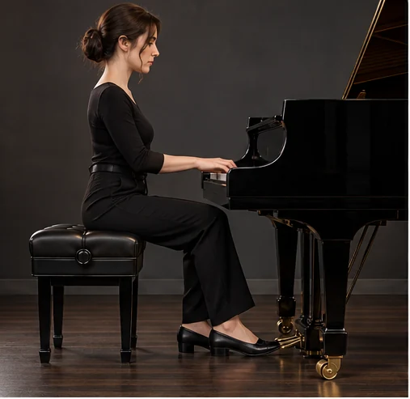<figcaption>側面：肩膀放鬆，手肘與琴鍵接近同一平面</figcaption></figure>
<figure>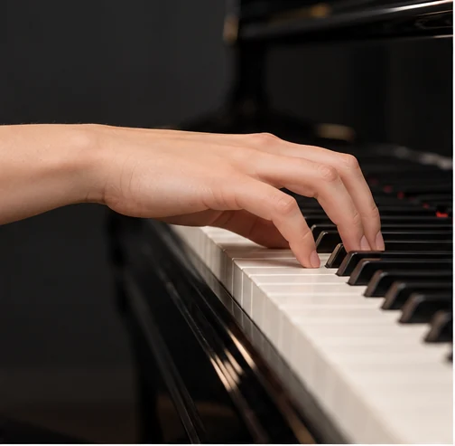<figcaption>近拍：手指成弧、手腕自然</figcaption></figure>

<h3>踏板與腳部操作｜圖解示範</h3>

<figure><figcaption>三個踏板的實際位置</figcaption></figure>
<figure><figcaption>腳跟留在地面，以前腳掌踩下延音踏板</figcaption></figure>
<figure>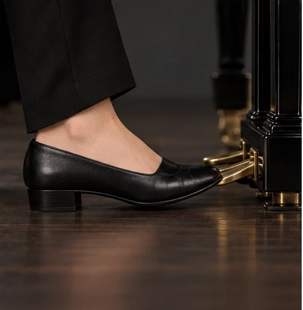<figcaption>前腳掌放開，腳跟繼續支撐</figcaption></figure>

平台鋼琴與直立鋼琴的中踏板功能可能不同，依琴款確認。

<h3>五指位置與指位譜｜圖解示範</h3>

<figure>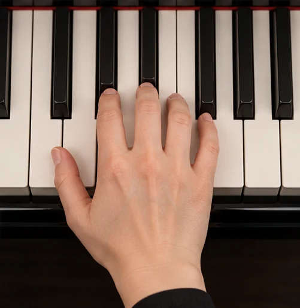<figcaption>五根手指各對應一個琴鍵</figcaption></figure>
<figure>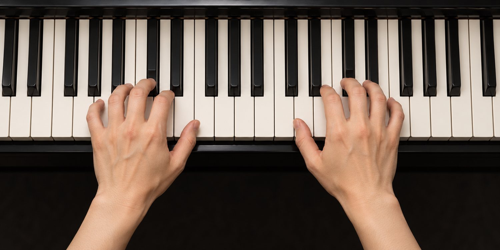<figcaption>由上方觀察左右手位置</figcaption></figure>

指法編號從拇指 1 到小指 5；音高與手位以鍵盤圖核對。

<!-- teaching-visuals-end -->

## 第二堂｜基礎樂理與識譜 Basic Theory · Reading Music

本堂目標：能說出音名、唱名與簡譜的對應，並在鍵盤上找到每一個音；能閱讀大譜表上中央 C 附近的音，理解音符時值與拍號；理解全音、半音與升降記號，能計算兩個音之間的音程；下課前，在找音遊戲中連續答對十題。

### 課前問卷

- 上一堂的課後練習，完成的項數
- 五指位置彈奏時，五個音的音量是否平均
- 閉上眼睛找到中央 C 的把握
- 最想加強的樂理
- 練琴時感到緊繃的部位

### 課程綱要（120 分鐘）

| 段落 | 時間 | 內容 | 投影片 |
| --- | --- | --- | --- |
| 起 | 00:00–00:20 | 五指位置，現在穩定了嗎？、音的三要素：高低、大小、音色 | 3–4 |
| 承 | 00:20–00:55 | 同一個音，有三種稱呼、切換音名、唱名、簡譜，觀察每個白鍵的名字、高音譜號屬於右手，低音譜號屬於左手、二分法：每往下一級，長度剩下一半、上方是每小節幾拍，下方是幾分音符為一拍、譜表與拍子 | 5–10 |
| 休 | 00:55–01:05 | 休息十分鐘 | 11 |
| 轉 | 01:05–01:40 | 相鄰的兩個琴鍵，相差一個半音、升、降、還原：讓音往上或往下移動半音、兩個音之間的距離，以「度」計算、點選兩個琴鍵，計算音程並聆聽協和度、音程的計算 | 12–16 |
| 合 | 01:40–02:00 | 看見音名，點出正確的琴鍵、看見五線譜上的音，點出正確的琴鍵、離開教室前，寫下 3-2-1 | 17–20 |
| 收尾 | 課後 | 三句話總結、出場券、課後練習與下一堂預告 | 19、21、22 |

### 講義擴充：音名、唱名與簡譜

| 級數 | Ⅰ 主音 | Ⅱ 上主音 | Ⅲ 中音 | Ⅳ 下屬音 | Ⅴ 屬音 | Ⅵ 下中音 | Ⅶ 導音 |
| --- | --- | --- | --- | --- | --- | --- | --- |
| 音名 | C | D | E | F | G | A | B |
| 唱名 | Do | Re | Mi | Fa | Sol | La | Si |
| 簡譜 | 1 | 2 | 3 | 4 | 5 | 6 | 7 |

- 音的三要素：高低（頻率）、大小（振幅）、音色（泛音）。A4 為 440 Hz。
- 大譜表由高音譜表與低音譜表組成。中央 C 位於高音譜表的下加一線；高音譜表第一線是 E4，低音譜表第一線是 G2。

### 講義擴充：時值與拍號

| 音符 | 4/4 中的拍數 |
| --- | --- |
| 全音符 | 4 拍 |
| 二分音符 | 2 拍 |
| 四分音符 | 1 拍 |
| 八分音符 | ½ 拍 |
| 十六分音符 | ¼ 拍 |

- 附點增加原本時值的一半；三連音將一拍平均分成三份。
- 二拍子系統（2/4、4/4）、三拍子系統（3/4、6/8），以及由兩者組合的變化拍子（5/4、7/8）。

### 講義擴充：半音、變化記號與音程

- 相鄰的兩個琴鍵相差半音，兩個半音是一個全音；E–F、B–C 之間沒有黑鍵，本身就相差半音。
- 升記號 ♯ 升高半音、降記號 ♭ 降低半音、還原記號 ♮ 取消升降。寫在小節中的是臨時記號，寫在譜號旁的是調號。

| 半音數 | 音程 | 協和度 |
| --- | --- | --- |
| 0 | 完全一度 | 完全協和 |
| 1 | 小二度 | 不協和 |
| 2 | 大二度 | 不協和 |
| 3 | 小三度 | 不完全協和 |
| 4 | 大三度 | 不完全協和 |
| 5 | 完全四度 | 完全協和 |
| 6 | 增四度、減五度 | 不協和 |
| 7 | 完全五度 | 完全協和 |
| 8 | 小六度 | 不完全協和 |
| 9 | 大六度 | 不完全協和 |
| 10 | 小七度 | 不協和 |
| 11 | 大七度 | 不協和 |
| 12 | 完全八度 | 完全協和 |

### 課堂互動（網站簡報）

| 投影片 | 互動 | 內容 |
| --- | --- | --- |
| 2 | 手機同步 | 今天的路線：閱讀樂譜，在鍵盤上找到每一個音 |
| 3 | 舉手計票 | 五指位置，現在穩定了嗎？ |
| 6 | 可彈奏的鍵盤 | 切換音名、唱名、簡譜，觀察每個白鍵的名字 |
| 10 | 選擇題 | 譜表與拍子 |
| 15 | 音程計算 | 點選兩個琴鍵，計算音程並聆聽協和度 |
| 16 | 選擇題 | 音程的計算 |
| 17 | 找音遊戲 | 看見音名，點出正確的琴鍵 |
| 18 | 找音遊戲・五線譜 | 看見五線譜上的音，點出正確的琴鍵 |
| 20 | 出場券 3-2-1 | 離開教室前，寫下 3-2-1 |
| 21 | 自主學習追蹤 | 課後練習：完成一項，點選一次打勾 |
| 22 | 課前問卷 | 第三堂 音階運指 |

### 課後練習

- [ ] 找音遊戲（音名）連續答對二十題
- [ ] 找音遊戲（五線譜）連續答對十題
- [ ] 在鍵盤上彈出 C 到 G、C 到 E、E 到 F，說出它們的音程
- [ ] 將〈小星星〉的簡譜 1 1 5 5 6 6 5 寫成音名與唱名
- [ ] 填寫第三堂課前問卷

## 第三堂｜音階運指 Scales & Fingering

本堂目標：能說明大調音階「全全半全全全半」的組成規則；能運用拇指穿越與中指跨越，彈奏一個八度的音階；能以正確的指法彈奏 C 大調，並認識 G 大調與 F 大調的指法；下課前，右手與左手各以 60 BPM 彈奏 C 大調音階上下行。

### 課前問卷

- 找音遊戲（五線譜）連續答對的題數
- 最容易混淆的部分
- 每天練琴的時間
- 五根手指中，最難控制的一根
- 左手的熟練程度

### 課程綱要（120 分鐘）

| 段落 | 時間 | 內容 | 投影片 |
| --- | --- | --- | --- |
| 起 | 00:00–00:20 | 找音遊戲，你的成績是多少？、從主音出發，依照固定的距離排列 | 3–4 |
| 承 | 00:20–00:55 | 全、全、半、全、全、全、半、手指不夠用的時候，拇指穿過，中指跨過、跟著亮起的琴鍵與指法，彈奏 C 大調上下行、指法與公式 | 5–8 |
| 休 | 00:55–01:05 | 休息十分鐘 | 9 |
| 轉 | 01:05–01:40 | 更換主音，觀察升降記號與指法的改變、三個調，兩種指法、雙手同時彈奏：拇指穿越的時間不一樣、〈卡農〉的旋律裡，有一段一段的下行音階、音階接力：一人一個音，穩定地傳下去 | 10–14 |
| 合 | 01:40–02:00 | 錄下右手與左手的 C 大調音階、離開教室前，寫下 3-2-1 | 15–17 |
| 收尾 | 課後 | 三句話總結、出場券、課後練習與下一堂預告 | 16、18、19、20 |

### 講義擴充：大調音階與指法

- 大調音階的公式：全、全、半、全、全、全、半。分成「全全半」兩組音型，中間以一個全音連接。
- 從 G 開始依照公式排列，第七音必須升高成 F♯；從 F 開始，第四音必須降低成 B♭。
- 十二平均律將一個八度分成十二個均等的半音，不論在哪一個調彈奏都一樣均勻。

| 調性 | 音階 | 右手上行 | 左手上行 |
| --- | --- | --- | --- |
| C 大調 | C D E F G A B C | 1 2 3 1 2 3 4 5 | 5 4 3 2 1 3 2 1 |
| G 大調 | G A B C D E F♯ G | 1 2 3 1 2 3 4 5 | 5 4 3 2 1 3 2 1 |
| F 大調 | F G A B♭ C D E F | 1 2 3 4 1 2 3 4 | 5 4 3 2 1 3 2 1 |
| A 小調 | A B C D E F G A | 1 2 3 1 2 3 4 5 | 5 4 3 2 1 3 2 1 |

- 右手上行在第 3 指之後拇指穿越，下行時第 3 指跨過拇指；左手相反。
- 練習順序：右手、左手，最後雙手合併；從 50 BPM 開始，穩定之後每次增加 4 BPM。

### 課堂互動（網站簡報）

| 投影片 | 互動 | 內容 |
| --- | --- | --- |
| 2 | 手機同步 | 今天的路線：十根手指，流暢地走過八個音 |
| 3 | 舉手計票 | 找音遊戲，你的成績是多少？ |
| 7 | 音階運指 | 跟著亮起的琴鍵與指法，彈奏 C 大調上下行 |
| 8 | 選擇題 | 指法與公式 |
| 10 | 音階運指 | 更換主音，觀察升降記號與指法的改變 |
| 13 | 曲例聆聽・YouTube | 〈卡農〉的旋律裡，有一段一段的下行音階 |
| 14 | 分組任務・計分 | 音階接力：一人一個音，穩定地傳下去 |
| 15 | 錄音對照 | 錄下右手與左手的 C 大調音階 |
| 17 | 出場券 3-2-1 | 離開教室前，寫下 3-2-1 |
| 18 | 自主學習紀錄 | 每天 15 分鐘音階課表 |
| 19 | 自主學習追蹤 | 課後練習：完成一項，點選一次打勾 |
| 20 | 課前問卷 | 第四堂 和弦組成與結構 |

### 課後練習

- [ ] 不看講義，寫出大調音階的公式與 C 大調的指法
- [ ] 右手 C 大調音階上下行，60 BPM 連續五次不中斷
- [ ] 左手 C 大調音階上下行，60 BPM 連續五次不中斷
- [ ] 挑戰雙手合併，或彈奏 G 大調音階
- [ ] 填寫第四堂課前問卷

<!-- teaching-visuals-start -->

<h3>穿指與跨指｜圖解示範</h3>

<figure>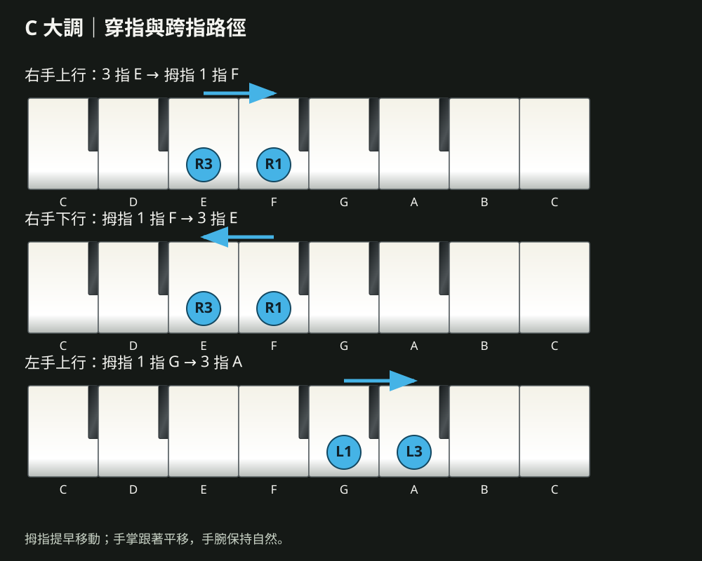<figcaption>穿指與跨指的確切音名、手指編號與移動路徑</figcaption></figure>
<figure>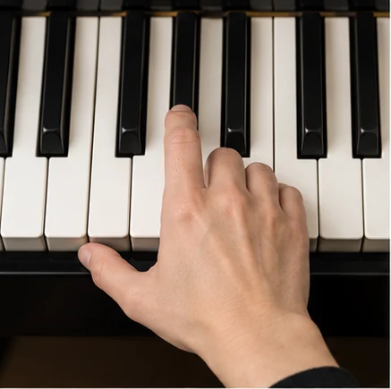<figcaption>近拍觀察手指與琴鍵的接觸</figcaption></figure>
<figure>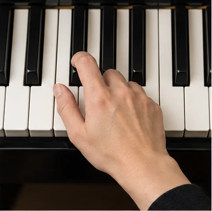<figcaption>手位移動時保持手腕自然</figcaption></figure>
<figure>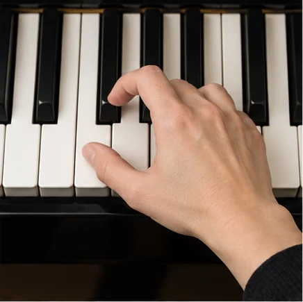<figcaption>其他手指自然抬起，準備下一個音</figcaption></figure>
<figure>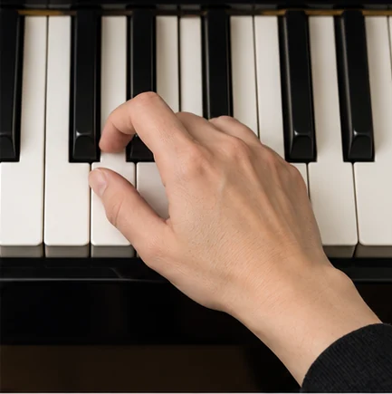<figcaption>手掌跟著指位平移</figcaption></figure>

<!-- teaching-visuals-end -->

## 第四堂｜和弦組成與結構 Chords & Inversions

本堂目標：能說明和聲與和弦的定義，以三度疊出三和弦；能分辨大、小、增、減四種三和弦的組成與聽感；能說出 C 大調的七個順階和弦，並彈奏三種轉位；下課前，右手以轉位彈奏 C → F → G → C，手不跳動。

### 課前問卷

- C 大調音階最穩定的速度
- 穿指與跨指的順暢程度
- 已經會按的和弦
- 雙手同時彈奏音階

### 課程綱要（120 分鐘）

| 段落 | 時間 | 內容 | 投影片 |
| --- | --- | --- | --- |
| 起 | 00:00–00:20 | C 大調音階，你最穩定的速度是多少？、兩個音以上是和聲，三個音以三度堆疊是和弦 | 3–4 |
| 承 | 00:20–00:55 | 大三度與小三度，組合出四種顏色、更換根音與性質，聆聽和弦的顏色、推算和弦、以音階的每一個音為根音，疊出七個和弦 | 5–8 |
| 休 | 00:55–01:05 | 休息十分鐘 | 9 |
| 轉 | 01:05–01:40 | 同樣三個音，更換最下面的音、點選轉位，觀察最低音的改變、轉位讓右手少移動，和弦之間連得更順、迷思還是事實？、和弦快問快答：老師喊名稱，各組彈出來 | 10–14 |
| 合 | 01:40–02:00 | 跟著播放器彈奏 C → F → G → C，右手試著加上轉位、離開教室前，寫下 3-2-1 | 15–17 |
| 收尾 | 課後 | 三句話總結、出場券、課後練習與下一堂預告 | 16、18、19 |

### 講義擴充：三和弦

| 和弦 | 組成 | C 為根音 | 符號 | 聽感 |
| --- | --- | --- | --- | --- |
| 大三和弦 | 大三度 ＋ 小三度 | C E G | C | 明亮、開朗 |
| 小三和弦 | 小三度 ＋ 大三度 | C E♭ G | Cm | 柔和、憂傷 |
| 增三和弦 | 大三度 ＋ 大三度 | C E G♯ | C+、Caug | 懸疑、不安 |
| 減三和弦 | 小三度 ＋ 小三度 | C E♭ G♭ | Cdim、C° | 緊張、詭異 |

- 和聲是兩個以上的音同時發聲；和弦是三個或三個以上的音，以三度堆疊而成。
- 掛四和弦（sus4）將三音換成四音，例如 Csus4 = C F G，聽起來懸而未決，想回到大三和弦。

### 講義擴充：C 大調的順階和弦

| 級數 | Ⅰ | Ⅱm | Ⅲm | Ⅳ | Ⅴ | Ⅵm | Ⅶdim |
| --- | --- | --- | --- | --- | --- | --- | --- |
| 和弦 | C | Dm | Em | F | G | Am | Bdim |
| 組成音 | 1 3 5 | 2 4 6 | 3 5 7 | 4 6 1 | 5 7 2 | 6 1 3 | 7 2 4 |

### 講義擴充：轉位

| 位置 | C 和弦 | 最低音 | 右手指法 |
| --- | --- | --- | --- |
| 原位 | C E G | 根音 | 1 3 5 |
| 第一轉位 | E G C | 三音 | 1 2 5 |
| 第二轉位 | G C E | 五音 | 1 3 5 |

- 轉位讓相鄰的和弦保留共同音，其他的音就近移動。C → F → G → C 可以彈成 C E G → C F A → B D G → C E G。
- 密集式：三個音在一個八度之內；開放式：音與音之間拉開，聲音更寬廣。

### 課堂互動（網站簡報）

| 投影片 | 互動 | 內容 |
| --- | --- | --- |
| 2 | 手機同步 | 今天的路線：用三個音疊出和弦 |
| 3 | 舉手計票 | C 大調音階，你最穩定的速度是多少？ |
| 6 | 和弦實驗室 | 更換根音與性質，聆聽和弦的顏色 |
| 7 | 選擇題 | 推算和弦 |
| 8 | 順階和弦 | 以音階的每一個音為根音，疊出七個和弦 |
| 11 | 和弦實驗室・轉位 | 點選轉位，觀察最低音的改變 |
| 13 | 迷思破解・翻牌 | 迷思還是事實？ |
| 14 | 分組任務・計分 | 和弦快問快答：老師喊名稱，各組彈出來 |
| 15 | 伴奏型播放器 | 跟著播放器彈奏 C → F → G → C，右手試著加上轉位 |
| 17 | 出場券 3-2-1 | 離開教室前，寫下 3-2-1 |
| 18 | 自主學習追蹤 | 課後練習：完成一項，點選一次打勾 |
| 19 | 課前問卷 | 第五堂 基本歌曲彈奏（一） |

### 課後練習

- [ ] 彈奏 C 大調七個順階和弦，說出每一個和弦的名稱與性質
- [ ] 從任意根音推算大三和弦與小三和弦，至少六組
- [ ] 右手以轉位彈奏 C → F → G → C，連續十次手不跳動
- [ ] 左手彈奏 C、F、G 的根音，右手同時按住和弦
- [ ] 填寫第五堂課前問卷

## 第五堂｜基本歌曲彈奏（一） First Songs · Melody & Chords

本堂目標：能閱讀簡譜與和弦譜，為旋律安排右手的指法；能以左手根音、五度音與柱式和弦三種方式伴奏；理解如何依照旋律的音，選擇合適的和弦；下課前，雙手完成〈小星星〉，並以 3/4 拍彈奏〈生日快樂歌〉。

### 課前問卷

- 能夠立刻彈出的和弦數量
- 以轉位彈奏 C → F → G → C 的狀態
- 分辨大和弦與小和弦的把握
- 最想先學會的一首歌

### 課程綱要（120 分鐘）

| 段落 | 時間 | 內容 | 投影片 |
| --- | --- | --- | --- |
| 起 | 00:00–00:20 | C、F、G 三個和弦，你能閉著眼睛按出來嗎？、一首歌的鋼琴，分成兩個角色 | 3–4 |
| 承 | 00:20–00:55 | 一格一小節，上方是和弦，下方是旋律、先找出旋律的最低音與最高音，再決定手的位置、由簡單到豐富：根音、五度、柱式和弦、跟著播放器，彈奏左手的柱式和弦與分散和弦 | 5–8 |
| 休 | 00:55–01:05 | 休息十分鐘 | 9 |
| 轉 | 01:05–01:40 | 旋律的音落在哪一個和弦裡，就選擇那個和弦、為旋律選擇和弦、〈小星星〉：右手旋律，左手換和弦、同一首〈小星星〉，三種左手 | 10–13 |
| 合 | 01:40–02:00 | 〈生日快樂歌〉：3/4 拍，從「祝你」的弱起開始、離開教室前，寫下 3-2-1 | 14–16 |
| 收尾 | 課後 | 三句話總結、出場券、課後練習與下一堂預告 | 15、17、18、19 |

### 講義擴充：簡譜與和弦譜

| 寫法 | 意思 |
| --- | --- |
| 5 | 四分音符，一拍 |
| 5 - | 延長一拍，共兩拍 |
| 數字下方一條線 | 八分音符 |
| 0 | 休止 |
| 數字上方或下方加點 | 高八度或低八度 |

- 讀譜順序：念出唱名、拍出節奏、找到和弦，最後才放到鍵盤上。
- 在簡譜上寫下指法數字，每次都用同一套指法。

### 講義擴充：左手的三種彈法

| 彈法 | C 和弦 | 左手指法 |
| --- | --- | --- |
| 根音 | C | 5 |
| 五度音 | C G | 5 1 |
| 柱式和弦 | C E G | 5 3 1 |

### 講義擴充：和弦內音與和弦選搭

| 和弦 | 和弦內音 | 適合的旋律音 |
| --- | --- | --- |
| C（Ⅰ） | 1 3 5 | Do、Mi、Sol |
| F（Ⅳ） | 4 6 1 | Fa、La、Do |
| G（Ⅴ） | 5 7 2 | Sol、Si、Re |

- 依照每小節第一拍的旋律音選擇和弦；樂句結尾常是 G → C。
- 〈小星星〉：C｜F C｜F C｜G C｜C F｜C G｜C F｜C G｜C｜F C｜F C｜G C。
- 〈生日快樂歌〉（3/4，弱起）：C｜G｜G｜C｜C｜F｜C G｜C。

### 課堂互動（網站簡報）

| 投影片 | 互動 | 內容 |
| --- | --- | --- |
| 2 | 手機同步 | 今天的路線：完成你在鋼琴上的第一首歌 |
| 3 | 舉手計票 | C、F、G 三個和弦，你能閉著眼睛按出來嗎？ |
| 4 | 曲例聆聽・YouTube | 一首歌的鋼琴，分成兩個角色 |
| 8 | 伴奏型播放器 | 跟著播放器，彈奏左手的柱式和弦與分散和弦 |
| 11 | 選擇題 | 為旋律選擇和弦 |
| 12 | 歌曲彈奏 | 〈小星星〉：右手旋律，左手換和弦 |
| 13 | 分組任務・計分 | 同一首〈小星星〉，三種左手 |
| 14 | 歌曲彈奏 | 〈生日快樂歌〉：3/4 拍，從「祝你」的弱起開始 |
| 16 | 出場券 3-2-1 | 離開教室前，寫下 3-2-1 |
| 17 | 自主學習紀錄 | 每天 15 分鐘歌曲課表 |
| 18 | 自主學習追蹤 | 課後練習：完成一項，點選一次打勾 |
| 19 | 課前問卷 | 第六堂 基本歌曲彈奏（二）與節奏型態 |

### 課後練習

- [ ] 〈小星星〉三種左手版本，各雙手彈奏一次
- [ ] 〈生日快樂歌〉雙手彈奏，第一拍的和弦換對
- [ ] 挑選一首簡單的兒歌，自己在簡譜上標出和弦與指法
- [ ] 錄下〈小星星〉的雙手版本
- [ ] 填寫第六堂課前問卷

## 第六堂｜基本歌曲彈奏（二）與節奏型態 Rhythm Patterns I · Slow Soul & Waltz

本堂目標：能閱讀 L5 L3 L2 L1、R1 R2 R5 的指位譜，彈奏分散和弦；能彈奏 Slow Soul 的四種伴奏型，並說出它們的差別；能以 3/4 華爾滋的蹦洽洽與分散和弦伴奏；下課前，以 Slow Soul 彈奏〈小星星〉，以華爾滋彈奏〈生日快樂歌〉。

### 課前問卷

- 雙手彈奏〈小星星〉的狀態
- 左手最習慣的彈法
- 雙手協調的程度
- 使用延音踏板的經驗

### 課程綱要（120 分鐘）

| 段落 | 時間 | 內容 | 投影片 |
| --- | --- | --- | --- |
| 起 | 00:00–00:20 | 〈小星星〉的雙手版本，完成了嗎？、同樣是抒情，四拍與三拍的伴奏不一樣 | 3–4 |
| 承 | 00:20–00:55 | 指位譜：用手指的位置，寫下伴奏、Slow Soul：時下流行歌曲最常見的節奏、Slow Soul 四種伴奏：先聆聽，再跟著彈奏、閱讀指位譜 | 5–8 |
| 休 | 00:55–01:05 | 休息十分鐘 | 9 |
| 轉 | 01:05–01:40 | 強、弱、弱：三拍子的四種伴奏、先聆聽拍號與速度，再決定左手、迷思還是事實？、〈小星星〉換成 Slow Soul，雙手合併 | 10–13 |
| 合 | 01:40–02:00 | 〈生日快樂歌〉：換成 3/4 分散和弦、錄下四拍與三拍兩個版本、離開教室前，寫下 3-2-1 | 14–17 |
| 收尾 | 課後 | 三句話總結、出場券、課後練習與下一堂預告 | 16、18、19 |

### 講義擴充：分散和弦伴奏法與指位譜

以 C 和弦為例：L5 = C3（根音）、L3 = E3（三音）、L2 = G3（五音）、L1 = C4（高八度根音）、R1 = E4、R2 = G4、R5 = C5。換和弦時，手指的位置不變，整隻手移到新的根音。

### 講義擴充：Slow Soul

| 型態 | 簡譜（C 和弦） | 指位 |
| --- | --- | --- |
| （一） | 1̣ 5̣ 1 3 5 － | L5 L2 L1 R1 R2 |
| （二） | 1̣ 5̣ 1 3 5 1̇ 5 3 | L5 L2 L1 R1 R2 R5 R2 R1 |
| （三） | （1 3 5）× 4 | L5＋L3＋L2 |
| （四） | 1̣ 5̣ 1 5̣ 3 5̣ 1 5̣ | L5 L2 L1 L2 R1 L2 L1 L2 |

### 講義擴充：3/4 華爾滋

| 拍式 | 指位 |
| --- | --- |
| 4 Beats 單手 8 度 | L5 L3 L2 |
| 蹦洽洽 | L5、和弦、和弦 |
| 8 Beats 單手 8 度 | L5 L3 L2 L1 L2 L1 |
| 8 Beats 雙手 16 度 | L5 L2 L1 R1 R2 R5 |

### 講義擴充：選擇伴奏型

| 歌曲感覺 | 速度 | 建議的伴奏型 |
| --- | --- | --- |
| 抒情慢歌 | 60–80 BPM | Slow Soul（一）（二） |
| 中板流行 | 80–110 BPM | Slow Soul（三）（四）、8 Beats |
| 圓舞曲、生日歌 | 3/4 | 華爾滋 |
| 兒歌、輕快歌曲 | 100 BPM 以上 | 柱式和弦、4 Beats |

### 課堂互動（網站簡報）

| 投影片 | 互動 | 內容 |
| --- | --- | --- |
| 2 | 手機同步 | 今天的路線：讓左手開始流動 |
| 3 | 舉手計票 | 〈小星星〉的雙手版本，完成了嗎？ |
| 4 | 曲例聆聽・YouTube | 同樣是抒情，四拍與三拍的伴奏不一樣 |
| 7 | 伴奏型播放器 | Slow Soul 四種伴奏：先聆聽，再跟著彈奏 |
| 8 | 選擇題 | 閱讀指位譜 |
| 10 | 伴奏型播放器 | 強、弱、弱：三拍子的四種伴奏 |
| 12 | 迷思破解・翻牌 | 迷思還是事實？ |
| 13 | 歌曲彈奏 | 〈小星星〉換成 Slow Soul，雙手合併 |
| 14 | 歌曲彈奏 | 〈生日快樂歌〉：換成 3/4 分散和弦 |
| 15 | 錄音對照 | 錄下四拍與三拍兩個版本 |
| 17 | 出場券 3-2-1 | 離開教室前，寫下 3-2-1 |
| 18 | 自主學習追蹤 | 課後練習：完成一項，點選一次打勾 |
| 19 | 課前問卷 | 第七堂 伴奏技巧強化（4＋8） |

### 課後練習

- [ ] Slow Soul 四種伴奏，搭配 C → Am → F → G，各彈奏兩輪
- [ ] 3/4 蹦洽洽與分散和弦，搭配 C → G → G → C，各彈奏兩輪
- [ ] 〈小星星〉挑選一種 Slow Soul，雙手完整彈奏並錄音
- [ ] 挑選期中想彈唱的 C 調歌曲，找好和弦譜
- [ ] 填寫第七堂課前問卷

<!-- teaching-visuals-start -->

<h3>五指位置與指位譜｜圖解示範</h3>

<figure><figcaption>五根手指各對應一個琴鍵</figcaption></figure>
<figure><figcaption>由上方觀察左右手位置</figcaption></figure>

指法編號從拇指 1 到小指 5；音高與手位以鍵盤圖核對。

<!-- teaching-visuals-end -->

## 第七堂｜伴奏技巧強化（4＋8） Accompaniment · 4 Beats & 8 Beats

本堂目標：能說明 4 Beats 與 8 Beats 的差別，依照速度選擇伴奏密度；能彈奏單手 8 度與雙手 16 度的分散和弦；理解左右手接力時的指法與手的位置；下課前，以 C → Am → F → G 完成一段「主歌 4 Beats、副歌 8 Beats」的伴奏。

### 課前問卷

- 最熟練的 Slow Soul 伴奏
- 華爾滋的熟練程度
- 期中想彈唱的歌曲
- 期中發表的形式

### 課程綱要（120 分鐘）

| 段落 | 時間 | 內容 | 投影片 |
| --- | --- | --- | --- |
| 起 | 00:00–00:20 | Slow Soul 四種伴奏，你最喜歡哪一種？、主歌與副歌，鋼琴的音符數量不一樣 | 3–4 |
| 承 | 00:20–00:55 | 一拍一個音，或一拍兩個音、4 Beats：單手 8 度三種、雙手 16 度三種、交接的那一拍，聲音不能斷、伴奏的密度與音域 | 5–8 |
| 休 | 00:55–01:05 | 休息十分鐘 | 9 |
| 轉 | 01:05–01:40 | 8 Beats：單手三種、雙手三種、4/4 拍的十二種伴奏、主歌 4 Beats，副歌 8 Beats、伴奏接力：每人負責一種型態 | 10–13 |
| 合 | 01:40–02:00 | 錄下主歌與副歌兩種伴奏、離開教室前，寫下 3-2-1 | 14–16 |
| 收尾 | 課後 | 三句話總結、出場券、課後練習與下一堂預告 | 15、17、18、19 |

### 講義擴充：分散和弦伴奏法（4/4）

| 拍式 | 音域 | 每小節的指位 |
| --- | --- | --- |
| 4 Beats | 單手 8 度 | L5 L3 L2 L1 |
| 4 Beats | 單手 8 度 | L5 L3 L2 L1｜L2 L1 L2 L1 |
| 4 Beats | 單手 8 度 | L5 L3 L2 L1｜L3 L2 L1 L3｜L2 L1 L3 L2｜L1 L3 L2 L1 |
| 4 Beats | 雙手 16 度 | L5 L3 L2 L1｜R1 R2 R5 R2 |
| 4 Beats | 雙手 16 度 | L5 L3 L2 L1｜R5 R2 R1 R2 |
| 4 Beats | 雙手 16 度 | L5 L3 L2 L1｜R1 R2 R5 R2｜R1 L1 L2 L3｜L5 L3 L2 L1 |
| 8 Beats | 單手 8 度 | L5 L3 L2 L1 L5 L3 L2 L1 |
| 8 Beats | 單手 8 度 | L5 L3 L2 L1 L3 L1 L2 L1 |
| 8 Beats | 單手 16 度 | L5 L3 L2 L1 L3 L2 L1 L2 |
| 8 Beats | 雙手 16 度 | L5 L3 L2 L1 R1 R2 R5 R2 |
| 8 Beats | 雙手 16 度 | L5 L2 L1 R1 R2 R5 R2 R1 |
| 8 Beats | 雙手 16 度 | L5 L2 L1 R2 R5 R2 R1 R2 |

- 4 Beats 每拍一個音，穩重；8 Beats 每拍兩個音，流動。
- 左右手接力：左手彈奏 L1 時，右手已懸在 R1 上方；搭配延音踏板，讓兩個八度連成一片。
- 段落轉換：主歌 4 Beats 單手 8 度，前副歌 4 Beats 雙手 16 度，副歌 8 Beats 雙手 16 度。

### 課堂互動（網站簡報）

| 投影片 | 互動 | 內容 |
| --- | --- | --- |
| 2 | 手機同步 | 今天的路線：左右手接力，彈出兩個八度的聲音 |
| 3 | 舉手計票 | Slow Soul 四種伴奏，你最喜歡哪一種？ |
| 4 | 曲例聆聽・YouTube | 主歌與副歌，鋼琴的音符數量不一樣 |
| 6 | 伴奏型播放器 | 4 Beats：單手 8 度三種、雙手 16 度三種 |
| 8 | 選擇題 | 伴奏的密度與音域 |
| 10 | 伴奏型播放器 | 8 Beats：單手三種、雙手三種 |
| 13 | 分組任務・計分 | 伴奏接力：每人負責一種型態 |
| 14 | 錄音對照 | 錄下主歌與副歌兩種伴奏 |
| 16 | 出場券 3-2-1 | 離開教室前，寫下 3-2-1 |
| 17 | 自主學習紀錄 | 每天 20 分鐘伴奏課表 |
| 18 | 自主學習追蹤 | 課後練習：完成一項，點選一次打勾 |
| 19 | 課前問卷 | 第八堂 單一調性歌曲與自彈自唱 |

### 課後練習

- [ ] 4 Beats 六種伴奏，各搭配 C → Am → F → G 彈奏兩輪
- [ ] 8 Beats 六種伴奏，挑選三種，練習到 72 BPM
- [ ] 為期中曲目設計主歌與副歌的伴奏型，寫在和弦譜上
- [ ] 錄下期中曲目的伴奏，不唱歌
- [ ] 填寫第八堂課前問卷

<!-- teaching-visuals-start -->

<h3>左右手交接｜圖解示範</h3>

<figure>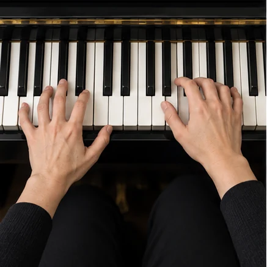<figcaption>左手完成低音區，右手預先準備</figcaption></figure>
<figure>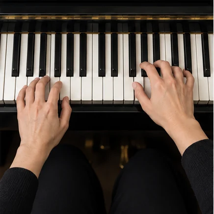<figcaption>右手接續高音區，保持律動連續</figcaption></figure>

<!-- teaching-visuals-end -->

## 第八堂｜單一調性歌曲與自彈自唱 One Key · Sing & Play

本堂目標：能從和弦譜判斷一首歌的調性，閱讀流行歌曲的段落；能為歌曲設計前奏與尾奏；能依照四個步驟練習自彈自唱，並在需要時簡化伴奏；完成期中發表：一首 C 調歌曲的自彈自唱或彈奏。

### 課前問卷

- 期中曲目
- 主歌與副歌使用的伴奏型
- 伴奏的熟練程度
- 自彈自唱最困難的地方

### 課程綱要（120 分鐘）

| 段落 | 時間 | 內容 | 投影片 |
| --- | --- | --- | --- |
| 起 | 00:00–00:20 | 期中曲目準備好了嗎？、自彈自唱時，鋼琴的音量要低於歌聲 | 3–4 |
| 承 | 00:20–00:55 | 第一個和弦與最後一個和弦，通常就是調性、一張和弦譜，記錄了整首歌的地圖、借用副歌的最後四小節，當作前奏、單一調性的完整練習：C 調、4/4、十六小節 | 5–8 |
| 休 | 00:55–01:05 | 休息十分鐘 | 9 |
| 轉 | 01:05–01:40 | 伴奏熟練到無需思考，才有餘力演唱、演唱吃力時，先簡化雙手、自彈自唱的觀念、兩人一組，互相聆聽彩排 | 10–13 |
| 合 | 01:40–02:00 | 每人兩分鐘：一段主歌，一段副歌、錄下期中發表，第十二堂再聆聽一次、離開教室前，寫下 3-2-1 | 14–17 |
| 收尾 | 課後 | 三句話總結、出場券、課後練習與下一堂預告 | 16、18、19 |

### 講義擴充：判斷調性與閱讀和弦譜

- 單一調性：整首歌沒有轉調。看第一個與最後一個和弦，再看出現最多的三個和弦。
- 和弦譜常見記號：Intro、Verse、Chorus、反覆記號、第一次與第二次結尾、D.S.、D.C.、Coda、N.C.。

### 講義擴充：前奏與尾奏

- 前奏：借用副歌最後四小節的和弦，最後停在 G，準備進入主歌。
- 尾奏：重複最後一句的和弦並放慢，最後以 C 和弦的分散和弦結束，踩住延音踏板。

### 講義擴充：自彈自唱的四個步驟

1. 背熟伴奏：不依賴樂譜，整首伴奏連續彈奏兩次不中斷。
2. 伴奏加上哼唱：讓手與嘴巴分工。
3. 伴奏加上唱名：確認每個音落在哪一拍。
4. 伴奏加上歌詞：從主歌開始，一段一段加入。

演唱吃力時，先簡化伴奏：只用左手、減少音符、在換氣的地方只彈奏根音。

### 講義擴充：期中發表

評量五個面向：穩定、和弦、段落、平衡（伴奏比歌聲或旋律輕）、台風。練習曲〈Jingle Bells〉：C｜C｜C｜C｜F｜C｜G｜G｜C｜C｜C｜C｜F｜C｜G｜C。

### 課堂互動（網站簡報）

| 投影片 | 互動 | 內容 |
| --- | --- | --- |
| 2 | 手機同步 | 今天的路線：一邊彈奏，一邊演唱 |
| 3 | 舉手計票 | 期中曲目準備好了嗎？ |
| 4 | 曲例聆聽・YouTube | 自彈自唱時，鋼琴的音量要低於歌聲 |
| 8 | 歌曲彈奏 | 單一調性的完整練習：C 調、4/4、十六小節 |
| 12 | 選擇題 | 自彈自唱的觀念 |
| 13 | 分段計時・隨機點名 | 兩人一組，互相聆聽彩排 |
| 14 | 分段計時・評分 | 每人兩分鐘：一段主歌，一段副歌 |
| 15 | 錄音 | 錄下期中發表，第十二堂再聆聽一次 |
| 17 | 出場券 3-2-1 | 離開教室前，寫下 3-2-1 |
| 18 | 自主學習追蹤 | 課後練習：完成一項，點選一次打勾 |
| 19 | 課前問卷 | 第九堂 級數和弦與調性關係 |

### 課後練習

- [ ] 重新聆聽期中錄音，寫下最想改進的一件事
- [ ] 〈Jingle Bells〉雙手完整彈奏，並嘗試自彈自唱
- [ ] 為期中曲目補上前奏與尾奏
- [ ] 尋找一首新的 C 調歌曲，標出段落與換氣點
- [ ] 填寫第九堂課前問卷

## 第九堂｜級數和弦與調性關係 Chord Degrees & Keys

本堂目標：能以羅馬數字表示和弦的級數，說出大調的順階和弦；理解主和弦、下屬和弦、屬和弦的功能與常見的終止式；能依照級數，將一組和弦進行移到 G 大調與 F 大調；下課前，以 C 大調與 G 大調各彈奏一次〈Jingle Bells〉。

### 課前問卷

- 期中發表最滿意的地方
- 期中發表最想改進的地方
- 對「級數」「Ⅰ Ⅳ Ⅴ」的熟悉程度
- 希望能夠移調的原因

### 課程綱要（120 分鐘）

| 段落 | 時間 | 內容 | 投影片 |
| --- | --- | --- | --- |
| 起 | 00:00–00:20 | 期中發表之後，你最想改進什麼？、歌手說「太高了，降低一點」，伴奏要怎麼辦？ | 3–4 |
| 承 | 00:20–00:55 | 以羅馬數字，記錄和弦在調裡的位置、切換調性，點選和弦卡片，觀察級數不變的規律、主和弦是家，下屬和弦出門，屬和弦想回家、樂句的結尾，和弦如何回家、級數與功能 | 5–9 |
| 休 | 00:55–01:05 | 休息十分鐘 | 10 |
| 轉 | 01:05–01:40 | 三個步驟，將和弦譜搬到另一個調、同一組 Ⅰ Ⅵm Ⅳ Ⅴ，四個調依序聆聽、移調快問快答 | 11–13 |
| 合 | 01:40–02:00 | 〈Jingle Bells〉G 大調：簡譜不變，和弦換成 G、C、D、離開教室前，寫下 3-2-1 | 14–16 |
| 收尾 | 課後 | 三句話總結、出場券、課後練習與下一堂預告 | 15、17、18 |

### 講義擴充：級數

| 級數 | Ⅰ | Ⅱm | Ⅲm | Ⅳ | Ⅴ | Ⅵm | Ⅶdim |
| --- | --- | --- | --- | --- | --- | --- | --- |
| C 大調 | C | Dm | Em | F | G | Am | Bdim |
| G 大調 | G | Am | Bm | C | D | Em | F♯dim |
| F 大調 | F | Gm | Am | B♭ | C | Dm | Edim |
| D 大調 | D | Em | F♯m | G | A | Bm | C♯dim |

### 講義擴充：和弦的功能與終止式

- 主和弦 Ⅰ（Ⅵm、Ⅲm 可代替）：安定、結束。下屬和弦 Ⅳ（Ⅱm 相似）：離開、流動。屬和弦 Ⅴ（Ⅶdim 相似）：張力、想回家。
- Ⅰ、Ⅳ、Ⅴ 為主要三和弦，許多民謠與兒歌只用這三個和弦。

| 終止式 | 級數 | 聽感 |
| --- | --- | --- |
| 正格終止 | Ⅴ → Ⅰ | 確定、完整 |
| 變格終止 | Ⅳ → Ⅰ | 溫和 |
| 半終止 | → Ⅴ | 等待下一句 |
| 假終止 | Ⅴ → Ⅵm | 轉了彎 |

### 講義擴充：依照級數移調

1. 寫出原調和弦的級數。
2. 選擇新的調。
3. 依照級數換成新調的和弦。旋律的簡譜數字不需要改變。

### 課堂互動（網站簡報）

| 投影片 | 互動 | 內容 |
| --- | --- | --- |
| 2 | 手機同步 | 今天的路線：找到和弦背後的數字規律 |
| 3 | 舉手計票 | 期中發表之後，你最想改進什麼？ |
| 6 | 順階和弦 | 切換調性，點選和弦卡片，觀察級數不變的規律 |
| 8 | 伴奏型播放器 | 樂句的結尾，和弦如何回家 |
| 9 | 選擇題 | 級數與功能 |
| 12 | 伴奏型播放器 | 同一組 Ⅰ Ⅵm Ⅳ Ⅴ，四個調依序聆聽 |
| 13 | 分組任務・計分 | 移調快問快答 |
| 14 | 歌曲彈奏 | 〈Jingle Bells〉G 大調：簡譜不變，和弦換成 G、C、D |
| 16 | 出場券 3-2-1 | 離開教室前，寫下 3-2-1 |
| 17 | 自主學習追蹤 | 課後練習：完成一項，點選一次打勾 |
| 18 | 課前問卷 | 第十堂 根音連結、複合和弦與常用和弦行進 |

### 課後練習

- [ ] 寫出 C、G、F 大調的七個順階和弦與級數
- [ ] 將期中曲目的和弦譜，標上級數
- [ ] 將期中曲目移到另一個調，彈奏一次
- [ ] 〈Jingle Bells〉以 C 大調與 G 大調各彈奏一次
- [ ] 填寫第十堂課前問卷

## 第十堂｜根音連結、複合和弦與常用和弦行進 Bass Lines · Slash Chords · Progressions

本堂目標：能閱讀複合和弦的寫法，例如 C/E、G/B、Am/G；能以根音連結，讓相鄰和弦的低音級進；能彈奏 1645、1564、卡農進行與 2-5-1，並說出它們的聽感；下課前，全班以下行低音線合奏卡農進行。

### 課前問卷

- 能夠寫出順階和弦的調性
- 期中曲目移調的進度
- 聽過「卡農進行」嗎
- 喜愛的歌曲中，你注意到重複出現的和弦

### 課程綱要（120 分鐘）

| 段落 | 時間 | 內容 | 投影片 |
| --- | --- | --- | --- |
| 起 | 00:00–00:20 | 期中曲目移調了嗎？、只聆聽最低的聲音：它一直往下走 | 3–4 |
| 承 | 00:20–00:55 | 斜線左邊是和弦，右邊是低音、相鄰的兩個低音，最好只差一步、切換兩組和弦，比較低音跳躍與低音級進、讀出複合和弦 | 5–8 |
| 休 | 00:55–01:05 | 休息十分鐘 | 9 |
| 轉 | 01:05–01:40 | 流行歌曲最常用的五組和弦進行、切換和弦進行，跟著彈奏，感受情緒的差別、迷思還是事實？、設計一條低音線 | 10–13 |
| 合 | 01:40–02:00 | 一半同學彈奏低音線，一半同學彈奏右手和弦、離開教室前，寫下 3-2-1 | 14–16 |
| 收尾 | 課後 | 三句話總結、出場券、課後練習與下一堂預告 | 15、17、18 |

### 講義擴充：複合和弦

- 寫法：斜線左邊是和弦，右邊是低音。C/E 念作 C over E，又稱分數和弦、分割和弦。
- 左手彈奏斜線右邊的低音，右手照常彈奏和弦。C/E 等於 C 的第一轉位；Am/G、C/B 的低音不在和弦裡，只為了讓低音線級進。

### 講義擴充：根音連結

| 原本 | C | G | Am | Em | F | C | F | G |
| --- | --- | --- | --- | --- | --- | --- | --- | --- |
| 根音連結 | C | G/B | Am | Em/G | F | C/E | F | G |
| 低音 | C | B | A | G | F | E | F | G |

另一條常見的下行低音線：C → C/B → Am → Am/G → F → C/E → Dm → G。

### 講義擴充：常用和弦行進

| 名稱 | 級數 | C 大調 | 聽感 |
| --- | --- | --- | --- |
| 1645 | Ⅰ Ⅵm Ⅳ Ⅴ | C Am F G | 溫暖懷舊 |
| 1564 | Ⅰ Ⅴ Ⅵm Ⅳ | C G Am F | 明亮有力 |
| 卡農進行 | Ⅰ Ⅴ Ⅵm Ⅲm Ⅳ Ⅰ Ⅳ Ⅴ | C G Am Em F C F G | 優雅、經典 |
| 4536 | Ⅳ Ⅴ Ⅲm Ⅵm | F G Em Am | 情緒往上推 |
| 2-5-1 | Ⅱm Ⅴ Ⅰ | Dm G C | 回家的路 |
| 16451 | Ⅰ Ⅵm Ⅳ Ⅴ Ⅰ | C Am F G C | 主和弦開始與結束 |

### 課堂互動（網站簡報）

| 投影片 | 互動 | 內容 |
| --- | --- | --- |
| 2 | 手機同步 | 今天的路線：讓低音一步一步走下樓梯 |
| 3 | 舉手計票 | 期中曲目移調了嗎？ |
| 4 | 曲例聆聽・YouTube | 只聆聽最低的聲音：它一直往下走 |
| 7 | 伴奏型播放器 | 切換兩組和弦，比較低音跳躍與低音級進 |
| 8 | 選擇題 | 讀出複合和弦 |
| 11 | 伴奏型播放器 | 切換和弦進行，跟著彈奏，感受情緒的差別 |
| 12 | 迷思破解・翻牌 | 迷思還是事實？ |
| 13 | 分組任務・計分 | 設計一條低音線 |
| 14 | 伴奏型播放器・全班合奏 | 一半同學彈奏低音線，一半同學彈奏右手和弦 |
| 16 | 出場券 3-2-1 | 離開教室前，寫下 3-2-1 |
| 17 | 自主學習追蹤 | 課後練習：完成一項，點選一次打勾 |
| 18 | 課前問卷 | 第十一堂 節奏型態（二）與十度、十六度伴奏 |

### 課後練習

- [ ] 彈奏卡農進行的兩個版本：一般低音與下行低音線
- [ ] 1645、1564、4536、2-5-1 各彈奏兩輪，說出聽感
- [ ] 為期中曲目加入一個複合和弦
- [ ] 聆聽一首喜愛的歌曲，找出它使用的和弦進行
- [ ] 填寫第十一堂課前問卷

## 第十一堂｜節奏型態（二）與十度、十六度伴奏 Rhythm Patterns II · Tenths & Sixteenths

本堂目標：能以 12/8 的三連音律動彈奏 Slow Rock 伴奏；能彈奏 2/4 進行曲的蹦洽伴奏，並辨識 Bossa Nova 的風格；能彈奏十度音伴奏與雙手十六度的分散和弦；下課前，以三種不同的節奏型態彈奏同一組和弦，讓同學猜出風格。

### 課前問卷

- 卡農進行下行低音線的狀態
- 最熟練的和弦進行
- 左手張開，拇指到小指能跨幾個白鍵
- 想學習的音樂風格

### 課程綱要（120 分鐘）

| 段落 | 時間 | 內容 | 投影片 |
| --- | --- | --- | --- |
| 起 | 00:00–00:20 | 卡農進行的下行低音線，練好了嗎？、十度音、Slow Rock、Bossa Nova | 3–4 |
| 承 | 00:20–00:55 | 12/8：每一拍分成三份，帶有搖擺感、Slow Rock 與進行曲：先聆聽，再跟著彈奏、兩拍子的「蹦洽」，以及巴西的 Bossa Nova、節奏型態 | 5–8 |
| 休 | 00:55–01:05 | 休息十分鐘 | 9 |
| 轉 | 01:05–01:40 | 十度音：三音的高八度、十度音與雙手十六度：伴奏音域擴大到兩個八度、十二堂學過的伴奏型，總整理、風格猜猜看 | 10–13 |
| 合 | 01:40–02:00 | 錄下兩種新的伴奏、離開教室前，寫下 3-2-1 | 14–16 |
| 收尾 | 課後 | 三句話總結、出場券、課後練習與下一堂預告 | 15、17、18 |

### 講義擴充：節奏型態（二）

| 風格 | 拍號 | 伴奏型 | 說明 |
| --- | --- | --- | --- |
| Slow Rock | 12/8 | L5 L2 L1　R1 L1 L2 | 每拍三個音，帶有搖擺感 |
| 進行曲 | 2/4 | 根音、和弦、五音、和弦 | 蹦洽，輕快有朝氣 |
| Bossa Nova | 4/4 | 低音在一、三拍，和弦切分 | 源自巴西，中級課程再深入 |

原教材的節奏型態另有 Rumba、Cha Cha、Tango、Disco、Boogie Woogie 與古典風格，流行鋼琴的伴奏多半來自各國的傳統舞曲。

### 講義擴充：十度與十六度伴奏

- 十度音是三音的高八度。十度音伴奏彈奏 1 5 10 5 10 5 10 5：根音、五音、十度音，再於五音與十度音之間來回，理查‧克萊德曼的作品常用這種伴奏。
- 雙手十六度：左手彈奏完 L5 L3 L2 L1，交給右手 R1 R2 R5，音域擴大到兩個八度。
- 手掌較小時，以分散的方式彈奏，不必同時按住十度。

### 課堂互動（網站簡報）

| 投影片 | 互動 | 內容 |
| --- | --- | --- |
| 2 | 手機同步 | 今天的路線：為同一組和弦換上不同的風格 |
| 3 | 舉手計票 | 卡農進行的下行低音線，練好了嗎？ |
| 4 | 曲例聆聽・YouTube | 十度音、Slow Rock、Bossa Nova |
| 6 | 伴奏型播放器 | Slow Rock 與進行曲：先聆聽，再跟著彈奏 |
| 8 | 選擇題 | 節奏型態 |
| 11 | 伴奏型播放器 | 十度音與雙手十六度：伴奏音域擴大到兩個八度 |
| 13 | 分組任務・計分 | 風格猜猜看 |
| 14 | 錄音對照 | 錄下兩種新的伴奏 |
| 16 | 出場券 3-2-1 | 離開教室前，寫下 3-2-1 |
| 17 | 自主學習追蹤 | 課後練習：完成一項，點選一次打勾 |
| 18 | 課前問卷 | 第十二堂 大小調關係與 G 大調歌曲彈奏 |

### 課後練習

- [ ] Slow Rock 搭配 C → Am → F → G，三連音保持平均
- [ ] 十度音伴奏搭配卡農進行，彈奏兩輪
- [ ] 為期末曲目選擇兩種伴奏型，標在和弦譜上
- [ ] 錄下期末曲目的伴奏
- [ ] 填寫第十二堂課前問卷

<!-- teaching-visuals-start -->

<h3>十度音與雙手十六度｜圖解示範</h3>

<figure>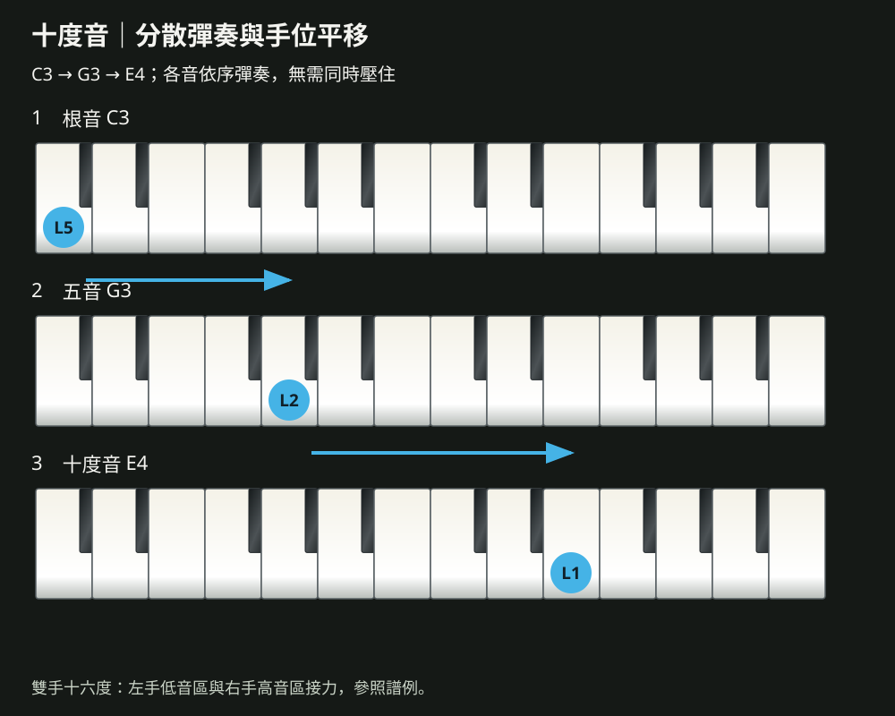<figcaption>根音、五音與十度音依序彈奏的手位路徑</figcaption></figure>
<figure><figcaption>由上方觀察低音區與高音區的左右手分工</figcaption></figure>
<figure><figcaption>雙手交接時保持自然弧度與連續律動</figcaption></figure>

分散彈奏時以手臂平移協助，不必同時張開手掌壓住十度。

<!-- teaching-visuals-end -->

## 第十二堂｜大小調關係與 G 大調歌曲彈奏 Major & Minor · Songs In G

本堂目標：能找出大調的關係小調，理解兩者共用同一組調號；能分辨自然小調、和聲小調與旋律小調；能彈奏 G 大調的音階與順階和弦，並以 G 大調彈奏歌曲；完成期末發表：一首使用兩種以上伴奏型的歌曲。

### 課前問卷

- 期末曲目
- 期末曲目的調性
- 使用的伴奏型
- 發表前的心情

### 課程綱要（120 分鐘）

| 段落 | 時間 | 內容 | 投影片 |
| --- | --- | --- | --- |
| 起 | 00:00–00:20 | 同一組白鍵，更換起點，情緒就不一樣 | 3 |
| 承 | 00:20–00:55 | 大調的第六級，就是關係小調的主音、自然、和聲、旋律：改變的都是第六與第七個音、A 自然小調與 A 和聲小調：聆聽第七個音的差別、A 小調的 Ⅰ Ⅳ Ⅴ：Am、Dm、E、G 大調：一個升記號 F♯，七個順階和弦、大小調與 G 大調 | 4–9 |
| 休 | 00:55–01:05 | 休息十分鐘 | 10 |
| 轉 | 01:05–01:40 | 先熱手：G 大調音階，第七個音是黑鍵 F♯、簡譜不變，和弦換成 G、C、D | 11–12 |
| 合 | 01:40–02:00 | 每人三分鐘：前奏、兩種伴奏型、尾奏、錄下期末發表，與第一天的錄音比較、十二堂課，十二個關鍵字、最後一張出場券 | 13–17 |
| 收尾 | 課後 | 三句話總結、出場券、課後練習與下一堂預告 | 16、18、19 |

### 講義擴充：關係大小調

| 大調 | 關係小調 | 調號 |
| --- | --- | --- |
| C 大調 | A 小調 | 沒有升降 |
| G 大調 | E 小調 | F♯ |
| F 大調 | D 小調 | B♭ |

將大調的主音往下移動小三度，就是關係小調的主音；兩者共用同一組調號。

### 講義擴充：三種小調音階

| 音階 | A 小調 | 說明 |
| --- | --- | --- |
| 自然小調 | A B C D E F G A | 全半全全半全全 |
| 和聲小調 | A B C D E F G♯ A | 第七音升高半音，F–G♯ 為增二度 |
| 旋律小調 | 上行 A B C D E F♯ G♯ A，下行同自然小調 | 為了歌唱避開增二度 |

- A 和聲小調的順階和弦：Ⅰ、Ⅳ 為小和弦，Ⅴ、Ⅵ 為大和弦，Ⅱ、Ⅶ 為減和弦，Ⅲ 為增和弦。小調歌曲常見 Am → Dm → E → Am。

### 講義擴充：G 大調

- 調號：一個升記號 F♯。音階：G A B C D E F♯ G，指法與 C 大調相同。
- 順階和弦：G、Am、Bm、C、D、Em、F♯dim；主要三和弦 G、C、D。
- 〈生日快樂歌〉G 大調：G｜D｜D｜G｜G｜C｜G D｜G。

### 講義擴充：期末發表

一首使用兩種以上伴奏型的歌曲，C 大調或 G 大調皆可，包含前奏與尾奏。評量面向：穩定、伴奏、和聲、完整。

### 參考書目

1. 紀華麟，《和弦完全 PLAY》，樂匠音樂叢書。
2. 招敏慧，《流行鋼琴自學秘笈》，麥書文化。
3. 楊鴻棋，《爵士鋼琴獨奏大全》，立誼音樂叢書。
4. 楊善蘭，《快樂學爵士》，立誼音樂叢書。
5. 彭萬雄，《流行好爵士》，立誼音樂叢書。

### 課堂互動（網站簡報）

| 投影片 | 互動 | 內容 |
| --- | --- | --- |
| 2 | 手機同步 | 今天的路線：認識另一個調，完成期末發表 |
| 3 | 舉手計票 | 同一組白鍵，更換起點，情緒就不一樣 |
| 6 | 音階運指 | A 自然小調與 A 和聲小調：聆聽第七個音的差別 |
| 7 | 伴奏型播放器 | A 小調的 Ⅰ Ⅳ Ⅴ：Am、Dm、E |
| 8 | 順階和弦 | G 大調：一個升記號 F♯，七個順階和弦 |
| 9 | 選擇題 | 大小調與 G 大調 |
| 11 | 音階運指 | 先熱手：G 大調音階，第七個音是黑鍵 F♯ |
| 12 | 歌曲彈奏 | 簡譜不變，和弦換成 G、C、D |
| 13 | 分段計時・隨機點名 | 每人三分鐘：前奏、兩種伴奏型、尾奏 |
| 14 | 錄音對照 | 錄下期末發表，與第一天的錄音比較 |
| 15 | 翻牌 | 十二堂課，十二個關鍵字 |
| 17 | 出場券 3-2-1 | 最後一張出場券 |
| 18 | 課程回饋問卷 | 課程回饋問卷 |
